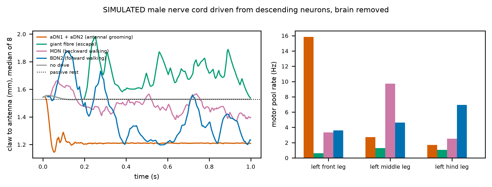
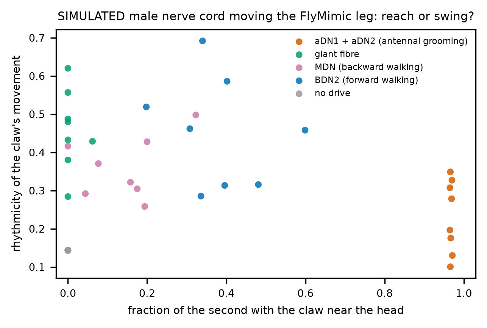
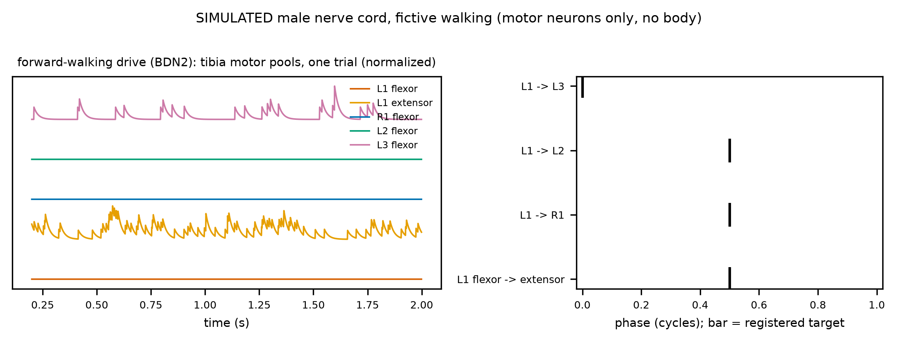
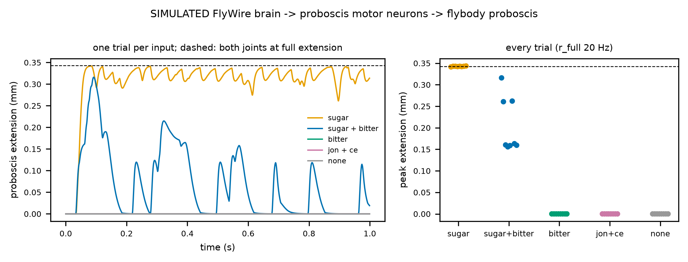
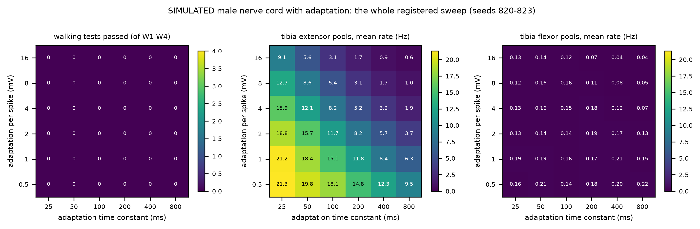

# Roadmap: from chip to an embodied, closed-loop fly

*What NeuroMPS builds next, after the final round. The plan below is a commitment, not a result:
nothing in it has been run yet except where a number cites `outputs/metrics.json`. Everything it
will produce is **simulated**, for research decision support; none of it is a claim about any
compound's effect in any animal or person.*

**Slide message:** *Today we read a simulated fly brain as a chip and as an animal, through the
neurons that drive behaviour. Next we give it a body and close the loop, so that the question
"does the chip flag a drug before behaviour fails?" can be asked of movement itself, with
sensory feedback in place. Each stage has a registered go/no-go test.*

## 1. Why close the loop

The chip-to-animal study (report Act VII) reads behaviour as the firing of named neurons, down
to the motor neurons of the male nerve cord. Three things it cannot see:

- **Movement.** A motor neuron firing faster is not a leg moving differently. Muscles, joints and
  contact with the ground turn firing into behaviour, and they can mask or amplify a change.
- **Feedback.** In a real fly, movement is sensed and fed back: leg proprioceptors report joint
  angles and loads to the nerve cord and brain. A drug that disturbs a circuit inside a loop can
  have effects an open-loop model misses, in either direction.
- **The environment.** Feeding is a sequence (find, taste, extend the proboscis), not a firing
  rate; grooming is a sequence of leg sweeps.

Our current results are the baseline the embodied model has to be compared against. On the
simulated fly brain, the chip's firing rate ranks drugs by how much they disrupt behaviour
(Spearman 0.863 <!-- metrics.json: fly_chip_to_animal.predictions.C1_chip_tracks_disruption.value -->),
but it raises the alarm late. At the motor neurons of the male nerve cord, the chip is later than
motor output in
4 <!-- metrics.json: fly_motor_tie_break.combined_with_parent.chip_later --> drug families, level
in 1 <!-- metrics.json: fly_motor_tie_break.combined_with_parent.tied -->, and never earlier. And
electrodes on the brain's output tract caught GABA block in time where a planar array did not
(0.361 <!-- metrics.json: fly_output_tract.abs_delta_mfr_at_onset.tract_64.gaba_block -->
against
0.044 <!-- metrics.json: fly_output_tract.abs_delta_mfr_at_onset.planar_64.gaba_block --> log2).
The embodied model asks whether these conclusions survive movement and feedback.

## 2. What already exists

| Layer | Status | Where |
|---|---|---|
| Whole-brain model (FlyWire), drug knobs by transmitter class | built, validated against the published sugar→MN9 result | `src/neuromps/fly/model.py`; report §23 |
| Brain and nerve cord (MaleCNS, 165,122 <!-- metrics.json: fly_models.malecns.neurons --> neurons) | built; replicates the behaviour results | `fly/malecns.py`; §25 |
| Virtual MEA scored by the chip's own extractor | built | `fly/electrodes.py`, `features/mea.py` |
| Motor-neuron readouts (proboscis, front legs, all motor neurons) | built, registered study done | `fly/motor.py`; §25 |
| Neuron-to-muscle map | in the data: 260 <!-- metrics.json: fly_roadmap_inventory.leg_motor_neurons_typed_by_muscle --> of 381 <!-- metrics.json: fly_roadmap_inventory.leg_motor_neurons_total --> leg motor neurons are typed by the muscle they drive | `fly/roadmap_inventory.py` |
| Feedback neurons | in the data: 1,030 <!-- metrics.json: fly_roadmap_inventory.vnc_proprioceptive_sensory_neurons --> proprioceptive sensory neurons in the nerve cord, among them 403 <!-- metrics.json: fly_roadmap_inventory.vnc_chordotonal_organ_neurons --> chordotonal-organ and 175 <!-- metrics.json: fly_roadmap_inventory.vnc_campaniform_sensilla_neurons --> campaniform-sensilla neurons | `fly/roadmap_inventory.py` |
| Body and physics | available, not yet used: NeuroMechFly v2 (FlyGym) and flybody, both on MuJoCo, all Apache-2.0 | external |

## 3. The loop we will close

1. **Brain and nerve cord** (MaleCNS, leaky integrate-and-fire, the drug knobs as now).
2. **Motor neurons to muscles.** Each leg motor neuron typed by its muscle drives that muscle's
   activation; the untyped ones are mapped by their connectivity to typed partners, or left out
   and reported.
3. **Muscles to joints.** Muscle activations become joint torques in the body model (NeuroMechFly
   v2's leg joints).
4. **Body and world.** MuJoCo integrates the body against the ground, with leg adhesion, and
   against a sugar spot for feeding.
5. **Joints back to neurons.** Joint angles and contact forces drive the matching proprioceptive
   sensory neurons (chordotonal organs for angles, campaniform sensilla for load), which re-enter
   the network.

The chip side does not change: the same virtual array, scored by the same extractor, read while
the fly behaves.

## 4. Stages, each with a registered go/no-go test

| Stage | When | Deliverable | Go/no-go test (registered before it runs) |
|---|---|---|---|
| 1. Open-loop legs | weeks 1–3 | front-leg motor neurons drive NeuroMechFly's front legs | antennal drive produces front-leg sweeps toward the head that untreated, undriven runs do not |
| 2. Feeding and walking | weeks 3–6 | proboscis extension from the proboscis pool; walking from descending commands | sugar drives proboscis extension and bitter suppresses it; a walking command produces an alternating gait |
| 3. Close the loop | weeks 6–10 | proprioceptive feedback into the nerve cord | feedback measurably changes the movement (it stabilises or reshapes the rhythm) against the open-loop run |
| 4. Drugs in the loop | weeks 10–14 | the registered chip-to-animal design rerun with movement as the readout | registered predictions, among them: does the chip still flag drugs after movement fails; does the output-tract electrode still lead |
| 5. Check against real flies | weeks 14–18 | comparison with published fly pharmacology (feeding and grooming under GABA-A and GluCl drugs) | the direction of each published behavioural change is reproduced, or the mismatch is reported |
| 6. Release | weeks 18–20 | open code, models and a paper | one command reproduces every number, as now |

Each stage stops if its test fails, and the failure is reported, as every failed prediction in
this project has been.

## 5. What it would change for organ-on-a-chip

The embodied model lets three chip-design questions be asked of behaviour itself rather than of
neurons:

- **Sensitivity.** How small a firing-rate change must a chip resolve to flag each mechanism
  before movement fails? Today's answer comes from interneurons and motor neurons (report §24).
- **Electrode placement.** Does recording the connection between compartments (the output tract,
  a chip's microchannels) still lead a planar array when behaviour is movement under feedback?
- **Screen thresholds.** How does a regulatory screen's hit cutoff compare with the change at
  which movement, not firing, fails?

## 6. Risks, and how each is handled

| Risk | Handling |
|---|---|
| Part of the neuron-to-muscle map is missing (motor neurons not typed by muscle) | map the rest by connectivity to typed partners; report coverage; test robustness by leaving the uncertain ones out |
| A leaky integrate-and-fire nerve cord may not generate rhythms (walking needs them) | stage 2's go/no-go test catches it; then add the intrinsic currents rhythm generation needs, as a stated change |
| The male nerve cord is over-excitable under the published weight (any drive recruits many motor neurons) | calibrate one weight against the untreated motor recruitment before stage 4, registered |
| Real fly pharmacology is sparse and in different units | stage 5 compares directions, not magnitudes, and says which comparisons were impossible |
| Compute | FlyGym 2 simulates on GPU; the GB10 runs the network and the body in parallel |

## 7. Status, and what stage 1 changed

**Stage 1 ran and failed its go/no-go test, as did its registered follow-up.** The male-CNS
network was wired to the FlyMimic leg (MuJoCo 3.16, the leg's 15 Hill-type muscles driven by
49 <!-- metrics.json: embodied_stage1.coverage.mapped --> of the
68 <!-- metrics.json: embodied_stage1.coverage.left_front_leg_motor_neurons --> left front-leg
motor neurons, by name). Antennal drive moved the claw toward the head in every trial, but sugar
drive moved it closer still (median closest approach
0.9386 <!-- metrics.json: embodied_stage1.predictions.S1a_antennal_drive_brings_the_claw_to_the_head.value.sugar -->
against
1.1067 <!-- metrics.json: embodied_stage1.predictions.S1a_antennal_drive_brings_the_claw_to_the_head.value.jon_ce -->
mm): the movement was not specific. Stage 1b rescaled the male-CNS weight by the ratio of
synaptic input per neuron between the connectomes; at that weight sugar no longer drove the
feeding motor neuron at all
(0.0 <!-- metrics.json: embodied_stage1b.predictions.B0_feeding_still_works.value.mn9_sugar_hz --> Hz),
so its leg results are uninterpretable, as registered.

**What went wrong.** The same sugar drive puts
251 <!-- metrics.json: fly_spread.flywire783.active_total --> neurons above 10 Hz in the published
FlyWire model and
14,263 <!-- metrics.json: fly_spread.malecns_published.active_total --> in the male CNS at the same
weight, most of them central-brain neurons
(11,082 <!-- metrics.json: fly_spread.malecns_published.cb_intrinsic.active --> of
32,160 <!-- metrics.json: fly_spread.malecns_published.cb_intrinsic.total -->); at the rescaled
weight still
7,586 <!-- metrics.json: fly_spread.malecns_rescaled.active_total -->. The published model's
parameters do not carry over to the second connectome's brain: there, activity avalanches, and
lowering one global weight silences weak pathways before it stops the avalanche. This is itself
a result for the paper, and it changes the plan.

**The revised plan.** Use each connectome where its model is validated:

- **Stage 1c (next):** drive the male nerve cord from its descending neurons alone, without the
  male brain. Activating the descending neurons the literature ties to antennal grooming should
  move the front leg toward the head; descending neurons for other behaviours should not. This
  tests the nerve cord, the muscle map and the leg without the brain's avalanche.
- **Then:** join the FlyWire brain, where the published model is validated, to the male nerve
  cord through descending neurons matched by cell type across the two connectomes.

Both steps are registered before they run, like every stage.

**Stage 1c ran: three of five registered predictions pass.** With the male brain removed and
named descending neurons driven, the nerve cord is silent without drive, and the descending
neurons the literature ties to antennal grooming (aDN1, aDN2) drive the left front-leg motor
pool at
15.846 <!-- metrics.json: embodied_stage1c.predictions.C2_the_front_leg_is_the_one_that_moves.value.front -->
Hz, against
2.72 <!-- metrics.json: embodied_stage1c.predictions.C2_the_front_leg_is_the_one_that_moves.value.middle -->
for the middle and
1.697 <!-- metrics.json: embodied_stage1c.predictions.C2_the_front_leg_is_the_one_that_moves.value.hind -->
for the hind leg; no other descending neuron recruits the front leg as strongly (forward walking
3.601 <!-- metrics.json: embodied_stage1c.predictions.C3_grooming_neurons_recruit_the_front_leg_most.value.forward_walking -->
Hz). The kinematic prediction failed: grooming drive brings the claw to
1.1345 <!-- metrics.json: embodied_stage1c.predictions.C1_grooming_neurons_bring_the_claw_to_the_head.value.grooming -->
mm of the antenna, but forward-walking drive reaches
1.154 <!-- metrics.json: embodied_stage1c.predictions.C1_grooming_neurons_bring_the_claw_to_the_head.value.forward_walking -->
mm at the low points of a rhythmic swing, so the closest approach does not separate the two.
The figure shows the difference the readout missed: under grooming drive the claw goes to the
head and stays there; under forward-walking drive it oscillates. That is the readout to register
next (stage 1d, fresh seeds), not a reason to re-score this one.

{width=95%}

**Stage 1d: all four registered predictions pass, on fresh seeds.** Read as the time the claw
spends near the head and as the rhythmicity of its movement, the two drives separate cleanly:
under grooming drive the claw is near the head for
0.9665 <!-- metrics.json: embodied_stage1d.predictions.D1_grooming_holds_the_claw_at_the_head.value.grooming -->
of the second, under forward-walking drive for
0.368 <!-- metrics.json: embodied_stage1d.predictions.D1_grooming_holds_the_claw_at_the_head.value.forward_walking -->,
and never under the giant fibre or without drive; forward walking moves the leg more
rhythmically
(0.4599 <!-- metrics.json: embodied_stage1d.predictions.D2_forward_walking_swings_the_leg.value.forward_walking -->
against
0.2374 <!-- metrics.json: embodied_stage1d.predictions.D2_forward_walking_swings_the_leg.value.grooming -->);
the result holds at every activation scale, and stage 1c's front-leg specificity replicates
(front-leg pool
16.066 <!-- metrics.json: embodied_stage1d.predictions.D4_the_front_leg_specificity_replicates.value.grooming.front -->
Hz under grooming drive). Rhythmicity alone does not mark walking: the giant fibre scores as
high
(0.4561 <!-- metrics.json: embodied_stage1d.predictions.D2_forward_walking_swings_the_leg.value.giant_fibre -->),
while keeping the claw away from the head. **Stage 1's question is answered for the nerve cord:**
the descending neurons that start antennal grooming in the fly move this leg to the head and hold
it there, specifically. Next is the brain: the FlyWire brain joined to this nerve cord through
type-matched descending neurons, so that sensory drive, not a stimulated command neuron, starts
the movement.

{width=70%}

**Stages 1e and 1f: the FlyWire brain drives the male nerve cord, end to end.** Each FlyWire
descending neuron was paired with the male-CNS descending neuron of the same cell type and side
(1,220 <!-- metrics.json: embodied_stage1f.matching.flywire_matched --> of
1,303 <!-- metrics.json: embodied_stage1f.matching.flywire_total --> matched), the published brain
model was run under antennal, sugar or no input, and its descending spikes were replayed into
the male nerve cord, which moved the leg. Stage 1e's registered precondition, an absolute 10 Hz
line for the grooming descending neurons, failed at
8.531 <!-- metrics.json: embodied_stage1e.predictions.E0_the_grooming_neurons_are_reached.value -->
Hz, so its leg results are uninterpretable; it also showed that its time-near-head readout
counted a mild flexion under sugar input as a reach. Stage 1f, registered with a relative
precondition and the depth of reach as readout and run on fresh seeds, passes all five
predictions. Antennal input brings the claw to
0.5369 <!-- metrics.json: embodied_stage1f.predictions.F1_antennal_input_reaches_deepest.value.jon_ce -->
mm of the antenna, sugar input to
0.9377 <!-- metrics.json: embodied_stage1f.predictions.F1_antennal_input_reaches_deepest.value.sugar -->
mm, no input leaves it at rest; the front-leg pool carries the movement; and removing the spikes
of the two grooming descending neuron types alone (aDN1, aDN2; four neurons) returns the claw to
1.4793 <!-- metrics.json: embodied_stage1f.predictions.F4_the_reach_runs_through_the_grooming_neurons.value.lesioned -->
mm. **Stage 1 is complete:** sensory input to a validated whole-brain model, carried by the
descending neurons the fly uses for antennal grooming, moves a muscle-driven leg to the head;
sugar input does not, and without those four neurons the movement is gone. Next is stage 2
(feeding and walking) and stage 3 (closing the loop).

{width=70%}

**Stage 2a: no walking rhythm from the nerve cord alone (failed as registered).** Before any
body, stage 2a asked whether the male nerve cord turns its forward-walking command (BDN2,
DNg100) into a motor rhythm: tibia flexors and extensors alternating within a leg, the two front
legs alternating, and a tripod across legs, read from the twelve tibia motor pools of the six
legs. Without drive the cord is silent (W0 passes). Under the walking command it is active but
tonic: the left middle-leg tibia extensors fire at
54.12 <!-- metrics.json: embodied_stage2a.pool_rates_hz.forward_walking.L2_extensor -->
Hz and the right hind-leg extensors at
34.12 <!-- metrics.json: embodied_stage2a.pool_rates_hz.forward_walking.R3_extensor -->
Hz, while the tibia flexor pools of five of the six legs stay silent (left front flexors
0.0 <!-- metrics.json: embodied_stage2a.pool_rates_hz.forward_walking.L1_flexor --> Hz). The left front flexor pool
has no rhythm (median rhythmicity
0.0 <!-- metrics.json: embodied_stage2a.predictions.W1_the_walking_command_makes_a_rhythm.value.forward_walking -->),
so no phase can be measured and W1 to W4 fail. Backward-walking drive (MDN) gives the same
picture with different legs. This is the risk §6 names: a leaky integrate-and-fire nerve cord,
with connectome weights and no intrinsic currents, has no half-centre oscillator. The next
step is the one §6 commits to, a stated model change registered before it runs: add the
intrinsic property rhythm generation needs (spike-frequency adaptation) and test again on fresh
seeds, with the connectome-only result kept as the reference.

{width=70%}

**Stage 2b: sugar input to the FlyWire brain extends a simulated proboscis; bitter input gates
it (six of six registered predictions pass).** Every proboscis motor neuron that McKellar et al.
(2020) tie to a muscle has a FlyWire cell type (through the male-CNS cross-reference). The
rostrum protractor (MN9) and its retractors (MN1, MN2) set the rostrum's command; the haustellum
extensors (MN4) and flexors (MN3) set the haustellum's. Both commands drive the proboscis of the
flybody whole-fly model. Under sugar input the
extending pools reach activations of
0.9644 <!-- metrics.json: embodied_stage2b.predictions.G2_both_joints_are_driven_to_extend.value.rostrum_protractor -->
(rostrum) and
0.8858 <!-- metrics.json: embodied_stage2b.predictions.G2_both_joints_are_driven_to_extend.value.haustellum_extensor -->
(haustellum), their antagonists
0.0561 <!-- metrics.json: embodied_stage2b.predictions.G2_both_joints_are_driven_to_extend.value.rostrum_retractor -->
and 0.0 <!-- metrics.json: embodied_stage2b.predictions.G2_both_joints_are_driven_to_extend.value.haustellum_flexor -->,
and the proboscis extends fully
(0.3431 <!-- metrics.json: embodied_stage2b.predictions.G1_sugar_extends_the_proboscis.value.sugar --> mm peak;
full extension is
0.3428 <!-- metrics.json: embodied_stage2b.predictions.G1_sugar_extends_the_proboscis.value.e_full --> mm).
Bitter input alone, antennal input and no input leave it at rest. Adding bitter input to sugar
input halves the peak
(0.1618 <!-- metrics.json: embodied_stage2b.predictions.G3_bitter_gates_extension.value.sugar_bitter --> mm) and
cuts the time-averaged extension from
0.3054 <!-- metrics.json: embodied_stage2b.reported.sugar.mean_extension_mm --> to
0.0488 <!-- metrics.json: embodied_stage2b.reported.sugar_bitter.mean_extension_mm --> mm: the proboscis starts to
extend, then is held back to brief flicks. The result holds at the other activation scales. Only
the MN9 part of this was seen before registration (it is the published model's result); the
haustellum pools and their antagonists were not. Exploratory, not scored: sugar input recruits
only feeding motor neurons (neck, eye, antennal and crop motor neurons stay silent), and the
bitter gate acts on the proboscis pools (other proboscis motor neurons
52.25 <!-- metrics.json: embodied_stage2b.exploratory_other_motor_neurons_hz.sugar.proboscis_motor_neuron --> Hz under sugar,
2.75 <!-- metrics.json: embodied_stage2b.exploratory_other_motor_neurons_hz.sugar_bitter.proboscis_motor_neuron --> with
bitter added) far more than on the ingestion pool
(24.58 <!-- metrics.json: embodied_stage2b.exploratory_other_motor_neurons_hz.sugar.ingestion_motor_neuron --> and
19.98 <!-- metrics.json: embodied_stage2b.exploratory_other_motor_neurons_hz.sugar_bitter.ingestion_motor_neuron --> Hz).
**Stage 2's feeding test passes; its walking test (2a) does not.** The body is held fixed and its
joints are position servos, so this is the motor command made visible, not a muscle-level
proboscis.

{width=70%}

**Stage 2c: adding spike-frequency adaptation does not make the nerve cord walk (stopped as
registered).** §6 committed to adding an intrinsic property if stage 2a failed. Adaptation's two
parameters have no published fly value, so they were swept over a registered grid of
36 <!-- metrics.json: embodied_stage2c.sweep.grid_size --> cells. The registration fixed in advance a rule for
choosing one cell and a confirmatory test on fresh seeds, with a rewired control and a comparison
with the published step period. No cell passes any of the four walking tests (rhythm:
0 <!-- metrics.json: embodied_stage2c.sweep.cells_passing.W1_the_walking_command_makes_a_rhythm --> cells), so
the rule selects nothing, the stage stops, and its seven predictions fail. Adaptation does act:
the tibia extensor pools fall from
21.3 <!-- metrics.json: embodied_stage2c.sweep.cells.1.extensor_hz --> Hz (weakest, fastest adaptation) to
0.55 <!-- metrics.json: embodied_stage2c.sweep.cells.36.extensor_hz --> Hz (strongest, slowest). But the flexor pools never exceed
0.22 <!-- metrics.json: embodied_stage2c.sweep.cells.6.flexor_hz --> Hz in any cell, so there is nothing for the extensors to
alternate with. An exploratory diagnostic (not registered; exploration seeds) shows why. With
every inhibitory connection removed the flexor pools fire at
151.341 <!-- metrics.json: embodied_stage2c_diagnostic.pool_rates_hz.no_inhibition.flexor --> Hz, so excitation does reach them.
Of the neurons the walking command activates, each flexor motor neuron receives
274.73 <!-- metrics.json: embodied_stage2c_diagnostic.flexor_inputs.from_active.inhibitory_per_neuron --> inhibitory against
130.78 <!-- metrics.json: embodied_stage2c_diagnostic.flexor_inputs.from_active.excitatory_per_neuron --> excitatory synapses, while each
extensor motor neuron receives
754.17 <!-- metrics.json: embodied_stage2c_diagnostic.extensor_inputs.from_active.excitatory_per_neuron --> excitatory against
698.17 <!-- metrics.json: embodied_stage2c_diagnostic.extensor_inputs.from_active.inhibitory_per_neuron --> inhibitory. GABA alone
(182.68 <!-- metrics.json: embodied_stage2c_diagnostic.flexor_inputs.from_active.inhibitory_by_transmitter_per_neuron.gaba --> per flexor
neuron) outweighs that excitation. Whether the flexors stay net-inhibited if glutamate excites
depends on the model's rule that every glutamate synapse inhibits
(92.05 <!-- metrics.json: embodied_stage2c_diagnostic.flexor_inputs.from_active.inhibitory_by_transmitter_per_neuron.glut --> per flexor
neuron). Under the model's signs, the walking command's population holds the flexors down and
drives the extensors. A rhythm then needs something that periodically releases the flexors,
which uniform adaptation does not provide. Candidates for a registered next step are the
glutamate sign rule (glutamate excites through some receptors in the fly nerve cord), sensory
feedback from the leg (stage 3), or a different intrinsic property (post-inhibitory rebound).

{width=95%}

**Stage 2d: the glutamate sign rule is not what keeps the cord from walking (1 of 7 at the
selected cell).** The model, like the published one, treats every glutamate synapse as
inhibitory, and the stage-2c diagnostic showed that the flexors' net inhibition depends on that
rule. No settled rule says where fly glutamate excites, so stage 2d registered two bounds.
Glutamate onto motor neurons became excitatory in one; glutamate everywhere in the other. Each
ran without adaptation and over stage 2c's grid
(37 <!-- metrics.json: embodied_stage2d.sweep.cells_per_rule --> cells per rule), with the
same selection rule and confirmation. Onto motor neurons only, the flexors stay weak
(1.76 <!-- metrics.json: embodied_stage2d.sweep.cells.0.flexor_hz --> Hz without adaptation) and no cell passes any walking test.
Everywhere, the flexors switch on
(40.4 <!-- metrics.json: embodied_stage2d.sweep.cells.37.flexor_hz --> Hz), but the cord becomes far more active
(7,118 <!-- metrics.json: embodied_stage2d.sweep.cells.37.active_neurons --> neurons at 1 Hz or more, against
2,136 <!-- metrics.json: embodied_stage2d.sweep.cells.0.active_neurons --> with glutamate onto motor neurons only). A rhythm appears in
5 <!-- metrics.json: embodied_stage2d.sweep.cells_passing.glut_all.W1_the_walking_command_makes_a_rhythm --> cells, as slow
waves of the whole population, but no cell alternates antagonists or legs
(0 <!-- metrics.json: embodied_stage2d.sweep.cells_passing.glut_all.W2_antagonists_alternate --> cells). The rule
selected the one cell that passed the tripod test on exploration seeds; on fresh seeds that pass
did not replicate. The left front flexor and extensor fire in phase there (distance
0.49 <!-- metrics.json: embodied_stage2d.predictions.D2_antagonists_alternate.value --> from the alternation target),
the right front flexor stays silent, the rhythm's period is
317.5 <!-- metrics.json: embodied_stage2d.predictions.D6_a_fly_like_step_period.value --> ms, slower than a walking fly's,
and only silence without drive passes. **Three registered attempts now agree.** The male nerve
cord's wiring, run as leaky integrate-and-fire neurons under the walking command, does not
produce alternation: not as published (2a), not with adaptation (2c), not with either
glutamate rule (2d). This is a result for the paper. A connectome alone, in this model class,
does not contain a working walking rhythm generator. The roadmap's own answer is the next
stage, sensory feedback from the legs (stage 3), which the fly also needs to walk.

{width=95%}

## 8. What carries over unchanged

Pre-registration before every run; licensed data with checksums in the manifest; every reported
number written by a script and checked against the documents that cite it; failed predictions
reported beside the passed ones; and a demo anyone can open.
