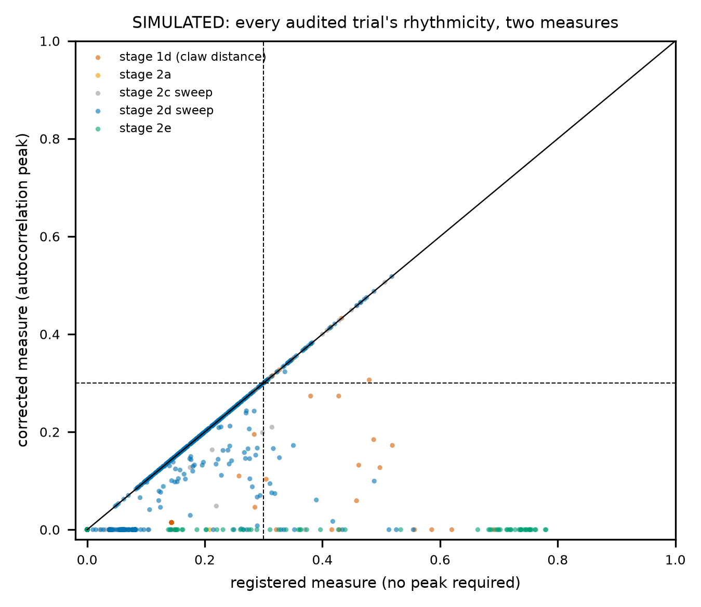
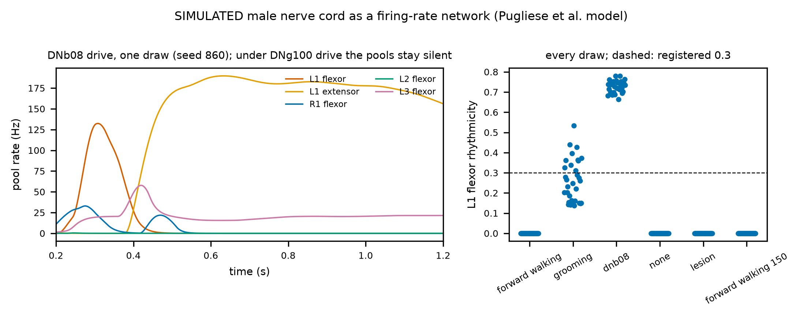
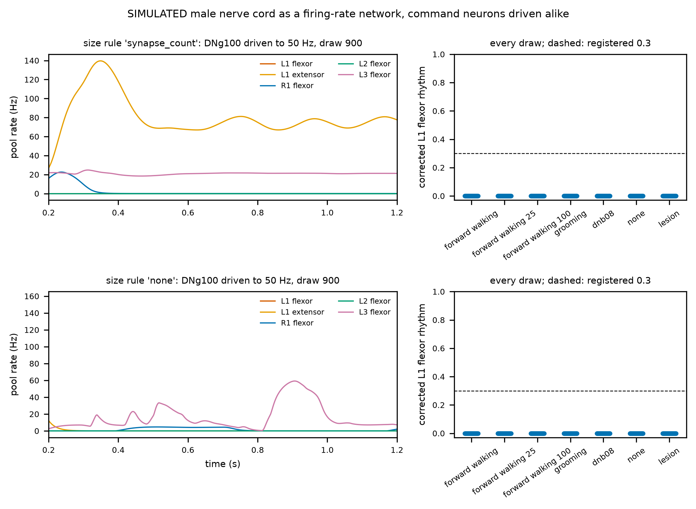
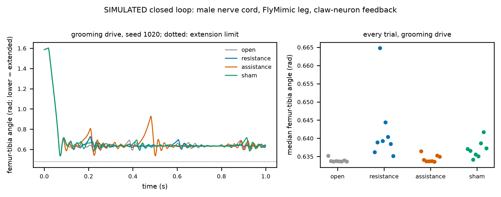
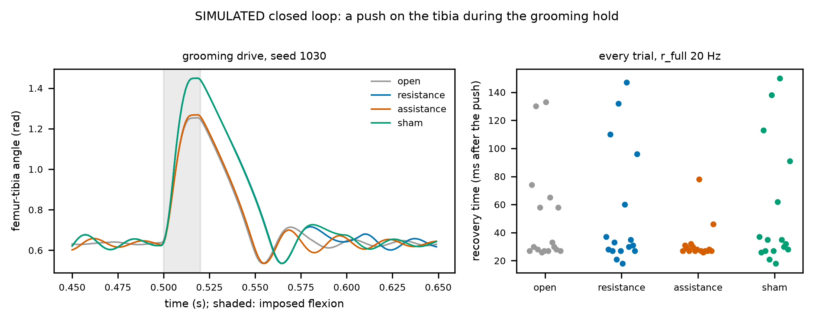
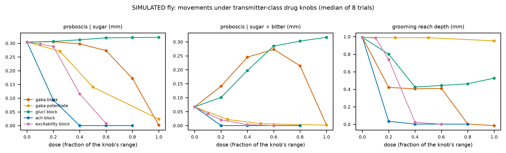

# Roadmap: from chip to an embodied, closed-loop fly

*What NeuroMPS builds next, after the final round. The plan below is a commitment, not a result:
nothing in it has been run yet except where a number cites `outputs/metrics.json`. Everything it
will produce is **simulated**, for research decision support; none of it is a claim about any
compound's effect in any animal or person.*

**Slide message:** *Today we read a simulated fly brain as a chip and as an animal, through the
neurons that drive behaviour. Next we give it a body and close the loop, so that the question
"does the chip flag a drug before behaviour fails?" can be asked of movement itself, with
sensory feedback in place. Each stage has a registered go/no-go test.*

## 1. Why close the loop

The chip-to-animal study (report Act VII) reads behaviour as the firing of named neurons, down
to the motor neurons of the male nerve cord. Three things it cannot see:

- **Movement.** A motor neuron firing faster is not a leg moving differently. Muscles, joints and
  contact with the ground turn firing into behaviour, and they can mask or amplify a change.
- **Feedback.** In a real fly, movement is sensed and fed back: leg proprioceptors report joint
  angles and loads to the nerve cord and brain. A drug that disturbs a circuit inside a loop can
  have effects an open-loop model misses, in either direction.
- **The environment.** Feeding is a sequence (find, taste, extend the proboscis), not a firing
  rate; grooming is a sequence of leg sweeps.

Our current results are the baseline the embodied model has to be compared against. On the
simulated fly brain, the chip's firing rate ranks drugs by how much they disrupt behaviour
(Spearman 0.863 <!-- metrics.json: fly_chip_to_animal.predictions.C1_chip_tracks_disruption.value -->),
but it raises the alarm late. At the motor neurons of the male nerve cord, the chip is later than
motor output in
4 <!-- metrics.json: fly_motor_tie_break.combined_with_parent.chip_later --> drug families, level
in 1 <!-- metrics.json: fly_motor_tie_break.combined_with_parent.tied -->, and never earlier. And
electrodes on the brain's output tract caught GABA block in time where a planar array did not
(0.361 <!-- metrics.json: fly_output_tract.abs_delta_mfr_at_onset.tract_64.gaba_block -->
against
0.044 <!-- metrics.json: fly_output_tract.abs_delta_mfr_at_onset.planar_64.gaba_block --> log2).
The embodied model asks whether these conclusions survive movement and feedback.

## 2. What already exists

| Layer | Status | Where |
|---|---|---|
| Whole-brain model (FlyWire), drug knobs by transmitter class | built, validated against the published sugar→MN9 result | `src/neuromps/fly/model.py`; report §23 |
| Brain and nerve cord (MaleCNS, 165,122 <!-- metrics.json: fly_models.malecns.neurons --> neurons) | built; replicates the behaviour results | `fly/malecns.py`; §25 |
| Virtual MEA scored by the chip's own extractor | built | `fly/electrodes.py`, `features/mea.py` |
| Motor-neuron readouts (proboscis, front legs, all motor neurons) | built, registered study done | `fly/motor.py`; §25 |
| Neuron-to-muscle map | in the data: 260 <!-- metrics.json: fly_roadmap_inventory.leg_motor_neurons_typed_by_muscle --> of 381 <!-- metrics.json: fly_roadmap_inventory.leg_motor_neurons_total --> leg motor neurons are typed by the muscle they drive | `fly/roadmap_inventory.py` |
| Feedback neurons | in the data: 1,030 <!-- metrics.json: fly_roadmap_inventory.vnc_proprioceptive_sensory_neurons --> proprioceptive sensory neurons in the nerve cord, among them 403 <!-- metrics.json: fly_roadmap_inventory.vnc_chordotonal_organ_neurons --> chordotonal-organ and 175 <!-- metrics.json: fly_roadmap_inventory.vnc_campaniform_sensilla_neurons --> campaniform-sensilla neurons | `fly/roadmap_inventory.py` |
| Body and physics | available, not yet used: NeuroMechFly v2 (FlyGym) and flybody, both on MuJoCo, all Apache-2.0 | external |

## 3. The loop we will close

1. **Brain and nerve cord** (MaleCNS, leaky integrate-and-fire, the drug knobs as now).
2. **Motor neurons to muscles.** Each leg motor neuron typed by its muscle drives that muscle's
   activation; the untyped ones are mapped by their connectivity to typed partners, or left out
   and reported.
3. **Muscles to joints.** Muscle activations become joint torques in the body model (NeuroMechFly
   v2's leg joints).
4. **Body and world.** MuJoCo integrates the body against the ground, with leg adhesion, and
   against a sugar spot for feeding.
5. **Joints back to neurons.** Joint angles and contact forces drive the matching proprioceptive
   sensory neurons (chordotonal organs for angles, campaniform sensilla for load), which re-enter
   the network.

The chip side does not change: the same virtual array, scored by the same extractor, read while
the fly behaves.

## 4. Stages, each with a registered go/no-go test

| Stage | When | Deliverable | Go/no-go test (registered before it runs) |
|---|---|---|---|
| 1. Open-loop legs | weeks 1–3 | front-leg motor neurons drive NeuroMechFly's front legs | antennal drive produces front-leg sweeps toward the head that untreated, undriven runs do not |
| 2. Feeding and walking | weeks 3–6 | proboscis extension from the proboscis pool; walking from descending commands | sugar drives proboscis extension and bitter suppresses it; a walking command produces an alternating gait |
| 3. Close the loop | weeks 6–10 | proprioceptive feedback into the nerve cord | feedback measurably changes the movement (it stabilises or reshapes the rhythm) against the open-loop run |
| 4. Drugs in the loop | weeks 10–14 | the registered chip-to-animal design rerun with movement as the readout | registered predictions, among them: does the chip still flag drugs after movement fails; does the output-tract electrode still lead |
| 5. Check against real flies | weeks 14–18 | comparison with published fly pharmacology (feeding and grooming under GABA-A and GluCl drugs) | the direction of each published behavioural change is reproduced, or the mismatch is reported |
| 6. Release | weeks 18–20 | open code, models and a paper | one command reproduces every number, as now |

Each stage stops if its test fails, and the failure is reported, as every failed prediction in
this project has been.

## 5. What it would change for organ-on-a-chip

The embodied model lets three chip-design questions be asked of behaviour itself rather than of
neurons:

- **Sensitivity.** How small a firing-rate change must a chip resolve to flag each mechanism
  before movement fails? Today's answer comes from interneurons and motor neurons (report §24).
- **Electrode placement.** Does recording the connection between compartments (the output tract,
  a chip's microchannels) still lead a planar array when behaviour is movement under feedback?
- **Screen thresholds.** How does a regulatory screen's hit cutoff compare with the change at
  which movement, not firing, fails?

## 6. Risks, and how each is handled

| Risk | Handling |
|---|---|
| Part of the neuron-to-muscle map is missing (motor neurons not typed by muscle) | map the rest by connectivity to typed partners; report coverage; test robustness by leaving the uncertain ones out |
| A leaky integrate-and-fire nerve cord may not generate rhythms (walking needs them) | stage 2's go/no-go test catches it; then add the intrinsic currents rhythm generation needs, as a stated change |
| The male nerve cord is over-excitable under the published weight (any drive recruits many motor neurons) | calibrate one weight against the untreated motor recruitment before stage 4, registered |
| Real fly pharmacology is sparse and in different units | stage 5 compares directions, not magnitudes, and says which comparisons were impossible |
| Compute | FlyGym 2 simulates on GPU; the GB10 runs the network and the body in parallel |

## 7. Status, and what stage 1 changed

**Stage 1 ran and failed its go/no-go test, as did its registered follow-up.** The male-CNS
network was wired to the FlyMimic leg (MuJoCo 3.16, the leg's 15 Hill-type muscles driven by
49 <!-- metrics.json: embodied_stage1.coverage.mapped --> of the
68 <!-- metrics.json: embodied_stage1.coverage.left_front_leg_motor_neurons --> left front-leg
motor neurons, by name). Antennal drive moved the claw toward the head in every trial, but sugar
drive moved it closer still (median closest approach
0.9386 <!-- metrics.json: embodied_stage1.predictions.S1a_antennal_drive_brings_the_claw_to_the_head.value.sugar -->
against
1.1067 <!-- metrics.json: embodied_stage1.predictions.S1a_antennal_drive_brings_the_claw_to_the_head.value.jon_ce -->
mm): the movement was not specific. Stage 1b rescaled the male-CNS weight by the ratio of
synaptic input per neuron between the connectomes; at that weight sugar no longer drove the
feeding motor neuron at all
(0.0 <!-- metrics.json: embodied_stage1b.predictions.B0_feeding_still_works.value.mn9_sugar_hz --> Hz),
so its leg results are uninterpretable, as registered.

**What went wrong.** The same sugar drive puts
251 <!-- metrics.json: fly_spread.flywire783.active_total --> neurons above 10 Hz in the published
FlyWire model and
14,263 <!-- metrics.json: fly_spread.malecns_published.active_total --> in the male CNS at the same
weight, most of them central-brain neurons
(11,082 <!-- metrics.json: fly_spread.malecns_published.cb_intrinsic.active --> of
32,160 <!-- metrics.json: fly_spread.malecns_published.cb_intrinsic.total -->); at the rescaled
weight still
7,586 <!-- metrics.json: fly_spread.malecns_rescaled.active_total -->. The published model's
parameters do not carry over to the second connectome's brain: there, activity avalanches, and
lowering one global weight silences weak pathways before it stops the avalanche. This is itself
a result for the paper, and it changes the plan.

**The revised plan.** Use each connectome where its model is validated:

- **Stage 1c (next):** drive the male nerve cord from its descending neurons alone, without the
  male brain. Activating the descending neurons the literature ties to antennal grooming should
  move the front leg toward the head; descending neurons for other behaviours should not. This
  tests the nerve cord, the muscle map and the leg without the brain's avalanche.
- **Then:** join the FlyWire brain, where the published model is validated, to the male nerve
  cord through descending neurons matched by cell type across the two connectomes.

Both steps are registered before they run, like every stage.

**Stage 1c ran: three of five registered predictions pass.** With the male brain removed and
named descending neurons driven, the nerve cord is silent without drive, and the descending
neurons the literature ties to antennal grooming (aDN1, aDN2) drive the left front-leg motor
pool at
15.846 <!-- metrics.json: embodied_stage1c.predictions.C2_the_front_leg_is_the_one_that_moves.value.front -->
Hz, against
2.72 <!-- metrics.json: embodied_stage1c.predictions.C2_the_front_leg_is_the_one_that_moves.value.middle -->
for the middle and
1.697 <!-- metrics.json: embodied_stage1c.predictions.C2_the_front_leg_is_the_one_that_moves.value.hind -->
for the hind leg; no other descending neuron recruits the front leg as strongly (forward walking
3.601 <!-- metrics.json: embodied_stage1c.predictions.C3_grooming_neurons_recruit_the_front_leg_most.value.forward_walking -->
Hz). The kinematic prediction failed: grooming drive brings the claw to
1.1345 <!-- metrics.json: embodied_stage1c.predictions.C1_grooming_neurons_bring_the_claw_to_the_head.value.grooming -->
mm of the antenna, but forward-walking drive reaches
1.154 <!-- metrics.json: embodied_stage1c.predictions.C1_grooming_neurons_bring_the_claw_to_the_head.value.forward_walking -->
mm at the low points of a rhythmic swing, so the closest approach does not separate the two.
The figure shows the difference the readout missed: under grooming drive the claw goes to the
head and stays there; under forward-walking drive it oscillates. That is the readout to register
next (stage 1d, fresh seeds), not a reason to re-score this one.

{width=95%}

**Stage 1d: all four registered predictions pass, on fresh seeds.** Read as the time the claw
spends near the head and as the rhythmicity of its movement, the two drives separate cleanly:
under grooming drive the claw is near the head for
0.9665 <!-- metrics.json: embodied_stage1d.predictions.D1_grooming_holds_the_claw_at_the_head.value.grooming -->
of the second, under forward-walking drive for
0.368 <!-- metrics.json: embodied_stage1d.predictions.D1_grooming_holds_the_claw_at_the_head.value.forward_walking -->,
and never under the giant fibre or without drive; forward walking moves the leg more
rhythmically
(0.4599 <!-- metrics.json: embodied_stage1d.predictions.D2_forward_walking_swings_the_leg.value.forward_walking -->
against
0.2374 <!-- metrics.json: embodied_stage1d.predictions.D2_forward_walking_swings_the_leg.value.grooming -->);
the result holds at every activation scale, and stage 1c's front-leg specificity replicates
(front-leg pool
16.066 <!-- metrics.json: embodied_stage1d.predictions.D4_the_front_leg_specificity_replicates.value.grooming.front -->
Hz under grooming drive). Rhythmicity alone does not mark walking: the giant fibre scores as
high
(0.4561 <!-- metrics.json: embodied_stage1d.predictions.D2_forward_walking_swings_the_leg.value.giant_fibre -->),
while keeping the claw away from the head. (Caveat found in stage 2e, below: this rhythmicity
measure does not require an autocorrelation peak, so smooth movements without a rhythm also score
high. The registered audit, below, re-scored D2 with a measure that requires a peak: forward
walking drops to
0.0956 <!-- metrics.json: rhythm_audit.embodied_stage1d.predictions.D2_forward_walking_swings_the_leg.audited.value.forward_walking --> and the giant fibre to
0.1896 <!-- metrics.json: rhythm_audit.embodied_stage1d.predictions.D2_forward_walking_swings_the_leg.audited.value.giant_fibre -->, while grooming keeps
0.2374 <!-- metrics.json: rhythm_audit.embodied_stage1d.predictions.D2_forward_walking_swings_the_leg.audited.value.grooming -->, so D2 fails under the corrected measure. The walking "swing" was an
artefact; D1, the hold at the head, does not depend on the measure and stands.)
**Stage 1's question is answered for the nerve cord:**
the descending neurons that start antennal grooming in the fly move this leg to the head and hold
it there, specifically. Next is the brain: the FlyWire brain joined to this nerve cord through
type-matched descending neurons, so that sensory drive, not a stimulated command neuron, starts
the movement.

{width=70%}

**Stages 1e and 1f: the FlyWire brain drives the male nerve cord, end to end.** Each FlyWire
descending neuron was paired with the male-CNS descending neuron of the same cell type and side
(1,220 <!-- metrics.json: embodied_stage1f.matching.flywire_matched --> of
1,303 <!-- metrics.json: embodied_stage1f.matching.flywire_total --> matched), the published brain
model was run under antennal, sugar or no input, and its descending spikes were replayed into
the male nerve cord, which moved the leg. Stage 1e's registered precondition, an absolute 10 Hz
line for the grooming descending neurons, failed at
8.531 <!-- metrics.json: embodied_stage1e.predictions.E0_the_grooming_neurons_are_reached.value -->
Hz, so its leg results are uninterpretable; it also showed that its time-near-head readout
counted a mild flexion under sugar input as a reach. Stage 1f, registered with a relative
precondition and the depth of reach as readout and run on fresh seeds, passes all five
predictions. Antennal input brings the claw to
0.5369 <!-- metrics.json: embodied_stage1f.predictions.F1_antennal_input_reaches_deepest.value.jon_ce -->
mm of the antenna, sugar input to
0.9377 <!-- metrics.json: embodied_stage1f.predictions.F1_antennal_input_reaches_deepest.value.sugar -->
mm, no input leaves it at rest; the front-leg pool carries the movement; and removing the spikes
of the two grooming descending neuron types alone (aDN1, aDN2; four neurons) returns the claw to
1.4793 <!-- metrics.json: embodied_stage1f.predictions.F4_the_reach_runs_through_the_grooming_neurons.value.lesioned -->
mm. **Stage 1 is complete:** sensory input to a validated whole-brain model, carried by the
descending neurons the fly uses for antennal grooming, moves a muscle-driven leg to the head;
sugar input does not, and without those four neurons the movement is gone. Next is stage 2
(feeding and walking) and stage 3 (closing the loop).

{width=70%}

**Stage 2a: no walking rhythm from the nerve cord alone (failed as registered).** Before any
body, stage 2a asked whether the male nerve cord turns its forward-walking command (BDN2,
DNg100) into a motor rhythm: tibia flexors and extensors alternating within a leg, the two front
legs alternating, and a tripod across legs, read from the twelve tibia motor pools of the six
legs. Without drive the cord is silent (W0 passes). Under the walking command it is active but
tonic: the left middle-leg tibia extensors fire at
54.12 <!-- metrics.json: embodied_stage2a.pool_rates_hz.forward_walking.L2_extensor -->
Hz and the right hind-leg extensors at
34.12 <!-- metrics.json: embodied_stage2a.pool_rates_hz.forward_walking.R3_extensor -->
Hz, while the tibia flexor pools of five of the six legs stay silent (left front flexors
0.0 <!-- metrics.json: embodied_stage2a.pool_rates_hz.forward_walking.L1_flexor --> Hz). The left front flexor pool
has no rhythm (median rhythmicity
0.0 <!-- metrics.json: embodied_stage2a.predictions.W1_the_walking_command_makes_a_rhythm.value.forward_walking -->),
so no phase can be measured and W1 to W4 fail. Backward-walking drive (MDN) gives the same
picture with different legs. This is the risk §6 names: a leaky integrate-and-fire nerve cord,
with connectome weights and no intrinsic currents, has no half-centre oscillator. The next
step is the one §6 commits to, a stated model change registered before it runs: add the
intrinsic property rhythm generation needs (spike-frequency adaptation) and test again on fresh
seeds, with the connectome-only result kept as the reference.

{width=70%}

**Stage 2b: sugar input to the FlyWire brain extends a simulated proboscis; bitter input gates
it (six of six registered predictions pass).** Every proboscis motor neuron that McKellar et al.
(2020) tie to a muscle has a FlyWire cell type (through the male-CNS cross-reference). The
rostrum protractor (MN9) and its retractors (MN1, MN2) set the rostrum's command; the haustellum
extensors (MN4) and flexors (MN3) set the haustellum's. Both commands drive the proboscis of the
flybody whole-fly model. Under sugar input the
extending pools reach activations of
0.9644 <!-- metrics.json: embodied_stage2b.predictions.G2_both_joints_are_driven_to_extend.value.rostrum_protractor -->
(rostrum) and
0.8858 <!-- metrics.json: embodied_stage2b.predictions.G2_both_joints_are_driven_to_extend.value.haustellum_extensor -->
(haustellum), their antagonists
0.0561 <!-- metrics.json: embodied_stage2b.predictions.G2_both_joints_are_driven_to_extend.value.rostrum_retractor -->
and 0.0 <!-- metrics.json: embodied_stage2b.predictions.G2_both_joints_are_driven_to_extend.value.haustellum_flexor -->,
and the proboscis extends fully
(0.3431 <!-- metrics.json: embodied_stage2b.predictions.G1_sugar_extends_the_proboscis.value.sugar --> mm peak;
full extension is
0.3428 <!-- metrics.json: embodied_stage2b.predictions.G1_sugar_extends_the_proboscis.value.e_full --> mm).
Bitter input alone, antennal input and no input leave it at rest. Adding bitter input to sugar
input halves the peak
(0.1618 <!-- metrics.json: embodied_stage2b.predictions.G3_bitter_gates_extension.value.sugar_bitter --> mm) and
cuts the time-averaged extension from
0.3054 <!-- metrics.json: embodied_stage2b.reported.sugar.mean_extension_mm --> to
0.0488 <!-- metrics.json: embodied_stage2b.reported.sugar_bitter.mean_extension_mm --> mm: the proboscis starts to
extend, then is held back to brief flicks. The result holds at the other activation scales. Only
the MN9 part of this was seen before registration (it is the published model's result); the
haustellum pools and their antagonists were not. Exploratory, not scored: sugar input recruits
only feeding motor neurons (neck, eye, antennal and crop motor neurons stay silent), and the
bitter gate acts on the proboscis pools (other proboscis motor neurons
52.25 <!-- metrics.json: embodied_stage2b.exploratory_other_motor_neurons_hz.sugar.proboscis_motor_neuron --> Hz under sugar,
2.75 <!-- metrics.json: embodied_stage2b.exploratory_other_motor_neurons_hz.sugar_bitter.proboscis_motor_neuron --> with
bitter added) far more than on the ingestion pool
(24.58 <!-- metrics.json: embodied_stage2b.exploratory_other_motor_neurons_hz.sugar.ingestion_motor_neuron --> and
19.98 <!-- metrics.json: embodied_stage2b.exploratory_other_motor_neurons_hz.sugar_bitter.ingestion_motor_neuron --> Hz).
**Stage 2's feeding test passes; its walking test (2a) does not.** The body is held fixed and its
joints are position servos, so this is the motor command made visible, not a muscle-level
proboscis.

{width=70%}

**Stage 2c: adding spike-frequency adaptation does not make the nerve cord walk (stopped as
registered).** §6 committed to adding an intrinsic property if stage 2a failed. Adaptation's two
parameters have no published fly value, so they were swept over a registered grid of
36 <!-- metrics.json: embodied_stage2c.sweep.grid_size --> cells. The registration fixed in advance a rule for
choosing one cell and a confirmatory test on fresh seeds, with a rewired control and a comparison
with the published step period. No cell passes any of the four walking tests (rhythm:
0 <!-- metrics.json: embodied_stage2c.sweep.cells_passing.W1_the_walking_command_makes_a_rhythm --> cells), so
the rule selects nothing, the stage stops, and its seven predictions fail. Adaptation does act:
the tibia extensor pools fall from
21.3 <!-- metrics.json: embodied_stage2c.sweep.cells.1.extensor_hz --> Hz (weakest, fastest adaptation) to
0.55 <!-- metrics.json: embodied_stage2c.sweep.cells.36.extensor_hz --> Hz (strongest, slowest). But the flexor pools never exceed
0.22 <!-- metrics.json: embodied_stage2c.sweep.cells.6.flexor_hz --> Hz in any cell, so there is nothing for the extensors to
alternate with. An exploratory diagnostic (not registered; exploration seeds) shows why. With
every inhibitory connection removed the flexor pools fire at
151.341 <!-- metrics.json: embodied_stage2c_diagnostic.pool_rates_hz.no_inhibition.flexor --> Hz, so excitation does reach them.
Of the neurons the walking command activates, each flexor motor neuron receives
274.73 <!-- metrics.json: embodied_stage2c_diagnostic.flexor_inputs.from_active.inhibitory_per_neuron --> inhibitory against
130.78 <!-- metrics.json: embodied_stage2c_diagnostic.flexor_inputs.from_active.excitatory_per_neuron --> excitatory synapses, while each
extensor motor neuron receives
754.17 <!-- metrics.json: embodied_stage2c_diagnostic.extensor_inputs.from_active.excitatory_per_neuron --> excitatory against
698.17 <!-- metrics.json: embodied_stage2c_diagnostic.extensor_inputs.from_active.inhibitory_per_neuron --> inhibitory. GABA alone
(182.68 <!-- metrics.json: embodied_stage2c_diagnostic.flexor_inputs.from_active.inhibitory_by_transmitter_per_neuron.gaba --> per flexor
neuron) outweighs that excitation. Whether the flexors stay net-inhibited if glutamate excites
depends on the model's rule that every glutamate synapse inhibits
(92.05 <!-- metrics.json: embodied_stage2c_diagnostic.flexor_inputs.from_active.inhibitory_by_transmitter_per_neuron.glut --> per flexor
neuron). Under the model's signs, the walking command's population holds the flexors down and
drives the extensors. A rhythm then needs something that periodically releases the flexors,
which uniform adaptation does not provide. Candidates for a registered next step are the
glutamate sign rule (glutamate excites through some receptors in the fly nerve cord), sensory
feedback from the leg (stage 3), or a different intrinsic property (post-inhibitory rebound).

{width=95%}

**Stage 2d: the glutamate sign rule is not what keeps the cord from walking (1 of 7 at the
selected cell).** The model, like the published one, treats every glutamate synapse as
inhibitory, and the stage-2c diagnostic showed that the flexors' net inhibition depends on that
rule. No settled rule says where fly glutamate excites, so stage 2d registered two bounds.
Glutamate onto motor neurons became excitatory in one; glutamate everywhere in the other. Each
ran without adaptation and over stage 2c's grid
(37 <!-- metrics.json: embodied_stage2d.sweep.cells_per_rule --> cells per rule), with the
same selection rule and confirmation. Onto motor neurons only, the flexors stay weak
(1.76 <!-- metrics.json: embodied_stage2d.sweep.cells.0.flexor_hz --> Hz without adaptation) and no cell passes any walking test.
Everywhere, the flexors switch on
(40.4 <!-- metrics.json: embodied_stage2d.sweep.cells.37.flexor_hz --> Hz), but the cord becomes far more active
(7,118 <!-- metrics.json: embodied_stage2d.sweep.cells.37.active_neurons --> neurons at 1 Hz or more, against
2,136 <!-- metrics.json: embodied_stage2d.sweep.cells.0.active_neurons --> with glutamate onto motor neurons only). A rhythm appears in
5 <!-- metrics.json: embodied_stage2d.sweep.cells_passing.glut_all.W1_the_walking_command_makes_a_rhythm --> cells, as slow
waves of the whole population, but no cell alternates antagonists or legs
(0 <!-- metrics.json: embodied_stage2d.sweep.cells_passing.glut_all.W2_antagonists_alternate --> cells). The rule
selected the one cell that passed the tripod test on exploration seeds; on fresh seeds that pass
did not replicate. The left front flexor and extensor fire in phase there (distance
0.49 <!-- metrics.json: embodied_stage2d.predictions.D2_antagonists_alternate.value --> from the alternation target),
the right front flexor stays silent, the rhythm's period is
317.5 <!-- metrics.json: embodied_stage2d.predictions.D6_a_fly_like_step_period.value --> ms, slower than a walking fly's,
and only silence without drive passes. **Three registered attempts now agree.** The male nerve
cord's wiring, run as leaky integrate-and-fire neurons under the walking command, does not
produce alternation: not as published (2a), not with adaptation (2c), not with either
glutamate rule (2d). This is a result for the paper. A connectome alone, in this model class,
does not contain a working walking rhythm generator. The roadmap's own answer is the next
stage, sensory feedback from the legs (stage 3), which the fly also needs to walk.

{width=95%}

**Stage 2e: the Pugliese et al. firing-rate model (2 of 8, one of them vacuous), and a flaw in our
rhythm measure.** Neither of the walking flies circulating online comes from a connectome. Eon
Systems drives a NeuroMechFly walking controller trained by imitation, with a few descending
neurons as handles. flybody (Google DeepMind with Janelia) walks with a trained policy. The one
study that finds a walking rhythm in nerve-cord wiring is Pugliese et al. (2025). They use a
firing-rate model with saturating, heterogeneous neurons. Steady drive to DNg100 produces leg
rhythms through a three-neuron circuit (IN17A001, INXXX466, IN16B036). Stage 2e reimplemented
that model from the paper and its configuration, ran it with their parameter distributions on the
male nerve cord (32 draws), and registered eight predictions before any run. Silence without
drive passes. Under DNg100 drive almost nothing happens: only
11 <!-- metrics.json: embodied_stage2e.reported.forward_walking.active_neurons --> neurons become active, and the rhythm
predictions fail. The silenced-circuit prediction passes, but vacuously: there was no rhythm to
remove. The cause is a stated deviation. The male CNS release has no neuron volumes, so size,
which scales each neuron's threshold, was taken as total synapse count. That makes DNg100 one of
the largest neurons in the cord
(17.8 <!-- metrics.json: embodied_stage2e.exploratory_driven_neurons.forward_walking.size_median_normalized.0 -->
times the median, in the top 1 %, which starts at
11.86 <!-- metrics.json: embodied_stage2e.exploratory_driven_neurons.network_size_quantiles.q99 -->). Under the registered input it reaches only
6.54 <!-- metrics.json: embodied_stage2e.exploratory_driven_neurons.forward_walking.drive_only_rate_hz.0 --> Hz, against
49.32 <!-- metrics.json: embodied_stage2e.exploratory_driven_neurons.grooming.drive_only_rate_hz.0 --> Hz for a grooming neuron. So this run does not
test Pugliese et al.'s result. Grooming and DNb08 drive, which reach their neurons, recruit about
7,055 <!-- metrics.json: embodied_stage2e.reported.dnb08.active_neurons --> neurons each. DNb08 scores a median rhythmicity of
0.7367 <!-- metrics.json: embodied_stage2e.reported.dnb08.rhythmicity_L1_flexor -->, with a "period" of
50.0 <!-- metrics.json: embodied_stage2e.reported.dnb08.period_ms --> ms in every draw, the shortest lag the measure looks at.
The figure shows why. The left front flexor fires one burst and falls silent, and the extensor
rises to a plateau; there is no rhythm. **The rhythmicity measure registered since stage 1d is
flawed.** It takes the largest autocorrelation within lags of 50 to 500 ms without requiring a
peak, so any smooth, slowly varying signal scores high at the 50 ms edge. Registered outcomes stay
as registered, but three readings are now suspect:
- stage 1d's D2 (forward walking "swings" the leg; scored on the smooth claw distance);
- stage 2d's five "rhythmic" cells;
- every grooming comparison value.

**The audit (registered before any corrected value was computed on stage data).** The corrected
measure counts a rhythm only at a genuine autocorrelation peak: a local maximum at least 0.1 above
the trough it rises from. Its period is that peak's lag, and phases use that period. It was
calibrated on synthetic signals only and passes its registered validation: smooth signals without
a rhythm score 0, and a sine keeps its value. Stages 1d, 2a, 2c, 2d and 2e were re-simulated with
their own code and seeds, and every trial was measured both ways. The registered measure
reproduces every recorded outcome. Under the corrected measure:
- one registered outcome changes: stage 1d's D2 now fails (above);
- in stage 2d the cells with a rhythm drop from
  5 <!-- metrics.json: rhythm_audit.embodied_stage2d.registered.cells_passing.glut_all.W1_the_walking_command_makes_a_rhythm --> to
  1 <!-- metrics.json: rhythm_audit.embodied_stage2d.audited.cells_passing.glut_all.W1_the_walking_command_makes_a_rhythm -->, and the
  selection rule would pick a different cell (glutamate everywhere, 16 mV, 100 ms); it is not
  confirmed here, since that would need fresh seeds;
- in stage 2e, DNb08's rhythmicity falls from
  0.7367 <!-- metrics.json: rhythm_audit.embodied_stage2e.reported.registered.dnb08.rhythmicity_L1_flexor --> to
  0.0 <!-- metrics.json: rhythm_audit.embodied_stage2e.reported.audited.dnb08.rhythmicity_L1_flexor -->, and the share of
  rhythmic leg motor neurons from
  0.699 <!-- metrics.json: rhythm_audit.embodied_stage2e.reported.registered.dnb08.leg_mn_rhythmic_fraction --> to
  0.01 <!-- metrics.json: rhythm_audit.embodied_stage2e.reported.audited.dnb08.leg_mn_rhythmic_fraction -->.

Stages 2a and 2c are unchanged. Registered outcomes stay recorded as they fell; this paragraph and
the figure carry both. From now on, every new stage registers the corrected measure. Next, a
registered stage-2e follow-up in which each command neuron gets enough drive to fire, so that
Pugliese et al.'s result is actually tested.

{width=60%}

{width=80%}

**Stage 2f: every command neuron driven alike; the walking command is switched off by the
activity it starts (precondition failed in both size rules).** Stage 2f gave each driven neuron
the input that alone brings it to 50 Hz, computed from its own drawn parameters. It ran two size
rules (synapse count, as in stage 2e, and none), used the audit's corrected rhythm measure, and
added a precondition that DNg100 actually fires near its target. The precondition fails in both
rules: DNg100's median rate is
0.18 <!-- metrics.json: embodied_stage2f.synapse_count.predictions.S0_the_command_is_on.value --> Hz with synapse-count sizes
and 0.0 <!-- metrics.json: embodied_stage2f.none.predictions.S0_the_command_is_on.value --> Hz without size scaling, so every
other prediction is uninterpretable. An exploratory trace of one registered draw (not scored)
shows why. DNg100 starts at
42.67 <!-- metrics.json: embodied_stage2f_diagnostic.synapse_count.t_50ms.dng100_hz --> Hz and recruits
443 <!-- metrics.json: embodied_stage2f_diagnostic.synapse_count.t_50ms.active_neurons --> neurons within 50 ms. The cord then tips into a
self-sustained state, and by 0.25 s the inhibitory input onto DNg100 is
-4452.5 <!-- metrics.json: embodied_stage2f_diagnostic.synapse_count.t_250ms.inhibitory_input --> against
2165.1 <!-- metrics.json: embodied_stage2f_diagnostic.synapse_count.t_250ms.excitatory_input --> excitatory, which silences it. Thereafter
5,247 <!-- metrics.json: embodied_stage2f_diagnostic.synapse_count.t_1850ms.active_neurons --> neurons stay active with the command off. The
comparison with Pugliese et al. explains the difference. Their network is not the whole cord but
the front leg's motor neurons, the premotor neurons onto them and the descending neurons onto
those (4,604 neurons). Their input is halved whenever more than 500 neurons are recruited; such
runs are treated as infeasible. Their positive result is a rhythm within the front leg, and they
report no consistent left-right phase and no tripod. Our whole-cord runs sit far outside that
regime, and our coordination tests ask for more than their model produces. The faithful test is
their own construction on the male CNS: the front-leg network, the 5-to-500 recruitment rule, and
their within-leg predictions. It is registered next as stage 2g.

{width=80%}

**Stage 2g: Pugliese et al.'s front-leg network on the male CNS (precondition failed narrowly;
suggestive, not yet a test).** Stage 2g rebuilt their network from the male CNS: the left front
leg's motor neurons, the premotor neurons onto them and the descending neurons onto those
(2,133 <!-- metrics.json: embodied_stage2g.network.neurons --> neurons). It used their recruitment
rule: start at 250, halve the input above 500 recruited neurons, double it below 5, for up to
10 runs. Rhythm was scored with the corrected measure. The registered precondition, a working
input in at least 16 of 32 draws, fails narrowly in both size rules:
12 <!-- metrics.json: embodied_stage2g.synapse_count.predictions.P0_the_rule_finds_a_working_input.value --> draws with synapse-count sizes,
15 <!-- metrics.json: embodied_stage2g.none.predictions.P0_the_rule_finds_a_working_input.value --> without size scaling. So every
prediction is uninterpretable as registered. The rule fails because this network is close to
all-or-none. In
20 <!-- metrics.json: embodied_stage2g.synapse_count.reported.forward_walking.infeasible_too_many --> draws (synapse-count sizes) and
11 <!-- metrics.json: embodied_stage2g.none.reported.forward_walking.infeasible_too_many --> (none), halving and doubling flip
between almost nothing and about
1,044 <!-- metrics.json: embodied_stage2g.synapse_count.reported.forward_walking.infeasible_median_recruited_when_too_many --> recruited
neurons, never landing between 5 and 500. What the feasible draws show is exploratory, not a
test. A genuine, regular oscillation appears in the few motor neurons that are active (median
1.0 <!-- metrics.json: embodied_stage2g.synapse_count.reported.forward_walking.median_active_motor --> and
2.0 <!-- metrics.json: embodied_stage2g.none.reported.forward_walking.median_active_motor -->, as their own "2-5 motor neurons").
Its corrected score is
0.8145 <!-- metrics.json: embodied_stage2g.synapse_count.reported.forward_walking.median_score --> and
0.8747 <!-- metrics.json: embodied_stage2g.none.reported.forward_walking.median_score -->, with periods of
80.5 <!-- metrics.json: embodied_stage2g.synapse_count.reported.forward_walking.median_period_ms --> and
154.0 <!-- metrics.json: embodied_stage2g.none.reported.forward_walking.median_period_ms --> ms, within a walking fly's range. The
rates are low (a few Hz). Without size scaling, silencing the three-neuron circuit removes the
rhythm (median
0.0 <!-- metrics.json: embodied_stage2g.none.reported.lesion.median_score -->); with synapse-count sizes it does not
(0.8145 <!-- metrics.json: embodied_stage2g.synapse_count.reported.lesion.median_score -->), so there the rhythm runs through another path.
The tibia flexor and extensor pools are silent in these draws. The next registered step keeps
their 5-500 criterion but searches the input finely (bisection between the last input that
recruited too few and the first that recruited too many), on fresh draws. Then their
within-leg result can be tested on every draw that has a working input at all.

{width=80%}

**Stage 2h: with a fine input search, the walking command drives a front-leg rhythm. Without
size scaling, that rhythm needs Pugliese et al.'s circuit; within-leg alternation still fails.**
Stage 2h kept stage 2g's network, criterion and predictions on fresh draws and changed only the
input search. Once a draw had an input recruiting too few neurons and one recruiting too many,
the next input was their geometric mean. A working input now exists in
32 <!-- metrics.json: embodied_stage2h.synapse_count.predictions.H0_a_working_input_exists.value --> of 32 draws with synapse-count sizes
and in 18 <!-- metrics.json: embodied_stage2h.none.predictions.H0_a_working_input_exists.value --> without size scaling. In the
draws without one, the bracket closes to a ratio of
1.0000001652591795 <!-- metrics.json: embodied_stage2h.none.reported.forward_walking.infeasible_bracket_ratio_median -->: the
network jumps from almost nothing to about
1,040 <!-- metrics.json: embodied_stage2h.none.reported.forward_walking.infeasible_median_recruited_when_too_many --> recruited
neurons, a true discontinuity. Registered outcomes:
- the walking command drives a leg rhythm in both size rules
  (0.6808 <!-- metrics.json: embodied_stage2h.synapse_count.predictions.H1_the_walking_command_makes_a_leg_rhythm.value -->
  and 0.8886 <!-- metrics.json: embodied_stage2h.none.predictions.H1_the_walking_command_makes_a_leg_rhythm.value -->), at a
  fly-like period
  (94.5 <!-- metrics.json: embodied_stage2h.synapse_count.predictions.H6_a_fly_like_step_period.value --> and
  196.5 <!-- metrics.json: embodied_stage2h.none.predictions.H6_a_fly_like_step_period.value --> ms);
- silencing the three-neuron circuit removes it without size scaling
  (0.0 <!-- metrics.json: embodied_stage2h.none.predictions.H5_the_rhythm_needs_the_three_neuron_circuit.value.lesion -->) but not
  with synapse-count sizes
  (0.6808 <!-- metrics.json: embodied_stage2h.synapse_count.predictions.H5_the_rhythm_needs_the_three_neuron_circuit.value.lesion -->);
- no reliable promotor-remotor offset and no tibia alternation in either rule: the remotor and
  tibia pools are rarely active together with the promotor;
- the comparison with grooming "passes" vacuously in both rules, because no grooming draw found
  a working input and the code scored the empty group as zero.

The one assumption that could make the lesion result wrong is that IN17A001 is the only neuron
receiving DNg100's input, so silencing it cuts the command's path rather than the rhythm. An
exploratory check (not registered) settles this for the no-size rule. With IN17A001 kept and only
INXXX466 and IN16B036 silenced, the network becomes more active
(474.5 <!-- metrics.json: embodied_stage2h_check.none.keep_relay_silence_INXXX466_IN16B036.median_recruited -->
recruited neurons against
27.0 <!-- metrics.json: embodied_stage2h_check.none.intact.median_recruited -->), yet the rhythm is gone
(0.0483 <!-- metrics.json: embodied_stage2h_check.none.keep_relay_silence_INXXX466_IN16B036.median_score -->). The rhythm sits mainly
in the coxa promotor motor neurons
(33 <!-- metrics.json: embodied_stage2h_check.none.rhythmic_motor_neuron_types.Tergopleural/Pleural promotor MN -->
rhythmic instances). With synapse-count sizes no silencing variant changes anything: that rhythm
runs through another path. **What this adds up to:** in an independent reimplementation on the
male CNS, Pugliese et al.'s central claim holds without size scaling. A walking command drives a
front-leg motor rhythm at a fly-like period, and the rhythm needs their inhibitory and excitatory
interneurons, not just the relay. It depends on the size rule, and it does not give the
antagonist alternation a walking leg needs. That is what our stage-2 question asked for and what
Pugliese et al. also stop short of.

{width=80%}

**Stage 3a: the first closed loop. Claw-neuron feedback shifts the motor pools toward resistance
but barely moves a held leg (go/no-go failed; 3 of 5).** The male nerve cord and the
muscle-driven left front leg now run together, one millisecond at a time. The leg's femur-tibia
angle drives the four left front-leg claw neurons, the femoral chordotonal organ's position
sensors, identified by type in the male CNS. The two types are wired differently: SNpp51 excite
the tibia flexors, SNpp50 the extensor. Which type senses flexion is unknown, so a resistance
assignment, its opposite and a non-contingent sham bracket it. Under the antennal-grooming drive,
whose open-loop reach holds the tibia near full extension, resistance feedback moves the tibia by
only
0.0054 <!-- metrics.json: embodied_stage3a.predictions.L1_feedback_resists_the_extension.value.shift --> rad, against the
registered 0.1. The go/no-go fails, so the contingency test is uninterpretable. The loop stays
silent without drive, the opposite assignment does not resist, and the reach survives with the
loop closed (claw near the head for
0.968 <!-- metrics.json: embodied_stage3a.predictions.L4_the_grooming_reach_survives_the_loop.value.grooming --> of the second).
At the motor level the feedback does act in the resisting direction: tibia extensor rates fall
from
43.25 <!-- metrics.json: embodied_stage3a.reported.open.grooming.tibia_extensor_hz --> to
31.75 <!-- metrics.json: embodied_stage3a.reported.resistance.grooming.tibia_extensor_hz --> Hz and flexor rates rise from
0.1 <!-- metrics.json: embodied_stage3a.reported.open.grooming.tibia_flexor_hz --> to
3.4 <!-- metrics.json: embodied_stage3a.reported.resistance.grooming.tibia_flexor_hz --> Hz. But the sham does almost the same
(33.25 <!-- metrics.json: embodied_stage3a.reported.sham.grooming.tibia_extensor_hz --> and
3.0 <!-- metrics.json: embodied_stage3a.reported.sham.grooming.tibia_flexor_hz --> Hz). In a held extension the claw neurons fire at a
nearly constant rate
(90.5232 <!-- metrics.json: embodied_stage3a.reported.resistance.grooming.claw_mean_hz --> Hz),
so contingent and non-contingent feedback are the same input. An exploratory check (not
registered) rules out muscle saturation as the reason the leg does not move. At a full-activation
rate of 80 Hz, resistance moves the tibia from
0.6546 <!-- metrics.json: embodied_stage3a_check.r_full_80.open.median_tibia_rad --> to
0.6705 <!-- metrics.json: embodied_stage3a_check.r_full_80.resistance.median_tibia_rad --> rad and the sham to 0.6711 <!-- metrics.json: embodied_stage3a_check.r_full_80.sham.median_tibia_rad -->.
**What it means:** a static hold cannot show a reflex.
The classic test, as in insect physiology, perturbs the joint and asks whether the loop pushes
back faster than the same input delivered blind. That is the next registered step (stage 3b):
a brief imposed flexion of the tibia during the held reach, with recovery time as the readout.

{width=80%}

**Stage 3b: a push on the tibia. The claw-neuron loop does not return it faster; the leg's
return is set by its muscles (2 of 5).** During the held grooming reach a 20 ms torque flexed
the tibia by a median
0.628 <!-- metrics.json: embodied_stage3b.predictions.M0_the_push_moves_the_leg.value --> rad, so the precondition passes. The
torque size came from a check on the leg alone. The sham kept the tonic claw feedback (the same
seed's unperturbed resistance rates) and removed the part that follows the push. Resistance
feedback did not speed the return. The leg came back
32.0 <!-- metrics.json: embodied_stage3b.predictions.M1_feedback_speeds_the_return.value.resistance --> ms
after the push, against
30.0 <!-- metrics.json: embodied_stage3b.predictions.M1_feedback_speeds_the_return.value.open --> ms open loop, so the
contingency test is uninterpretable. The opposite assignment was, if anything, slightly faster
(27.5 <!-- metrics.json: embodied_stage3b.predictions.M3_the_opposite_assignment_does_not_speed_it.value.assistance --> ms),
failing its prediction. The reach survives. In the traces the resistance and sham arms coincide:
the part of the feedback that follows the push changes nothing measurable. The steady part acts
instead. It lowers the extensor's rate
(33.0 <!-- metrics.json: embodied_stage3b.reported.r_full_20.resistance.grooming.tibia_extensor_hz -->
against 36.5 <!-- metrics.json: embodied_stage3b.reported.r_full_20.open.grooming.tibia_extensor_hz --> Hz) and so lets the push flex the leg
further in some trials. **One data limit stands out.** The male CNS traces few proprioceptors for
the front leg: 20 <!-- metrics.json: embodied_stage3b_check.chordotonal_by_leg.front_L.chordotonal --> chordotonal neurons and
4 <!-- metrics.json: embodied_stage3b_check.chordotonal_by_leg.front_L.claw --> claw neurons on the left, against
89 <!-- metrics.json: embodied_stage3b_check.chordotonal_by_leg.hind_L.chordotonal --> and 22 <!-- metrics.json: embodied_stage3b_check.chordotonal_by_leg.hind_L.claw --> for the left hind leg. A real
femoral chordotonal organ has far more. A four-neuron pathway may simply be too thin to shape
the movement. Stage 3's go/no-go has now failed twice. Feedback through this pathway changes the
motor neurons but not how the front leg moves. Closing the loop where the sensors are well
traced (the middle or hind legs) needs a muscle-driven body for those legs. FlyMimic models only
the front leg, and flybody's legs are position-servoed.

{width=80%}

**Stage 4a: drugs in the loop. With movement as the readout, the chip is still late (3 of
6).** The registered chip-to-animal drug design was rerun with the validated movements as the
behaviour: proboscis extension under sugar and under sugar with bitter, and the grooming reach
through the brain-to-nerve-cord relay. Each transmitter-class knob acted on every network of a
trial, and each family's movement onset was compared with the recorded chip and tract-electrode
detections. Under vehicle both movements appear (proboscis
0.3044 <!-- metrics.json: embodied_stage4a.predictions.N0_the_movements_are_there.value.proboscis_sugar --> mm,
reach depth 0.9932 <!-- metrics.json: embodied_stage4a.predictions.N0_the_movements_are_there.value.reach_depth --> mm). Acetylcholine
block stops both
(-0.8944 <!-- metrics.json: embodied_stage4a.predictions.N2_excitation_block_stops_movement.value.proboscis_sugar -->
and -0.8944 <!-- metrics.json: embodied_stage4a.predictions.N2_excitation_block_stops_movement.value.reach_depth -->). **The roadmap's
question has a clear answer: the chip first flags every family at a higher dose than movement
fails.** For example, GABA-A block impairs movement at
0.2 <!-- metrics.json: embodied_stage4a.predictions.N3_the_chip_flags_before_movement_fails.value.gaba_block.movement --> of the knob's range, and the chip first
flags it at 0.6 <!-- metrics.json: embodied_stage4a.predictions.N3_the_chip_flags_before_movement_fails.value.gaba_block.chip -->; GABA-A potentiation impairs movement at
0.5 <!-- metrics.json: embodied_stage4a.predictions.N3_the_chip_flags_before_movement_fails.value.gaba_potentiate.movement -->, the chip flags it at 1.0 <!-- metrics.json: embodied_stage4a.predictions.N3_the_chip_flags_before_movement_fails.value.gaba_potentiate.chip -->.
Movement never fails earlier than the neural readouts of the parent study. It fails at the same
dose in three families and later in two (excitability block
0.2 <!-- metrics.json: embodied_stage4a.predictions.N5_movement_fails_no_earlier_than_neural_behaviour.value.excitability_block.movement --> against
0.1 <!-- metrics.json: embodied_stage4a.predictions.N5_movement_fails_no_earlier_than_neural_behaviour.value.excitability_block.neural_behaviour -->): the body buffers small neural changes, but
not enough to let the chip catch up. The output-tract electrode no longer leads: it flags in
time in 4 <!-- metrics.json: embodied_stage4a.predictions.N4_the_output_tract_still_leads.value.tract_64 --> families, the same as the
planar array (4 <!-- metrics.json: embodied_stage4a.predictions.N4_the_output_tract_still_leads.value.planar_64 -->). The bitter gate is
released by partial GABA-A block, as in the parent study. With bitter present the proboscis
extends severalfold more than under vehicle (0.0671 <!-- metrics.json: embodied_stage4a.medians.vehicle.proboscis_sugar_bitter --> mm;
figure), but at full block every movement collapses. The relation is therefore not monotonic and
its rank-correlation prediction fails
(-0.0286 <!-- metrics.json: embodied_stage4a.predictions.N1_disinhibition_releases_the_bitter_gate_in_movement.value -->).
One scoring detail is reported, not hidden. At full GABA-A block the claw ends beyond its resting
distance (depth -0.0146 <!-- metrics.json: embodied_stage4a.medians.gaba_block_0.reach_depth --> mm), so that condition's
disruption index averages only the two proboscis terms. It does not change any onset. **What
this adds to the chip-to-animal result:** the chip's lateness, found at the neural and
motor-neuron levels, holds for the movements themselves. A drug that the simulated chip first
flags at a given dose has already changed how the simulated fly feeds and grooms at a lower one.

{width=95%}

**Stage 5: checking directions against real flies. The registered search found no fly
pharmacology to compare with (both predictions uninterpretable).** Before any search, the stage
registered ten queries, inclusion rules, a mapping from published manipulations to the knobs and
a rule for reading a simulated direction from stage 4a. This guards against choosing, after the
fact, the papers that agree. The searches found no study that gives an adult fly a GABA-A,
GluCl, nicotinic or sodium-channel drug, or manipulates those receptors genetically, and scores
proboscis extension or grooming:
0 <!-- metrics.json: embodied_stage5.predictions.V1_the_pharmacology_agrees.value.comparisons -->
qualifying comparisons, so both registered predictions are uninterpretable. The closest receptor
study (Rdl knockdown raises consumption; Cheung and Scott 2017) measured consumption, which the
registration placed out of scope. Studies that silence or activate identified GABAergic neurons
give 3 <!-- metrics.json: embodied_stage5.transmitter_neuron.comparisons --> comparisons, reported beside as registered, and
the simulation agrees with 1 <!-- metrics.json: embodied_stage5.transmitter_neuron.agree -->.
Silencing the GABAergic 13A/13B leg neurons reduces
anterior grooming (Syed, Ravbar and Simpson), as GABA block reduces the simulated reach.
Activating them also reduces grooming, while GABA potentiation leaves the simulated reach
unchanged. Silencing four GABAergic interneurons raises proboscis extension to sugar in fed flies
(Pool et al. 2014), while GABA block lowers it in the simulation. Two differences explain the
mismatches, and they are the model's to state. A transmitter-class knob changes every synapse
of that class, not a few identified neurons. And the simulated fly has no satiety: its sugar
response is already near full extension, while a fed fly's is low and has room to rise. The
search also recorded
16 <!-- metrics.json: embodied_stage5.candidates.excluded --> excluded candidates,
2 <!-- metrics.json: embodied_stage5.candidates.impossible --> findings the model cannot be compared with (a GABA-B result
and responses to bitter or water alone), and
4 <!-- metrics.json: embodied_stage5.candidates.inaccessible --> pages that could not be read; all are listed in
`src/neuromps/fly/real_fly_literature.json`. **What stage 5 shows:** the simulated drug effects
cannot yet be checked against fly pharmacology on these behaviours, because the experiments have
not been published. That gap is itself a result: it marks the experiments that would test the
model.

**Stage 6: release. One command reproduces every fly number.** `neuromps.fly.pipeline` reruns
every fly study after the chip-to-animal study in dependency order, each as its own process,
and `python run_all.py --full` runs it as its `embodied` stage. Run from scratch, the stage took
10884.5 <!-- metrics.json: run_all_timings_full.by_stage_s.embodied -->
s on the GB10 and reproduced every recorded value: the only differences were re-verification
timestamps in the data manifest, the order of keys in two output files, and one field later code
adds. Two overnight additions run in the same pipeline. First, the movement-level analogue of
the precision table (exploratory): at the dose where movement first fails, the chip has moved by
only
0.149 <!-- metrics.json: embodied_stage4a_precision.abs_log2_mfr_change_at_movement_onset.gaba_block -->
log2 under GABA-A block and at most
0.452 <!-- metrics.json: embodied_stage4a_precision.abs_log2_mfr_change_at_movement_onset.gaba_potentiate --> under GABA-A
potentiation, which is within the noise of real chips (the noisier recorded floor is
1.752 <!-- metrics.json: embodied_stage4a_precision.real_chip_noise_q95.vassallo2017_inactive -->). Second, the cell the corrected rhythm
measure selects in stage 2d (glutamate excitatory everywhere, 16 mV, 100 ms), confirmed on fresh
seeds as the audit left open: its rhythm does not replicate
(0.2035 <!-- metrics.json: embodied_stage2d_confirm.predictions.E1_the_walking_command_makes_a_rhythm.value.forward_walking -->
under the walking command against 0.3 required), so the glutamate line stays closed. Every
choice of path is recorded, with its alternatives, in `report/DECISION_LOG.md`.

**Stage 5b: the identified GABAergic leg neurons, manipulated as the experiment did (2 of 5).**
Stage 5 could compare the published identified-neuron results only with class-wide knobs. Stage
5b makes the published manipulation instead, in the grooming relay of stage 1f: the left front
leg's GABAergic 13A or 13B hemilineage neurons
(71 <!-- metrics.json: embodied_stage5b.population_sizes.13A --> and
73 <!-- metrics.json: embodied_stage5b.population_sizes.13B --> neurons in the nerve-cord network) were silenced, their outputs
removed, or activated with a 150 Hz drive. The published direction is less grooming under both
(Syed, Ravbar and Simpson). Silencing 13A reproduces it: the reach falls from
0.9927 <!-- metrics.json: embodied_stage5b.predictions.I0_the_reach_is_there.value --> to
0.3806 <!-- metrics.json: embodied_stage5b.predictions.I1_silencing_13A_reduces_grooming.value.depth_mm --> mm. The other three do not.
Silencing or activating 13B leaves the reach unchanged
(0.9923 <!-- metrics.json: embodied_stage5b.predictions.I2_silencing_13B_reduces_grooming.value.depth_mm -->
and 0.9927 <!-- metrics.json: embodied_stage5b.predictions.I4_activating_13B_reduces_grooming.value.depth_mm --> mm). Activating 13A almost
silences the front-leg motor pool
(1.1691 <!-- metrics.json: embodied_stage5b.reported.activate_13A.front_hz --> Hz against
13.9265 <!-- metrics.json: embodied_stage5b.reported.intact.front_hz --> intact) but shortens the reach only to
0.7309 <!-- metrics.json: embodied_stage5b.predictions.I3_activating_13A_reduces_grooming.value.depth_mm --> mm, short of the registered
line. Two readings of the mismatches stand out. The experiment manipulated sub-populations and
read the joints of a grooming leg, while the model manipulates whole hemilineages and reads one
reach. And 13B's outputs in this network appear not to reach the muscles that carry the reach.
Both are listed as branches in `report/DECISION_LOG.md` (D17).

## 8. What carries over unchanged

Pre-registration before every run; licensed data with checksums in the manifest; every reported
number written by a script and checked against the documents that cite it; failed predictions
reported beside the passed ones; and a demo anyone can open.
