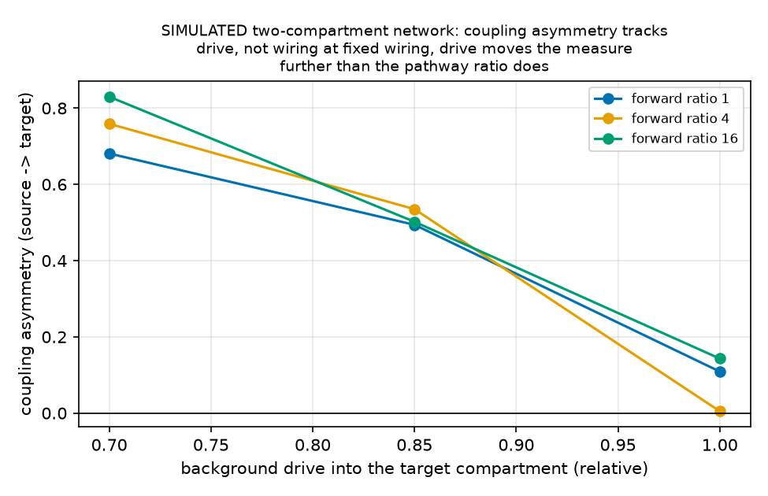
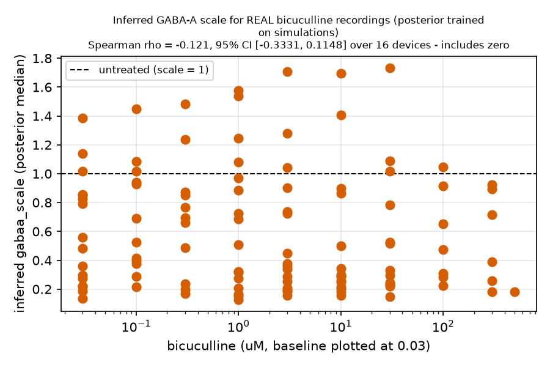

# NeuroMPS — a provenance-tracked MEA data asset and a calibrated two-compartment digital twin

**Technical report.** Entry for the AI4S Open Innovation: AI + Organ-on-a-Chip challenge
(5th Pazhou Algorithm Competition).

> **Research decision-support only.** Nothing in this report is an efficacy, safety, diagnostic or
> clinical claim. The models here describe public *in vitro* recordings and a simulation of them.

Every computed number below carries an HTML comment naming the `outputs/metrics.json` key it
came from. The few figures that describe a source deposit rather than a result of this
pipeline - a recording length, an electrode count - are attributed in the text instead.
`python -m neuromps.report.verify` re-reads each citation and fails if the document and the metrics
disagree, so a figure that goes stale when a stage is regenerated cannot quietly survive in the
prose. The decision record behind these results, including what was tried and abandoned, is
`report/LAB_NOTEBOOK.md`.

**Submission category: End-to-End System.** A complete path from public recordings to actionable
output — provenance-enforced ingestion, a standardized feature layer, models and a calibrated
digital twin, and a harness that reports which measurements the data can support — with an
interactive demo.

**Team.**
<!-- FILL IN BEFORE SUBMITTING. The competition gives a +0.5 bonus to teams covering both AI/CS and
     biology/bioengineering/clinical expertise, and asks that composition be declared here as well as
     in the Kaggle Writeup. Replace the row below with the real roster and name the relevant
     background explicitly. -->

| member | role | background |
|---|---|---|
| **[NAME]** (team leader) | **[ROLE]** | **[AI/CS and/or biology/bioengineering/clinical]** |

---

## 1. Summary

Two layers were built:

**(A) A standardized, provenance-tracked data asset** of public neural microelectrode-array (MEA)
recordings: 21,887 records <!-- metrics.json: data_asset.n_records --> from eight sources, each
record carrying its source URL, license, SHA256 and download time, validated against a JSON Schema
at a conformance level that requires every provenance hash to match the download manifest.

**(B) A Brian2 spiking-network digital twin** of an asymmetric two-compartment neural chip,
calibrated against the asset, with simulation-based inference (`sbi`) attempting to recover
connectivity and drug effects from MEA summary features.

The results that matter are as much negative as positive, and the report leads with both:

1. **Feature names do not determine feature values, and now there is a number for it.** Against the
   depositors' own meaRtools output on the same 336 recordings
   <!-- metrics.json: extractor_agreement.n_recordings -->, one of seven shared features reproduces;
   three rank recordings identically on a different scale; three burst measures disagree about
   *which* recordings burst more, "bursts per minute" by a factor of two (§3.5).
2. **Rate and burst-fraction measures survive a change of species; synchrony and network-burst
   measures do not** (§6.3, §6.5, §6.6, §7.3). **Across *platforms* none of them is safe** — mean
   firing rate itself reverses sign (§6.4), which is the sharper limitation of the two. That is a
   claim about drug-response deltas: *untreated* human and rat activity differs on 7 of the 9
   features even at matched platform and preparation (§6.8).
3. **Coupling asymmetry tracks relative firing rate, not pathway direction.** At fixed wiring,
   changing one chamber's drive moves the measure several times further than changing the wiring
   does, and pre-whitening makes that worse rather than better (§7.2). On real devices that
   instrument the connecting tunnels, the measure agrees with the axons' own measured direction on
   a fraction 0.419
   <!-- metrics.json: axonal_directionality.headline.sign_agreement.fraction --> of 31 chamber
   pairs — chance (§7.7).
4. **The twin's posterior does not recover drug-knob direction from real recordings.** The inferred
   GABA-A scale shows no bicuculline dose trend, and untreated chips already infer 0.3781
   <!-- metrics.json: twin_hd15_real_inference.gabaa_scale_at_baseline.median -->, so the parameter
   is absorbing model mismatch rather than tracking the compound. Training a second estimator on the
   *change* against each chip's own baseline recovers the neutral value — 1.0289
   <!-- metrics.json: twin_hd17_delta_inference.real_data.gabaa_scale_at_baseline.median --> — and
   still finds no dose trend, so baseline heterogeneity was not what was hiding it (§7.5).
5. **Direction *is* recoverable from simulated features once firing rate is residualised out** —
   AUC 0.8825
   <!-- metrics.json: twin_hd16_directionality.cheapest_configuration.free_rate_residualized.auc -->,
   95% CI [0.8184, 0.9359]
   <!-- metrics.json: twin_hd16_directionality.cheapest_configuration.free_rate_residualized.auc_ci95 -->,
   from 10 s on 6 electrodes per compartment — but as a *contrast* between two well-spaced wiring
   classes, not a measurement of a continuous ratio (§7.6). A second arm that matched rates reaches
   a higher AUC and **fails its own validity check**; it is reported as inconclusive.
6. **That result does not reproduce on real devices.** On 26 chips whose microchannel geometry was
   fabricated rather than assumed, propagation asymmetry does not separate straight channels from
   three asymmetric designs (Kruskal p = 0.64
   <!-- metrics.json: microchannel_directionality.comparison.kruskal_p -->), and the statistic is
   confounded with how many events a chip produced (§7.7). The sample is too small to call that a
   refutation of the simulated result, and too directly aimed to omit.

The honest summary of the twin is therefore: it reproduces baseline features and most drug
directions, it can tell two wiring regimes apart in simulation, it cannot yet read pharmacology off
a real chip, and the one real-data test of its directionality claim is null.

---

## 2. Problem and scope

Microphysiological systems produce electrophysiology that is rich but hard to compare: different
platforms, electrode counts, durations, species and feature definitions. Two consequences follow for
anyone trying to use public MEA data for compound screening.

*Data are not comparable by default.* Feature names collide while definitions differ — "synchrony"
from a spike-time tiling coefficient is not the Axion synchrony index — and provenance is usually
lost by the time data reach an analysis.

*A model of the chip is not a model of the measurement.* A spiking network that reproduces a
culture's firing does not necessarily reproduce what 48 electrodes detect from it.

This entry addresses both: a schema and feature standard with enforced provenance, and a digital
twin that is scored through the *same* feature extractor as the real recordings.

**Out of scope.** No clinical, diagnostic, efficacy or safety claim is made or implied. Compound
labels are mechanism classes drawn from the source publications, not indications.

---

## 3. The data standard

### 3.1 Record model and data levels

Records validate against `schema/neuromps_schema.json` (JSON Schema 2020-12). The central decision is
that records carry an explicit **data level**, and that records only compare within a level:

| level | meaning | records |
|---|---|---|
| `spike_times` | per-electrode spike trains; our feature vector is computable | 1,512 <!-- metrics.json: data_asset.counts.by_data_level.spike_times --> |
| `fitted_curve` | published concentration-response fits only | 20,375 <!-- metrics.json: data_asset.counts.by_data_level.fitted_curve --> |
| `per_well_features` | vendor feature tables without spike times | — |

This distinction is load-bearing. Most of the asset by count is ToxCast curve fits, from which our
nine-feature vector cannot be recomputed; only the 1,512
<!-- metrics.json: data_asset.counts.by_data_level.spike_times --> spike-time records support the
feature pipeline. A schema that hid that behind a single "features" field would invite exactly the
wrong comparison.

### 3.2 Provenance and conformance

Conformance **level 2** requires that every record's provenance hash matches `data/raw/MANIFEST.json`,
and the build refuses to emit an asset otherwise. Each fetcher records URL, license, SHA256, byte
count and download time, and re-checks the source's advertised license at fetch time so a
silently-relicensed upstream blocks rather than propagates.


### 3.3 Quality control

QC is recorded, never applied silently. Each record carries flags and a single `qc.usable` verdict,
and the flags are informational: a flagged record is still in the asset, with the reason attached, so
a downstream analysis can make its own decision.

The six flags, their counts and their meanings are in Appendix A.

Two decisions here were driven by defects found in the data rather than by design. The
replicate-divergence test originally used a robust z-score, which collapses when more than half a
replicate group shares a value — common in sparse recordings, where the median absolute deviation is
exactly zero; it now falls back to a mean absolute deviation and names the diverging feature. And
the 90 wells excluded by an upstream log were at first missing from the asset altogether, because
records were built from the feature tables alone; they are now built from the union of the log and
the spike files, so an exclusion is represented rather than absent.

### 3.4 Feature set

Nine features form the core vector, computed by a single extractor (`features/mea.py`) that the twin
must also call:

The nine features and how each is computed are listed in Appendix F.

Thresholds are fixed and recorded per record: an electrode is active at ≥5 spikes/min, a well is
usable at ≥10 active electrodes, a burst is ≥5 spikes with ISI ≤0.1 s, and the tiling coefficient
uses Δt = 0.05 s.

The network-burst threshold deserves its own note, because the obvious implementation is wrong. A
fixed participation threshold — *n* electrodes firing in the same window — counts coincidences that
independent electrodes produce anyway; at 5 Hz on 16 electrodes that is on the order of fifty
spurious "network bursts" per minute, which would dominate the measure. The threshold is therefore
set per recording so that the expected number of chance detections stays below 0.05, from the
recording's own electrode count and firing rates. This matters beyond bookkeeping: because the
correction scales with electrode count, it is a candidate explanation for part of the cross-platform
disagreement reported in §6.4, and that remains untested.

### 3.5 Does the extractor reproduce an independent implementation?

§2 claims that feature names collide while their definitions differ. That claim was asserted rather
than measured, and one source lets it be measured: Kapucu 2022's three maturation plates deposit
both the spike times and the authors' own **meaRtools** output — the same recordings scored by
different software — for seven of our nine features. Running `features/mea.py` over their spike
files and joining on plate, well and DIV gives 2,298 paired values
<!-- metrics.json: extractor_agreement.n_paired_values --> over 336 recordings
<!-- metrics.json: extractor_agreement.n_recordings --> and 24 wells, intervals clustered on the
well because one well contributes about twenty correlated DIVs.

**One of the seven reproduces on both ordering and scale**, `pct_spikes_in_bursts`: Spearman 0.9703
<!-- metrics.json: extractor_agreement.by_feature.pct_spikes_in_bursts.spearman_rho -->, median
ratio 0.9864
<!-- metrics.json: extractor_agreement.by_feature.pct_spikes_in_bursts.median_ratio_ours_over_theirs -->.
**Three rank the recordings identically on a different scale** — `mfr_hz`, `synchrony_index` and
`active_electrodes`, all with ρ above 0.97 — where our values are 0.754
<!-- metrics.json: extractor_agreement.by_feature.mfr_hz.median_ratio_ours_over_theirs --> and 0.736
<!-- metrics.json: extractor_agreement.by_feature.synchrony_index.median_ratio_ours_over_theirs -->
of theirs while we count 1.362
<!-- metrics.json: extractor_agreement.by_feature.active_electrodes.median_ratio_ours_over_theirs -->
times as many electrodes active. The first and third are one choice, not two: our activity threshold
admits more electrodes, and mean rate *per active electrode* falls accordingly.

**Three disagree on the ordering as well**, and all three are burst measures — `burst_rate_per_min`
(ρ = 0.8907 <!-- metrics.json: extractor_agreement.by_feature.burst_rate_per_min.spearman_rho -->,
ratio 0.4423
<!-- metrics.json: extractor_agreement.by_feature.burst_rate_per_min.median_ratio_ours_over_theirs -->),
`spikes_per_burst` and `burst_duration_s`. A rank correlation short of one means the two
implementations do not merely rescale each other: they disagree about *which* recordings burst more.
Our detector is a fixed rule (≥5 spikes, ISI ≤0.1 s); meaRtools uses its own. Which is preferable is
not the point and this cannot settle it. The point is the size of the gap — a study reporting "bursts
per minute" and a study reporting "bursts per minute" can differ by a factor of two and rank their
recordings differently, with nothing in either paper to warn a reader pooling them. Per-feature
numbers are in Appendix H.

`isi_cv` and `network_burst_rate_per_min`
<!-- metrics.json: extractor_agreement.uncheckable --> have no meaRtools counterpart here and are
unchecked; the network-burst measure is the one this report would most like to have checked, since
§3.4's chance correction is specific to it.

**This is the standard's justification, measured.** It is also a bound on every cross-source claim in
§6: results are computed inside one extractor, so they are internally consistent, but a reader
comparing our numbers to a published table should expect the offsets above rather than agreement.
The scatter, one panel per feature, is `outputs/figures/extractor_agreement_real.png`.

---

## 4. The data asset

| source | records | level | species | license |
|--------------------------|-------|------------|-----------|---------|
| `toxcast_mea` | 20,375 <!-- metrics.json: data_asset.counts.by_source.toxcast_mea --> | fitted_curve | rat | CC0-1.0 |
| `screenneuropharm_bic` | 580 <!-- metrics.json: data_asset.counts.by_source.screenneuropharm_bic --> | spike_times | rat | MIT |
| `kapucu2022` | 288 <!-- metrics.json: data_asset.counts.by_source.kapucu2022 --> | spike_times | human, rat | CC-BY-4.0 |
| `sharf2022` | 29 <!-- metrics.json: data_asset.counts.by_source.sharf2022 --> | spike_times | human | CC0-1.0 |
| `mateus2024` | 108 <!-- metrics.json: data_asset.counts.by_source.mateus2024 --> | spike_times | rat | CC-BY-4.0 |
| `trujillo2019` | 184 <!-- metrics.json: data_asset.counts.by_source.trujillo2019 --> | spike_times | human | CC-BY-4.0 |
| `brewer2021` | 40 <!-- metrics.json: data_asset.counts.by_source.brewer2021 --> | spike_times | rat | CC-BY-4.0 |
| `vassallo2017` | 283 <!-- metrics.json: data_asset.counts.by_source.vassallo2017 --> | spike_times | rat | US Public Domain |

Totals: 21,887 records <!-- metrics.json: data_asset.n_records -->, of which 21,350 are marked usable
<!-- metrics.json: data_asset.counts.by_usable.True --> and 537 are not
<!-- metrics.json: data_asset.counts.by_usable.False -->. By species, 21,530 records are rat
<!-- metrics.json: data_asset.counts.by_species.rat --> and 357 are human
<!-- metrics.json: data_asset.counts.by_species.human -->.

**The species imbalance is the asset's main structural weakness** and is stated wherever human
results appear. Adding Trujillo 2019 took the human count from 173 to 357
<!-- metrics.json: data_asset.counts.by_species.human --> across three sources, and changed no
modelling number at all: those records are untreated baselines, and every model in §6 consumes
exposure-minus-baseline pairs. §6.8 is the comparison they do support.

`brewer2021` is here for §7.7's sake rather than for a result: ten rat hippocampal cultures in a
four-chamber device whose **tunnels are themselves over electrodes**, so a crossing is measured
rather than inferred from the chambers either side. Its anatomical labels are not trusted — 4 of its
40 files carry the deposit's own subregion field and 2 of those disagree with the file name, which
each record's QC note states.

### 4.1 A rejection, as a worked example of the license discipline

Tukker 2020 (rat and hiPSC MEA pharmacology) is a good fit scientifically and is **excluded**. It is
CC BY-NC 4.0, and the competition rules assign joint ownership of submissions rather than preserving
an entrant's own license, so the non-commercial condition cannot be guaranteed downstream. It is
recorded as `skipped` in the manifest with that reason rather than dropped silently. The cost is
real: without it, the rat→human transfer study rests on one source.

### 4.2 A licence conflict, resolved rather than avoided

Zenodo 14525182 (Mateus et al. 2024) is the closest published analogue of the chip the twin models,
and its deposit contradicts itself: the Zenodo metadata licence field says `cc-by-4.0` while the
README inside says, in capitals, CC BY-NC-ND. Under NoDerivatives, publishing derived features would
not have been permitted, which is the whole of what this project does with a recording, so it was
**rejected on 2026-09-16**. On 2026-09-21 the corresponding author confirmed by email that the
metadata governs and the README line was an unintentional default, and the source was included on
that basis.

Both halves of the contradiction are public and the fetcher blocks if the metadata licence moves,
but **the resolution itself is private correspondence, which a reader cannot verify** — the one
source in the asset whose licence rests on anything other than a public record. `data/SOURCES.md`
says so in those words, and the full account, including what the fetcher checks on every run, is in
Appendix I. Its 108 records
<!-- metrics.json: data_asset.counts.by_source.mateus2024 --> are analysed in §7.7.

---

## 5. Methods

### 5.1 Cross-validation and resampling

Every model is evaluated with **grouped** cross-validation, grouping by culture/well so replicates
of one culture never span the train/test boundary, and every interval is a **cluster bootstrap over
those groups**, never over rows — with 1,000 resamples
<!-- metrics.json: mechanism_baselines.task1_within_platform.bootstrap_resamples --> in a full run and
fewer in `--quick`, the count recorded alongside each estimate. Bootstrapping rows here would report
intervals roughly a factor of two too narrow, because rows within a culture are not independent.

### 5.2 Tasks

- **Task 1 — mechanism classification** (within platform): predict mechanism class from the
  nine-feature delta vector of a treated/baseline pair.
- **Task 2 — external detection**: apply the Task 1 model to a source it never saw, with a negative
  control of the opposite mechanism.
- **Task 3 — platform contrast**: compare the same mechanism measured on two platforms.
- **Transfer**: rat → human, with and without domain adaptation.

---

## 6. Results: data and models

### 6.1 Task 1 — mechanism classification

Six classes, 73 treated/baseline pairs
<!-- metrics.json: mechanism_baselines.task1_within_platform.n_pairs --> across 50 culture groups
<!-- metrics.json: mechanism_baselines.task1_within_platform.n_groups -->, 4-fold grouped CV
<!-- metrics.json: mechanism_baselines.task1_within_platform.n_splits -->.

| model | balanced accuracy | 95% CI |
|---|---|---|
| logistic regression | 0.537 <!-- metrics.json: mechanism_baselines.task1_within_platform.models.logistic_regression.balanced_accuracy_mean --> | [0.4216, 0.6845] <!-- metrics.json: mechanism_baselines.task1_within_platform.models.logistic_regression.balanced_accuracy_ci95 --> |
| gradient boosting | 0.398 <!-- metrics.json: mechanism_baselines.task1_within_platform.models.gradient_boosting.balanced_accuracy_mean --> | [0.2762, 0.5178] <!-- metrics.json: mechanism_baselines.task1_within_platform.models.gradient_boosting.balanced_accuracy_ci95 --> |
| most-frequent baseline | 0.167 <!-- metrics.json: mechanism_baselines.task1_within_platform.models.dummy_most_frequent.balanced_accuracy_mean --> | — |

Chance is 0.167 <!-- metrics.json: mechanism_baselines.task1_within_platform.chance_balanced_accuracy -->.
Logistic regression beats chance with an interval that excludes it. Its interval and gradient
boosting's overlap heavily, so the gap between the two models is within noise; with 73 pairs the
simpler model is the one to prefer, not the one shown to be better.

The out-of-fold confusion matrix is in Appendix E; errors concentrate between the two GABA-A
classes.


**Calibration.** Expected calibration error on out-of-fold predictions is 0.1114
<!-- metrics.json: mechanism_baselines.task1_within_platform.calibration.ece -->, 95% CI [0.0773, 0.2557]
<!-- metrics.json: mechanism_baselines.task1_within_platform.calibration.ece_ci95 -->
(`outputs/figures/task1_reliability_real.png`). The upper end of that interval is large: predicted
probabilities should be read as ordering, not as calibrated risk — and not even as ordering above
0.8 confidence, where observed accuracy falls rather than rises, on a handful of predictions.

**Conformal sets.** At a 95% target the empirical coverage is 0.918
<!-- metrics.json: uncertainty_and_ablations.conformal_sweep.0.empirical_coverage --> with a mean set
size of 4.562 <!-- metrics.json: uncertainty_and_ablations.conformal_sweep.0.mean_set_size --> classes
out of six — honest coverage at the cost of sets too large to act on. That is the correct reading of
73 calibration points, not a defect to tune away. The set-size sweep is plotted in
`outputs/figures/conformal_set_size.png`.

**The same task on an independent platform.** `vassallo2017` is a different laboratory and vendor,
with six compounds Kapucu never used and each baseline on the same chip as its doses: 171 pairs
<!-- metrics.json: mechanism_baselines.task1b_independent_platform.n_pairs --> over 26 chips
<!-- metrics.json: mechanism_baselines.task1b_independent_platform.n_groups --> in four mechanism
classes. **Logistic regression reaches 0.333
<!-- metrics.json: mechanism_baselines.task1b_independent_platform.models.logistic_regression.balanced_accuracy_mean -->
there, 95% CI [0.2317, 0.4204]
<!-- metrics.json: mechanism_baselines.task1b_independent_platform.models.logistic_regression.balanced_accuracy_ci95 -->,
against a chance level of 0.25
<!-- metrics.json: mechanism_baselines.task1b_independent_platform.chance_balanced_accuracy -->** —
an interval that contains chance. The two tasks differ in class count and in compound, so the
accuracies are not directly comparable; what is comparable is each against its own chance level, and
only the first clears it. The mechanism claim is weaker than this section's Kapucu numbers alone
suggest.

**Why this is not one model over all 754 pairs.** Pooling the sources would measure the wrong
thing: a pair's mechanism label very nearly determines which laboratory produced it. The label
predicts the source for 97.35%
<!-- metrics.json: mechanism_baselines.label_source_confounding.source_determined_by_label --> of
the 754 pairs <!-- metrics.json: mechanism_baselines.label_source_confounding.n_pairs -->, and 6
<!-- metrics.json: mechanism_baselines.label_source_confounding.n_labels_from_one_source_only -->
of the nine labels occur in one source only, so a pooled model would be scored on recognising the
platform - which §6.4 shows these features do well. The asset supports within-source classification
and cross-source *detection* of one mechanism at a time (§6.2), not a cross-platform benchmark.
That is a property of what the field has published, not of the model.

---

### 6.2 Task 2 — external detection and its negative control

Applied to bicuculline recordings from a source the model never saw, the GABA-A antagonist class is
detected in 0.366 <!-- metrics.json: mechanism_baselines.task2_external_detection.screenneuropharm_bicuculline.detection_rate -->
of 497 records <!-- metrics.json: mechanism_baselines.task2_external_detection.screenneuropharm_bicuculline.n -->,
and the detection does **not** track dose (Spearman 0.014
<!-- metrics.json: mechanism_baselines.task2_external_detection.screenneuropharm_bicuculline.dose_spearman -->,
p = 0.751 <!-- metrics.json: mechanism_baselines.task2_external_detection.screenneuropharm_bicuculline.dose_spearman_p -->).

The negative control behaves as it should: diazepam, a positive modulator rather than an antagonist,
is called GABA-A antagonist in only 0.077
<!-- metrics.json: mechanism_baselines.task2_external_detection.sharf_diazepam_negative_control.detection_rate -->
of its records.


**This is a weak result reported as a weak result.** A detection rate near a third with no dose
relationship is not a screening tool; it is evidence that the mechanism signal partially survives a
platform change.

### 6.3 Species transfer (rat → human)

| setting | balanced accuracy | 95% CI |
|---|---|---|
| human, within-species | 0.646 <!-- metrics.json: species_transfer.transfer.none.human_within.balanced_accuracy --> | — |
| rat, within-species | 0.543 <!-- metrics.json: species_transfer.transfer.none.rat_within.balanced_accuracy --> | — |
| rat → human, no adaptation | 0.55 <!-- metrics.json: species_transfer.transfer.none.rat_to_human.balanced_accuracy --> | [0.4, 0.6] <!-- metrics.json: species_transfer.transfer.none.rat_to_human.balanced_accuracy_ci95 --> |
| rat → human, CORAL | 0.442 <!-- metrics.json: species_transfer.transfer.coral.rat_to_human.balanced_accuracy --> | [0.302, 0.591] <!-- metrics.json: species_transfer.transfer.coral.rat_to_human.balanced_accuracy_ci95 --> |
| rat → human, per-species standardisation | 0.408 <!-- metrics.json: species_transfer.transfer.standardize.rat_to_human.balanced_accuracy --> | [0.267, 0.568] <!-- metrics.json: species_transfer.transfer.standardize.rat_to_human.balanced_accuracy_ci95 --> |

Chance is 0.2 <!-- metrics.json: species_transfer.transfer.none.chance_balanced_accuracy -->.
Transfer works above chance (permutation p = 0.0002
<!-- metrics.json: species_transfer.transfer.none.rat_to_human.permutation_p -->), and **both
adaptation methods made it worse**. With 37 training and 32 test records
<!-- metrics.json: species_transfer.transfer.none.rat_to_human.n_test -->, CORAL is estimating a
covariance it cannot support. Reporting adaptation as a negative result is the useful outcome here.

### 6.4 Task 3 — platform contrast

The same mechanism at ≥30 µM
<!-- metrics.json: mechanism_baselines.task3_platform_contrast.min_dose_uM --> measured on two
platforms: gabazine on 16-electrode Axion wells, n = 10
<!-- metrics.json: mechanism_baselines.task3_platform_contrast.by_source.kapucu2022.n -->, against
bicuculline on multi-electrode arrays, n = 167
<!-- metrics.json: mechanism_baselines.task3_platform_contrast.by_source.screenneuropharm_bic.n -->.
Five features agree in sign and four disagree
<!-- metrics.json: mechanism_baselines.task3_platform_contrast.features_agreeing_in_sign -->
<!-- metrics.json: mechanism_baselines.task3_platform_contrast.features_disagreeing_in_sign -->.

{width=57%}

**The disagreement does not fall where the species analysis puts it.** `mfr_hz` reverses, +0.348
<!-- metrics.json: mechanism_baselines.task3_platform_contrast.by_source.kapucu2022.median_delta.mfr_hz -->
against −0.684
<!-- metrics.json: mechanism_baselines.task3_platform_contrast.by_source.screenneuropharm_bic.median_delta.mfr_hz -->,
while `synchrony_index` agrees, +1.743
<!-- metrics.json: mechanism_baselines.task3_platform_contrast.by_source.kapucu2022.median_delta.synchrony_index -->
against +0.148
<!-- metrics.json: mechanism_baselines.task3_platform_contrast.by_source.screenneuropharm_bic.median_delta.synchrony_index -->.
That is the opposite of the pattern in §6.5 and §6.6, and it is the reason this report separates the
two claims: **the portable-feature result is about species, and does not carry across platforms.**

Three cautions on how far this goes. The contrast confounds compound (gabazine against bicuculline)
with electrode count, recording duration and culture age, so it bounds portability rather than
explaining it. The two arms are ten wells against 167 records. And `active_electrodes` is counted as
a disagreement while its median delta is exactly 0.000
<!-- metrics.json: mechanism_baselines.task3_platform_contrast.by_source.kapucu2022.median_delta.active_electrodes -->
on both platforms — a zero has no sign, so the substantive count is three disagreements, not four.

### 6.5 Which features survive a species change

The most shifted features between species are `synchrony_index`
<!-- metrics.json: species_transfer.species_shift.most_shifted_features -->, `isi_cv` and
`network_burst_rate_per_min`; the most invariant are `mfr_hz`
<!-- metrics.json: species_transfer.species_shift.most_invariant_features -->,
`pct_spikes_in_bursts` and `burst_rate_per_min` (`outputs/figures/species_shift.png`). The synchrony
shift is large — a difference of −4.179
<!-- metrics.json: species_transfer.species_shift.by_feature.synchrony_index.difference --> in log2
units — though its interval [−5.7435, 0.1868]
<!-- metrics.json: species_transfer.species_shift.by_feature.synchrony_index.difference_ci95 -->
reaches zero, so the ordering is better supported than the magnitude. The same hedge applies to
`isi_cv`, whose interval [−1.6738, 0.15]
<!-- metrics.json: species_transfer.species_shift.by_feature.isi_cv.difference_ci95 --> also reaches
zero; only `network_burst_rate_per_min` has an interval that excludes it,
[−9.7879, −0.3389]
<!-- metrics.json: species_transfer.species_shift.by_feature.network_burst_rate_per_min.difference_ci95 -->.
The ranking is by standardised difference, so "most invariant" does not mean small: `burst_rate_per_min`
is named invariant while carrying a median difference of 1.04
<!-- metrics.json: species_transfer.species_shift.by_feature.burst_rate_per_min.difference --> log2
units, a two-fold shift whose interval also spans zero.

The per-feature shift, with cluster-bootstrap intervals, is plotted in Appendix E.


### 6.6 Ablations: the feature set is mostly one feature

Two rate features match all nine, and every subset's interval overlaps every other's (Appendix G). Leave-one-out agrees: dropping `mfr_hz` changes balanced accuracy
by −0.05 <!-- metrics.json: uncertainty_and_ablations.leave_one_out.mfr_hz.delta_vs_all -->, while
dropping `burst_rate_per_min` changes it by 0.0
<!-- metrics.json: uncertainty_and_ablations.leave_one_out.burst_rate_per_min.delta_vs_all -->.

### 6.7 Compartment asymmetry in real devices

Across 16 two-chamber devices <!-- metrics.json: compartment_asymmetry.n_devices -->, the statistic
that separates device types is coupling **lag**, not asymmetry. Median absolute lag is 11.25 ms
<!-- metrics.json: compartment_asymmetry.by_device_type.median_abs_lag_ms.by_type.CxHp.median -->
for cortical–hippocampal devices against 5.0 ms
<!-- metrics.json: compartment_asymmetry.by_device_type.median_abs_lag_ms.by_type.CxCx.median -->
and 5.0 ms
<!-- metrics.json: compartment_asymmetry.by_device_type.median_abs_lag_ms.by_type.HpHp.median -->
for the two same-tissue types (Kruskal p = 0.0082
<!-- metrics.json: compartment_asymmetry.by_device_type.median_abs_lag_ms.kruskal_p -->; Holm-adjusted
0.0413
<!-- metrics.json: compartment_asymmetry.by_device_type.median_abs_lag_ms.pairwise_holm.CxCx_vs_CxHp -->
and 0.0257
<!-- metrics.json: compartment_asymmetry.by_device_type.median_abs_lag_ms.pairwise_holm.CxHp_vs_HpHp -->
against the two homogeneous types).

**The internal control behaves.** The two same-tissue types are indistinguishable from each other,
Holm 0.4785
<!-- metrics.json: compartment_asymmetry.by_device_type.median_abs_lag_ms.pairwise_holm.CxCx_vs_HpHp -->,
which is what a real device-type effect should look like and what a pooled heterogeneous-against-
homogeneous split cannot show.

The per-device values are plotted by type in Appendix E.

Two things this section does **not** claim. On absolute asymmetry rather than lag, the same per-type
comparison does not survive correction, Holm 0.0519
<!-- metrics.json: compartment_asymmetry.by_device_type.median_abs_asymmetry.pairwise_holm.CxCx_vs_CxHp -->,
so lag is the claim and asymmetry is not. And a pooled heterogeneous-against-homogeneous test of
asymmetry *does* cross the line, p = 0.042
<!-- metrics.json: compartment_asymmetry.pooled_heterogeneous_vs_homogeneous.p_value -->; it is kept
in `metrics.json` and is deliberately not the headline here, because pooling CxCx with HpHp is an
artefact — the two homogeneous types differ from each other on peak correlation, so pooling them
manufactures a contrast. An earlier draft of this report led with that pooled test; the lab notebook
had already recorded it as abandoned, and this section now reports the analysis that replaced it.

With five to six devices per group, this supports an ordering of device types, not an effect size,
and §7.2 gives a specific reason to distrust the asymmetry measure in particular.

### 6.8 Untreated baselines: what differs before any drug is applied

Everything above consumes pairs — an exposure minus its own baseline. That is why adding 184 human
organoid recordings <!-- metrics.json: data_asset.counts.by_source.trujillo2019 --> changed none of
the numbers in §6.1 to §6.7: they are untreated baselines with nothing to pair against. They answer
a different question — before any compound, does human tissue sit inside the rat distribution?

Species and platform are confounded here — every MaxWell recording is human, every Multi Channel
Systems recording is rat — so the comparison is made inside one vendor, resampling over culture
units rather than rows: an organoid recorded twenty times is one culture.

**At matched platform and matched preparation, 7
<!-- metrics.json: baseline_activity.matched_preparation.n_features_separating_species -->
of the nine features separate the species** (Axion, dissociated monolayers, 28 human cultures
<!-- metrics.json: baseline_activity.matched_preparation.n_human_cultures --> against 44 rat
<!-- metrics.json: baseline_activity.matched_preparation.n_rat_cultures -->). Human cultures fire
faster, put more of their spikes into bursts — a median of 70.9
<!-- metrics.json: baseline_activity.matched_preparation.features.pct_spikes_in_bursts.median_human -->
against 40.05
<!-- metrics.json: baseline_activity.matched_preparation.features.pct_spikes_in_bursts.median_rat -->
percent — and are four times as synchronous. Only burst rate overlaps. Dropping the untreated wells
recorded during a plate's exposure phase leaves the same 7
<!-- metrics.json: baseline_activity.matched_preparation_baseline_phase_only.n_features_separating_species -->,
so this is not an artifact of session order.

This qualifies §6.5 rather than contradicting it: that section found rate-like **drug-response
deltas** portable, and a delta can travel between two populations whose resting activity does not
resemble each other at all. Preparation separates from species too — within human tissue on one
vendor, 3D organoids differ from dissociated monolayers on 5
<!-- metrics.json: baseline_activity.preparation_within_human.n_features_separating_species -->
of the nine features, so "human" does not name one kind of preparation.

**A confound the module refuses rather than reports.** Active-electrode count looked like the
strongest separator of all, reaching 49 electrodes
<!-- metrics.json: baseline_activity.within_vendor.features.active_electrodes.difference_ci95.1 -->
— an artifact of Trujillo's 64-electrode wells against Kapucu's 16. It is flagged
`format_confounded` and excluded; the fraction of electrodes active gives an interval of −0.031 to
0.063 <!-- metrics.json: baseline_activity.within_vendor.features.active_fraction.difference_ci95 -->,
astride zero —
the fourth apparent effect here dissolved by asking what else differs between the groups.

The three groups are plotted separately in Appendix E, because the species contrast and the
preparation contrast are both present in this slice and two groups would let the whole gap be read
as species.
three groups are shown separately because the species contrast and the preparation contrast are both
present in this slice; two groups would let the whole gap be read as species. Burst rate is the one
feature flat across all three.](../outputs/figures/baseline_species_comparison.png){width=58%}

---

## 7. Results: the digital twin

### 7.1 Model

Two compartments of conductance-based leaky integrate-and-fire neurons with spike-frequency
adaptation, 80/20 excitatory/inhibitory, recurrent intra-compartment connectivity and **directional**
inter-compartment projections whose forward/backward ratio is the parameter of interest. Poisson
background drive. Connectivity is parameterised by **in-degree rather than probability**, so a
calibration done at one network size still holds at another.

The parameters carried by the network, and how each was fixed:

The full parameter list, and how each was fixed, is in Appendix B.

Identical neurons synchronise almost perfectly, which no real culture does, so `threshold_spread`
exists to stop the twin being trivially more synchronous than any recording. `detection_radius_um`
is a property of the virtual electrode rather than of the culture, and is called out as such in the
calibration record so it is not read as a biological parameter. The seven parameters marked
calibrated above are exactly the search space
<!-- metrics.json: twin_hd12_calibration.tuned_parameters -->; the two marked *held* were left at
their module defaults and are stated here because an earlier draft of this table listed them as
calibrated, which they never were.

Neurons are placed on a virtual electrode grid and only spikes within a detection radius reach an
electrode; the resulting per-electrode spike trains go through the same `features/mea.py` as real
recordings, and — after a defect found in HD16 — through the same coupling measure on the same
per-electrode input.

### 7.2 The measure the twin exists to use is confounded

Coupling asymmetry was expected to report pathway direction. It reports relative firing rate. At
**fixed** wiring, lowering the receiving chamber's background drive moves asymmetry from 0.109
<!-- metrics.json: twin_hd11_validation.directionality_sweep.0.asymmetry_mean --> to 0.681
<!-- metrics.json: twin_hd11_validation.directionality_sweep.2.asymmetry_mean -->; at **fixed**
drive, raising the forward ratio from 1 to 16 moves it only from 0.109 to 0.143
<!-- metrics.json: twin_hd11_validation.directionality_sweep.6.asymmetry_mean -->. The measure's own
range is [−1, 1], so this is not the whole of it — but drive moves the statistic several times
further than the wiring it is supposed to be reporting. This is the most
consequential single finding about the twin, and it propagates into every later section: any analysis
that reads direction off coupling must control for rate first.

Three checks on the real devices confirmed the confound does not obviously bite there (firing-rate
imbalance does not differ by device type), which is why §6.6 survives as a hypothesis.

**It is not an artefact of the estimator.** Two spike trains with different autocorrelation kernels
give an asymmetric cross-correlogram even under symmetric coupling, so the drive dependence could be
a property of the measurement. Repeating the sweep with each compartment's burst structure filtered
out first — an order 5
<!-- metrics.json: twin_hd11_validation.confound_summary.prewhiten_order --> autoregressive
pre-whitening, through the same `features/coupling.py` the real recordings use — makes it
*stronger*. Averaged over wiring ratios, drive moves the raw measure by 0.671
<!-- metrics.json: twin_hd11_validation.confound_summary.raw.drive_span --> and the pre-whitened one
by 0.817 <!-- metrics.json: twin_hd11_validation.confound_summary.prewhitened.drive_span -->, against
0.109 <!-- metrics.json: twin_hd11_validation.confound_summary.raw.wiring_span --> and 0.173
<!-- metrics.json: twin_hd11_validation.confound_summary.prewhitened.wiring_span --> for wiring at
fixed drive; whether pre-whitening reduces the drive dependence: false
<!-- metrics.json: twin_hd11_validation.confound_summary.prewhitening_reduces_drive_dependence -->.
The confound is in the network — the pathway's own excitation raises the target's rate — not in the
correlogram, which is why §7.6 residualises rate out rather than filtering it out.

{width=54%}


### 7.3 Calibration

A random search over seven tuned parameters
<!-- metrics.json: twin_hd12_calibration.tuned_parameters --> brought the simulated baseline into the
real band for `mfr_hz`, `burst_rate_per_min` and `network_burst_rate_per_min`, and **not** for
`pct_spikes_in_bursts` or `synchrony_index`
<!-- metrics.json: twin_hd12_calibration.inside_real_band -->. The residual mismatch is precisely the
burst-structure and synchrony group that §6.5 and §6.6 independently identify as the unreliable part
of the feature set across species. Three analyses agree about species; the platform contrast of §6.4
disagrees, and that disagreement is itself the finding.

{width=54%}

**The missing mechanism is the right one and is nowhere near large enough.** A reviewer proposed the
standard explanation: spike-frequency adaptation acts on each cell alone and cannot stop a burst the
population is driving, while vesicle depletion at recurrent excitatory synapses can. Adding
Tsodyks-Markram depression to those synapses, with the calibration otherwise held fixed and `u = 0`
reproducing the model above exactly, moves both gap features the predicted way: the synchrony
penalty falls from 0.1314
<!-- metrics.json: twin_hd18_depression.synchrony_index_control_penalty --> to 0.1233
<!-- metrics.json: twin_hd18_depression.synchrony_index_best_penalty --> and the burst-fraction
penalty from 0.0211
<!-- metrics.json: twin_hd18_depression.pct_spikes_in_bursts_control_penalty --> to 0.0149
<!-- metrics.json: twin_hd18_depression.pct_spikes_in_bursts_best_penalty -->, in five of the seven
settings tried. It also needs the slow recovery the mechanism is usually quoted with: both settings
with τ_rec = 300 ms *raised* synchrony, because resources return faster than depression accumulates.

But the effect is small beside the gap. A penalty of 0.13 means simulated synchrony sits about 14%
above the real band's edge, and the strongest depression closes roughly a twentieth of that while
pushing the three features already inside the band back out — its overall score is worse than the
control's, and the best total score belongs to the weakest setting tried. So the explanation holds
and the fix is not free: depression has to enter the calibration search rather than be bolted on
after it, which is the twin's next version rather than this one.


### 7.4 Drug knobs

Each knob is compared against the real direction for its mechanism, scoring only features whose real
direction is established by a cluster bootstrap:

| knob | agrees / scored |
|---|---|
| GABA-A block | 4 <!-- metrics.json: twin_hd13_perturbation.knobs.0.n_features_agreeing --> / 5 <!-- metrics.json: twin_hd13_perturbation.knobs.0.n_features_scored --> |
| GABA-A potentiation | 2 <!-- metrics.json: twin_hd13_perturbation.knobs.1.n_features_agreeing --> / 4 <!-- metrics.json: twin_hd13_perturbation.knobs.1.n_features_scored --> |
| AMPA block | 4 <!-- metrics.json: twin_hd13_perturbation.knobs.2.n_features_agreeing --> / 4 <!-- metrics.json: twin_hd13_perturbation.knobs.2.n_features_scored --> |
| sodium-channel block | 3 <!-- metrics.json: twin_hd13_perturbation.knobs.3.n_features_agreeing --> / 3 <!-- metrics.json: twin_hd13_perturbation.knobs.3.n_features_scored --> |

Directions only: each knob is compared against a real reference from a different platform, so this
supports direction, never magnitude.

Per-feature agreement is plotted in Appendix E.


### 7.5 Simulation-based inference, and what it cannot do

A neural posterior estimator was trained on 3,500 simulations
<!-- metrics.json: twin_hd14_inference.n_simulations -->.

| parameter | posterior contraction | KS statistic |
|------------------------|-----------------------|--------------|
| `threshold_scale` | 0.8 <!-- metrics.json: twin_hd14_inference.contraction.threshold_scale.contraction --> | 0.0571 <!-- metrics.json: twin_hd14_inference.rank_uniformity_ks_p.threshold_scale.ks_statistic --> |
| `ampa_scale` | 0.443 <!-- metrics.json: twin_hd14_inference.contraction.ampa_scale.contraction --> | 0.0871 <!-- metrics.json: twin_hd14_inference.rank_uniformity_ks_p.ampa_scale.ks_statistic --> |
| `gabaa_scale` | 0.323 <!-- metrics.json: twin_hd14_inference.contraction.gabaa_scale.contraction --> | 0.1093 <!-- metrics.json: twin_hd14_inference.rank_uniformity_ks_p.gabaa_scale.ks_statistic --> |
| `inter_in_degree` | 0.32 <!-- metrics.json: twin_hd14_inference.contraction.inter_in_degree.contraction --> | 0.1029 <!-- metrics.json: twin_hd14_inference.rank_uniformity_ks_p.inter_in_degree.ks_statistic --> |
| `log10_forward_ratio` | 0.311 <!-- metrics.json: twin_hd14_inference.contraction.log10_forward_ratio.contraction --> | 0.0957 <!-- metrics.json: twin_hd14_inference.rank_uniformity_ks_p.log10_forward_ratio.ks_statistic --> |

Only excitability is well identified, and only `threshold_scale` passes a rank-uniformity check
(p = 0.1956 <!-- metrics.json: twin_hd14_inference.rank_uniformity_ks_p.threshold_scale.ks_p -->;
every other parameter is below 0.01). **Posterior intervals from this estimator should not be quoted
as calibrated.**

That statement is weaker than it looks. Posterior *training* was unseeded until this report was
being built, and rerunning identical code on the identical cache moved this p-value between 0.46 and
0.0092 — on one of those runs `threshold_scale` failed the check it passes here. Training is now
seeded and reproduces across processes, but that spread is the honest measure of how much weight one
rank-uniformity p-value carries; contraction was stable across the same runs. A learning curve showed
connectivity contraction still rising with training-set size, but only slightly: more simulations
alone will not fix it.

The rank histograms are in Appendix E.


**Applied to 113 real two-chamber recordings**
<!-- metrics.json: twin_hd15_real_inference.n_recordings --> from 16 devices, with 99.2% of real
summary values inside the simulated range
<!-- metrics.json: twin_hd15_real_inference.distribution_check.mean_fraction_inside -->:

- The inferred GABA-A scale shows **no dose trend**: Spearman 0.118
  <!-- metrics.json: twin_hd15_real_inference.gabaa_scale_dose_trend.spearman_rho -->,
  95% CI [−0.168, 0.419]
  <!-- metrics.json: twin_hd15_real_inference.gabaa_scale_dose_trend.spearman_rho_ci95 -->,
  clustered over devices.
- **Untreated recordings already infer 0.3781**
  <!-- metrics.json: twin_hd15_real_inference.gabaa_scale_at_baseline.median -->,
  CI [0.3149, 0.4677]
  <!-- metrics.json: twin_hd15_real_inference.gabaa_scale_at_baseline.median_ci95 -->, excluding the
  neutral value of 1.0. The knob is absorbing general model mismatch.
- Four summary dimensions
  <!-- metrics.json: twin_hd15_real_inference.distribution_check.unsupported_dimensions --> pass a
  range check but have almost no simulated draws where the real values sit: range containment is not
  density containment.

An earlier version of this analysis produced an apparent dose trend (ρ = −0.197, p = 0.036). It was
an artefact of pseudo-replication — 113 recordings from 16 devices treated as independent — and of
posterior extrapolation on out-of-distribution dimensions. Both are now checks in code.

**Inferring the change instead of the state fixes the offset and not the trend.** Absolute features
give the estimator no way to tell "this culture is unlike the simulator" from "this culture had a
drug applied", and pharmacology is never quantified that way: a compound is measured against the
same preparation's own baseline. A second estimator was trained on exactly that,
`p(θ_drug | x_treated − x_baseline, x_baseline)`, from 1,500
<!-- metrics.json: twin_hd17_delta_inference.n_pairs_simulated --> paired simulations — one chip
recorded twice, same connectivity and thresholds under fresh noise, neutral knob then a prior draw.
Each of the 16 real devices supplies its own untreated recording as the baseline.

The offset goes away. Untreated recordings now infer 1.0289
<!-- metrics.json: twin_hd17_delta_inference.real_data.gabaa_scale_at_baseline.median -->, 95% CI
[0.9847, 1.056]
<!-- metrics.json: twin_hd17_delta_inference.real_data.gabaa_scale_at_baseline.median_ci95 -->,
which contains the neutral value where the absolute version's interval excluded it, and contraction
rises from 0.323 to 0.3894
<!-- metrics.json: twin_hd17_delta_inference.held_out_checks.contraction -->. The dose trend does
not appear: ρ = −0.0326
<!-- metrics.json: twin_hd17_delta_inference.real_data.gabaa_scale_dose_trend.spearman_rho -->, 95%
CI [−0.1497, 0.131]
<!-- metrics.json: twin_hd17_delta_inference.real_data.gabaa_scale_dose_trend.spearman_rho_ci95 -->,
now at least pointing the way a GABA-A antagonist should rather than the opposite. The held-out rank
check still fails (KS p = 0.0056
<!-- metrics.json: twin_hd17_delta_inference.held_out_checks.rank_uniformity_ks_p -->), so these
intervals are no more calibrated than §7.5's.

That is a useful negative: removing a real defect recovered the neutral value almost exactly, which
says the pairing works as intended, and the dose response still did not come back. Whatever stops
the twin reading bicuculline off a real chip is not that the cultures differ from each other.

{width=50%}


### 7.6 Directionality: what it takes to see asymmetry

120 simulated networks per arm <!-- metrics.json: twin_hd16_directionality.n_networks --> with known
wiring, symmetric against asymmetric. Electrode count is varied by subsampling one fixed array and
recording length by truncating one simulation, so neither varies the culture.

The naive version is confounded exactly as §7.2 predicts: the full feature set separates the classes
at AUC from 0.9219
<!-- metrics.json: twin_hd16_directionality.summary_by_feature_set.free_rate.all.min --> to 0.9863
<!-- metrics.json: twin_hd16_directionality.summary_by_feature_set.free_rate.all.max -->, and three
firing-rate features alone reach from 0.8644
<!-- metrics.json: twin_hd16_directionality.summary_by_feature_set.free_rate.rate_only.min --> to 0.9841
<!-- metrics.json: twin_hd16_directionality.summary_by_feature_set.free_rate.rate_only.max -->.

Residualising every feature against both chambers' firing rates removes that, and carries its own
validity check: rate features after residualising score from 0.4772
<!-- metrics.json: twin_hd16_directionality.summary_by_feature_set.free_rate.rate_only_rate_residualized.min -->
to 0.6213
<!-- metrics.json: twin_hd16_directionality.summary_by_feature_set.free_rate.rate_only_rate_residualized.max -->
and do not clear chance in every cell. Direction still separates at 0.8825
<!-- metrics.json: twin_hd16_directionality.cheapest_configuration.free_rate_residualized.auc -->,
95% CI [0.8184, 0.9359]
<!-- metrics.json: twin_hd16_directionality.cheapest_configuration.free_rate_residualized.auc_ci95 -->,
from a 10 s recording
<!-- metrics.json: twin_hd16_directionality.cheapest_configuration.free_rate_residualized.duration_s -->
on 6 electrodes per compartment
<!-- metrics.json: twin_hd16_directionality.cheapest_configuration.free_rate_residualized.electrodes_per_compartment -->.

**The rate-matched arm does not pass its own check, and is not the result.** `metrics.json` states
the criterion: in that arm, rate-only features should fall towards chance, and if they do not, the
matching failed and the arm says nothing about direction. They do not — rate-only AUC there runs
from 0.8587
<!-- metrics.json: twin_hd16_directionality.summary_by_feature_set.rate_matched.rate_only.min -->
to 0.9859
<!-- metrics.json: twin_hd16_directionality.summary_by_feature_set.rate_matched.rate_only.max -->.
The drive adjustment did not remove the rate imbalance so much as reverse its sign, from −0.2756 and
−0.5180 before to +0.3116 and +0.2377 after
<!-- metrics.json: twin_hd16_directionality.rate_imbalance_by_arm -->, leaving a worst relative gap
of 0.26
<!-- metrics.json: twin_hd16_directionality.matching_quality.rate_matched.worst_relative_rate_gap -->
against 0.2248
<!-- metrics.json: twin_hd16_directionality.matching_quality.free_rate.worst_relative_rate_gap -->
before it. That arm reaches AUC 0.9869
<!-- metrics.json: twin_hd16_directionality.cheapest_configuration.rate_matched_residualized.auc -->
at the same electrode count, and an earlier draft of this report quoted its predecessor as the
headline. It is withdrawn: the guardrail written into `metrics.json` says the arm is
uninterpretable, and the correct response is to report the arm that passes.

**The residualisation is fitted inside each fold.** An earlier version fitted the rate regression
once across the whole cell before cross-validating, letting test rows help fit the coefficients that
built their own features. Moving it inside the training fold took this section's AUC from 0.9359 to
0.8825 and, because the criterion is the interval's *lower* bound, moved the cheapest qualifying
configuration from 24 electrodes per compartment to 6.

**Read this as a contrast, not a measurement.** The same summaries that classify two well-spaced
wiring regimes at 0.98 give a posterior contraction of only 0.311 for the continuous ratio (§7.5).
Classifying is a far weaker demand than estimating.

{width=56%}


### 7.7 The same question on real devices, and a null

§7.6 could only ask its question in simulation. The Mateus deposit (§4.2) has the answer fabricated
into the device: straight `control` microchannels against `arrows`, `rams` and `tesla`-valve
geometries, 57 recordings
<!-- metrics.json: microchannel_directionality.n_recordings --> from 26 chips
<!-- metrics.json: microchannel_directionality.n_chips -->.

The deposit publishes spike times and the measurement but not the electrode map, so the geometry is
recovered with the authors' own criterion — an event on all five electrodes of a microchannel with
at most 1 ms between consecutive electrodes — which finds 10–15 channels per chip in a single row
band, as the published five-electrode design predicts. Direction is reported as a magnitude: the
deposit does not record how each device was seated, so |asymmetry| says how one-sided propagation is,
not which way it points. The per-chip scatter is in
`outputs/figures/microchannel_asymmetry_real.png`; control spans almost the whole range on its own.

**The unit decides the answer.** A chip recorded at DIV 12, 17 and 21 supplies three recordings and
one device. Counting recordings, median |asymmetry| runs from 0.339
<!-- metrics.json: microchannel_directionality.per_recording_naive.by_condition.control.median_abs_asymmetry -->
for control to 0.854
<!-- metrics.json: microchannel_directionality.per_recording_naive.by_condition.rams.median_abs_asymmetry -->
for rams, which looks like a geometry effect. Counting chips, it is 0.617
<!-- metrics.json: microchannel_directionality.comparison.by_condition.control.median_abs_asymmetry -->
against 0.875
<!-- metrics.json: microchannel_directionality.comparison.by_condition.rams.median_abs_asymmetry -->,
Kruskal p = 0.64 <!-- metrics.json: microchannel_directionality.comparison.kruskal_p -->, every
Holm-adjusted comparison against control at 1.0
<!-- metrics.json: microchannel_directionality.comparison.vs_reference_holm.rams -->. Both are in
`metrics.json`, the per-recording one labelled as the wrong unit, because the gap between them is
the result — the pseudo-replication of §7.5 a third time, on a different dataset.

**Two reasons not to read the null as a measurement.** |asymmetry| is a ratio of counts, so a chip
with few events looks one-sided by chance: across chips it correlates with event count at −0.494
<!-- metrics.json: microchannel_directionality.event_count_confound.spearman_rho -->, and the
better-sampled half leaves 13 chips
<!-- metrics.json: microchannel_directionality.well_sampled_half.n_chips --> at p = 0.086
<!-- metrics.json: microchannel_directionality.well_sampled_half.kruskal_p -->. And control chips
sit in experiments 9–11 by the deposit's design, confounding condition with culture batch. None of
this contradicts the deposit's own paper, whose authors had the electrode map.

The null survives the detector's own assumptions: run under both array orientations and again with one electrode allowed to miss, none of the four detectors separates the conditions (Appendix C).

**What it says about the twin.** §7.6's directionality result is simulation-only; put to devices
whose asymmetry was fabricated rather than simulated, it does not reproduce.

**A second real-device test, of the confound rather than the result.** On `brewer2021`'s
four-chamber cultures, coupling asymmetry has no rank relationship with a pair's firing-rate
imbalance across 46 pairs <!-- metrics.json: tunnel_rate_tracking.n_pairs --> in 9 cultures
<!-- metrics.json: tunnel_rate_tracking.n_devices --> (ρ = −0.0527
<!-- metrics.json: tunnel_rate_tracking.spearman_rho -->, 95% CI [−0.5988, 0.4665]
<!-- metrics.json: tunnel_rate_tracking.spearman_rho_ci95 -->). That is not a refutation of §7.2,
which moved drive at fixed wiring while these pairs differ in both at once, and the interval is wide
enough to admit a substantial effect either way — an uninformative test, kept because the next one
answers the same question properly. Scatter in `outputs/figures/tunnel_asymmetry_vs_rate.png`.

**The ground truth was in the deposit all along.** Both tests above compare the chamber measure
against a proxy, because neither knows which way the axons actually fired. The Brewer device does:
40 of the 44 electrodes in its `sorted-spikes/mea_tunnels.mat` sit *inside* the microtunnels, two per
tunnel, so a spike crossing between chambers is recorded twice and the sign of the delay is the
direction it went. Counting signed crossings within 1 ms
<!-- metrics.json: axonal_directionality.headline_window_ms --> across 10 cultures
<!-- metrics.json: axonal_directionality.n_cultures --> gives a physical flow direction per chamber
pair, and the traffic is emphatically directed: mean |flow index| 0.363
<!-- metrics.json: axonal_directionality.headline.median_abs_flow_index --> against 0.0093
<!-- metrics.json: axonal_directionality.headline.shift_control_median_abs_index --> once one train
is circularly shifted by seconds, which is what chance coincidence alone delivers.

The chamber measure does not recover it. Told which way the axons fired, coupling asymmetry points
the same way on 13 <!-- metrics.json: axonal_directionality.headline.sign_agreement.n_agreeing -->
of 31 pairs <!-- metrics.json: axonal_directionality.headline.sign_agreement.n_pairs --> — a
fraction of 0.419 <!-- metrics.json: axonal_directionality.headline.sign_agreement.fraction -->,
95% CI [0.2667, 0.5484]
<!-- metrics.json: axonal_directionality.headline.sign_agreement.fraction_ci95 --> clustered over
cultures, against a chance level of one half. The rank correlation agrees: ρ = −0.23
<!-- metrics.json: axonal_directionality.headline.axonal_vs_chamber_asymmetry.spearman_rho -->, 95%
CI [−0.5106, 0.1234]
<!-- metrics.json: axonal_directionality.headline.axonal_vs_chamber_asymmetry.spearman_rho_ci95 -->.
Neither is sensitive to the window: at 0.5, 2 and 5 ms the correlation stays close to it, −0.2012
<!-- metrics.json: axonal_directionality.by_window.5000us.axonal_vs_chamber_asymmetry.spearman_rho -->
at the widest, and no window puts sign agreement above chance. The axonal direction does not track rate imbalance
either (ρ = 0.0915
<!-- metrics.json: axonal_directionality.headline.axonal_vs_log2_rate_ratio.spearman_rho -->, CI
spanning zero) — the control this needs, since it shows the physical direction is not itself a rate
artefact, so the disagreement is the chamber measure's.

This is the strongest statement the project can make about coupling asymmetry, and it is negative:
§7.2 showed the measure is confounded in a network we built, and this shows it fails on real devices
where direction was measured independently. The scatter is in
`outputs/figures/axonal_flow_vs_chamber.png`.

**One defect worth recording, because it would have inverted the answer.** Of the 50 spike files in
the deposit, 8
<!-- metrics.json: axonal_directionality.stored_coordinate_disagreements.n_files_disagreeing -->
store electrode `coordinates` that are the array point-reflected through its centre and contradict
the channel names in the same file, and the device was mounted in two orientations across the ten
cultures. Taking either at face value flips every affected tunnel's direction.
`etl/brewer_tunnels.py` therefore derives position from channel names and the orientation from the
tunnel labels' own topology, checked in `tests/test_brewer_tunnels.py` against the chamber files'
independent electrode positions.

---

## 8. Limitations

**Data.** The asset is 21,530 rat records
<!-- metrics.json: data_asset.counts.by_species.rat --> against 357 human
<!-- metrics.json: data_asset.counts.by_species.human -->; every human claim rests on three sources.
Most records are curve fits from which our features cannot be recomputed. Dropping Tukker 2020 on
license grounds leaves the *transfer* study on a single source, and Trujillo 2019 does not relieve
it: its drug sessions say a compound was applied but not which well received which, so those 24
records are flagged and excluded from pairing rather than labelled by guesswork. Nineteen of its 42
sessions are MATLAB 5 files that cannot be read in place, so its developmental series starts late.
The §6.8 human side rests on 8 organoid cultures
<!-- metrics.json: baseline_activity.preparation_within_human.n_human_cultures --> recorded many
times each, not 160 independent ones. Compound coverage is no longer thin - `vassallo2017` took the
modelling table from 73 pairs to 754 across nine mechanism classes - but it is uneven: over half of
those pairs are one compound at many doses, and the EPA chips carry four classes of which three are
its negative controls.

**Models.** Balanced accuracies around 0.5 on six classes are above chance but far from usable;
intervals are wide and overlapping, and on §6.1's independent platform the interval contains chance
outright. Conformal sets cover honestly but are too large to act on.
Calibration error may be as high as 0.2557
<!-- metrics.json: mechanism_baselines.task1_within_platform.calibration.ece_ci95.1 -->. The nine-feature
vector is effectively a rate feature plus noise for this task. The implementation uses single-level
grouped CV where the plan specified nested CV, so hyperparameter choice is not fully held out.

**The twin.** Coupling asymmetry tracks rate, not direction, and fails against measured axonal
direction (§7.2, §7.7). Calibration misses burst structure and synchrony, and the mechanism most
likely to fix it moves them only slightly at fixed weights (§7.3). Connectivity parameters are
weakly identified and no posterior is calibrated except by the weakest test; pairing against a
chip's own baseline removes the drug knob's offset but recovers no dose response (§7.5). Simulated
recordings are 10 s against real recordings of 480 s, and the simulated array is one fixed geometry
while real chambers carry 48, 36 or 60 electrodes. §7.6's positive result is identifiability *under
a correct model*, since the same simulator generated both classes, and its rate controls remove only
linear rate dependence.

**The real-device tests.** §7.7's microchannel null rests on 26 chips in five groups, with condition
confounded with culture batch, an unanchored direction, a statistic that varies with a chip's event
count, and a geometry recovered from spike times rather than a map the deposit does not publish: it
bounds the effect rather than excluding it. The axonal comparison in the same section is better
anchored but smaller — 31 chamber pairs in 9 cultures — and shows the chamber measure carries no
directional information, not that no summary of chamber activity could.

**Process.** CI runs on every push and both jobs pass; the quick pipeline takes 1,126 s on the
two-vCPU GitHub-hosted runner it was measured on, against 401 s on the 20-core development machine,
so the ten-minute budget is a claim about a machine rather than about the code. The demo video has been recorded. Every twin metric
produced before the coupling-definition fix is incomparable with those after it, and was regenerated.

A fuller list, with dates and commits, is in `report/LAB_NOTEBOOK.md` (33 numbered limitations).

---

## 9. Reproducibility

```bash
pip install uv
uv venv --python 3.11 .venv
uv pip install --python .venv/bin/python -e ".[dev]"
python run_all.py --quick     # path test: every stage, reduced settings (see below)
python run_all.py             # full run
```

**`--quick` is a path test, not a reproduction of this report**: it fetches the small-tier sources
only, so it builds a much smaller asset and leaves six `metrics.json` entries unwritten, each
skipping itself with a logged reason. Reproducing the numbers here takes the full path, and the two
modes write to separate roots so neither can overwrite the other. It completes in 401 s on a
20-core machine and 1,126 s on the two-vCPU runner CI provides, against a 600 s budget; each run
records its own per-stage timings rather than this report transcribing them. Dependencies are
pinned, tests run with `pytest`, and Appendix J has the detail — what `--quick` omits, where the
time goes, and what the repository enforces rather than documents.

### 9.1 Sources, licenses, and where each result lives

Data sources, with licenses and citations, are in `CITATIONS.md` and per file in
`data/raw/MANIFEST.json`; third-party licenses are in `THIRD_PARTY.md`; the repository is
MIT-licensed. Every number here comes from a key in `outputs/metrics.json` written by a script under
`src/`, and `report/RESULT_INDEX.md` maps each result to its key and script. Figures go to
`outputs/figures/` (real) and `outputs/twin/` (simulated), with that distinction enforced in the
captions rather than the filenames.

---

## 10. The demo

`streamlit run app/app.py`, after `python run_all.py --quick`, opens three tabs: the data asset and
its standard, mechanism prediction with a conformal set beside the transfer results, and the twin
with its posterior and what it does on real recordings.

No interaction waits on a simulator: `run_all.py --stage demo` precomputes a grid of 75
<!-- metrics.json: demo_precompute.n_grid_points --> twin simulations spanning the prior, posterior
samples for all 113 real two-chamber recordings
<!-- metrics.json: demo_precompute.n_real_recordings -->, and a classifier fitted once, in 66.3 s
<!-- metrics.json: run_all_timings_full.by_stage_s.demo -->. Every interaction then lands between
0.6 and 0.9 s, except a button running one Brian2 simulation in about 4.5 s, so the twin is
verifiably a simulator and not a lookup table. The app recomputes nothing, so it cannot disagree
with this report. Detail and screenshots: `app/README.md`.

---

## 11. AI assistance disclosure

This work was produced in a paired workflow with Anthropic's Claude (Claude Opus 5) via Claude Code.
The model wrote most of the code, tests and prose here under step-by-step human direction: the human
set the plan and phase gates, chose the scope, approved each step, and directed the science. Three
practices kept that honest: numbers are emitted into `metrics.json` and re-checked by
`neuromps.report.verify` rather than typed; results are reported as observed; and the lab notebook
records what was abandoned.

---

## Appendices

### Appendix A — Quality-control flags

Referenced from §3.3. QC is recorded, never applied silently: a flagged record stays in the asset
with the reason attached.

| flag | records | what it means |
|----------------------------|-------|--------------------------------------------|
| `incomplete_dose_series` | 272 <!-- metrics.json: data_card.flag_counts.incomplete_dose_series --> | the compound's dose series is missing points |
| `too_few_active_electrodes` | 265 <!-- metrics.json: data_card.flag_counts.too_few_active_electrodes --> | under 10 electrodes cleared 5 spikes/min |
| `replicate_divergence` | 221 <!-- metrics.json: data_card.flag_counts.replicate_divergence --> | one replicate departs from its group |
| `outlier_feature_value` | 221 <!-- metrics.json: data_card.flag_counts.outlier_feature_value --> | a feature sits far outside its source's distribution |
| `excluded_well_upstream` | 90 <!-- metrics.json: data_card.flag_counts.excluded_well_upstream --> | the source's own log excluded the well |
| `noisy_electrodes_present` | 11 <!-- metrics.json: data_card.flag_counts.noisy_electrodes_present --> | the source marked electrodes as noisy |

### Appendix B — Digital twin parameters

Referenced from §7.1. The seven marked *calibrated* are exactly the calibration search space
<!-- metrics.json: twin_hd12_calibration.tuned_parameters -->.

| parameter | role | how it was set |
|--------------------------------------|----------------------|----------------------|
| `intra_in_degree` | recurrent inputs per neuron | calibrated, searched over 10-35 |
| `inter_in_degree` | cross-compartment inputs per neuron | inferred, prior 2-20 |
| `forward_ratio` | forward against backward pathway strength | inferred, prior 1-20 in log space |
| `excitatory_weight`, `inhibitory_weight` | synaptic conductance steps | calibrated |
| `background_weight` | Poisson drive | calibrated; drive to the target chamber is a separate scale |
| `background_rate_hz` | Poisson drive rate | **held at 10 Hz**, not searched |
| `adaptation_increment` | spike-frequency adaptation step | calibrated |
| `adaptation_tau_ms` | adaptation time constant | **held at 380 ms**, not searched |
| `threshold_spread` | per-neuron excitability heterogeneity | calibrated, searched over 0-0.3 |
| `detection_radius_um` | how far an electrode hears | calibrated, searched over 100-300 µm |
| `gabaa_scale`, `ampa_scale`, `threshold_scale` | drug knobs, 1.0 is untreated | inferred |

### Appendix C — Microchannel detector robustness

Referenced from §7.7.

**The null is not an artefact of the geometry assumptions.** The detector assumes the channels run
down the array's columns and that all five electrodes fired; the deposit settles neither. Under both
orientations, and again with one electrode allowed to miss, none of the four detectors separates the
conditions — worst case Kruskal p = 0.13074
<!-- metrics.json: microchannel_directionality.geometry_robustness.variants.column_one_missing.kruskal_p -->
beside the headline's 0.63969 — and tolerating a missing electrode triples the events to 1,101,233
<!-- metrics.json: microchannel_directionality.geometry_robustness.variants.column_one_missing.total_events -->
without changing it. The orientation is more than an assumption: down the columns the detector finds
a median of 14
<!-- metrics.json: microchannel_directionality.geometry_robustness.variants.column_strict.median_channels_detected -->
channels per recording against 1
<!-- metrics.json: microchannel_directionality.geometry_robustness.variants.row_strict.median_channels_detected -->
along the rows.

### Appendix D — What the repository enforces, rather than documents

Referenced from §9.

### 9.1 What the repository enforces, rather than documents

- **Provenance.** The asset build fails if any record's provenance hash disagrees with the manifest.
- **One feature extractor.** The twin computes features through the same `features/mea.py` as real
  recordings, and — after a defect that survived several phases — through the same coupling measure
  on the same per-electrode input.
- **Interval discipline.** A contract test fails if any headline metric loses its confidence
  interval, and the resample count sits next to every estimate.
- **Cache meaning.** The simulation cache stores its summary names, electrode count and a hash of
  the source of every function defining a summary, and refuses to load across a change in any.
- **Report numbers.** `neuromps.report.verify` re-reads every citation in this document and fails on
  disagreement.
- **No clinical claims.** A test scans the reports for efficacy, diagnostic and treatment language
  and fails unless the line is a disclaimer ruling it out.

### Appendix E — Supporting figures

Referenced from §6.1, §7.4 and §7.5.

{width=50%}

{width=50%}

{width=54%}

{width=47%}

{width=55%}

### Appendix F — The nine-feature vector

Referenced from §3.4. Computed by `features/mea.py`, which the twin is also required to call.

| feature | definition as computed |
|------------------------------|-------------------------------------------|
| `mfr_hz` | spikes per second per active electrode |
| `burst_rate_per_min` | bursts per minute per active electrode |
| `burst_duration_s` | mean burst duration |
| `spikes_per_burst` | mean spikes in a burst |
| `pct_spikes_in_bursts` | share of spikes falling inside bursts |
| `network_burst_rate_per_min` | network bursts per minute, chance-corrected participation |
| `synchrony_index` | spike-time tiling coefficient, mean over electrode pairs |
| `isi_cv` | coefficient of variation of inter-spike intervals |
| `active_electrodes` | electrodes clearing the activity threshold |

### Appendix G — Feature-subset ablations

Referenced from §6.6.

| feature subset | balanced accuracy | 95% CI |
|---|---|---|
| all nine | 0.514 <!-- metrics.json: uncertainty_and_ablations.feature_subsets.all.balanced_accuracy_mean --> | [0.3983, 0.6619] <!-- metrics.json: uncertainty_and_ablations.feature_subsets.all.balanced_accuracy_ci95 --> |
| rate only | 0.53 <!-- metrics.json: uncertainty_and_ablations.feature_subsets.rate_only.balanced_accuracy_mean --> | [0.3964, 0.6235] <!-- metrics.json: uncertainty_and_ablations.feature_subsets.rate_only.balanced_accuracy_ci95 --> |
| species-invariant three | 0.516 <!-- metrics.json: uncertainty_and_ablations.feature_subsets.species_invariant.balanced_accuracy_mean --> | [0.371, 0.6295] <!-- metrics.json: uncertainty_and_ablations.feature_subsets.species_invariant.balanced_accuracy_ci95 --> |
| synchrony only | 0.455 <!-- metrics.json: uncertainty_and_ablations.feature_subsets.synchrony_only.balanced_accuracy_mean --> | [0.3554, 0.586] <!-- metrics.json: uncertainty_and_ablations.feature_subsets.synchrony_only.balanced_accuracy_ci95 --> |
| network measures only | 0.417 <!-- metrics.json: uncertainty_and_ablations.feature_subsets.network_only.balanced_accuracy_mean --> | [0.2983, 0.5573] <!-- metrics.json: uncertainty_and_ablations.feature_subsets.network_only.balanced_accuracy_ci95 --> |

### Appendix H — Extractor agreement, per feature

Referenced from §3.5. Our `features/mea.py` against the depositors' meaRtools output on the same
recordings. `reproduces` requires both ρ ≥ 0.95 and a median ratio within 5% of one.

**One feature of the seven reproduces.** `pct_spikes_in_bursts` agrees on both ordering and scale —
Spearman 0.9703
<!-- metrics.json: extractor_agreement.by_feature.pct_spikes_in_bursts.spearman_rho -->, median
ratio 0.9864
<!-- metrics.json: extractor_agreement.by_feature.pct_spikes_in_bursts.median_ratio_ours_over_theirs -->,
73% of values within a tenth of each other
<!-- metrics.json: extractor_agreement.by_feature.pct_spikes_in_bursts.fraction_within_10pct -->.

**Three rank the recordings identically and sit on a different scale.** `mfr_hz` (ρ = 0.9831
<!-- metrics.json: extractor_agreement.by_feature.mfr_hz.spearman_rho -->), `synchrony_index`
(0.9839 <!-- metrics.json: extractor_agreement.by_feature.synchrony_index.spearman_rho -->) and
`active_electrodes` (0.9763
<!-- metrics.json: extractor_agreement.by_feature.active_electrodes.spearman_rho -->) would order
any set of recordings the same way, but our values are 0.754
<!-- metrics.json: extractor_agreement.by_feature.mfr_hz.median_ratio_ours_over_theirs --> and 0.736
<!-- metrics.json: extractor_agreement.by_feature.synchrony_index.median_ratio_ours_over_theirs -->
of theirs while we count 1.362
<!-- metrics.json: extractor_agreement.by_feature.active_electrodes.median_ratio_ours_over_theirs -->
times as many electrodes active. The first and third are one choice, not two: our activity threshold
admits more electrodes, and mean rate *per active electrode* falls accordingly.

**Three disagree on the ordering as well**, and all three are burst measures: `burst_rate_per_min`
(ρ = 0.8907 <!-- metrics.json: extractor_agreement.by_feature.burst_rate_per_min.spearman_rho -->,
ratio 0.4423
<!-- metrics.json: extractor_agreement.by_feature.burst_rate_per_min.median_ratio_ours_over_theirs -->),
`spikes_per_burst` (0.9167
<!-- metrics.json: extractor_agreement.by_feature.spikes_per_burst.spearman_rho -->) and
`burst_duration_s` (0.7926
<!-- metrics.json: extractor_agreement.by_feature.burst_duration_s.spearman_rho -->). A rank
correlation short of one means the two implementations do not merely rescale each other — they
disagree about *which* recordings burst more. Our detector is a fixed rule (≥5 spikes, ISI ≤0.1 s);
meaRtools uses its own. Which is preferable is not the point and this analysis cannot settle it. The
point is the size of the gap: a study reporting "bursts per minute" and a study reporting "bursts per
minute" can differ by a factor of two and rank their recordings differently, with nothing in either
paper to warn a reader pooling them.

The scatter, one panel per feature, is `outputs/figures/extractor_agreement_real.png`.

### Appendix I — The Mateus 2024 licence conflict in full

Referenced from §4.2.

Zenodo 14525182 (Mateus et al. 2024) is the closest published analogue of the chip the twin models:
hippocampal cultures on straight against asymmetric microchannels, 57 spike-data recordings, with the
geometry fabricated into the device. It was **rejected on 2026-09-16** because the deposit
contradicts itself — the Zenodo metadata licence field says `cc-by-4.0` and the record is open
access, while the README inside says, in capitals, CC BY-NC-ND. Under NoDerivatives, publishing
derived features would not have been permitted, which is the whole of what this project does with a
recording.

On 2026-09-21 the corresponding author confirmed by email that the metadata governs and the README
line was an unintentional default. The source is included on that basis, and the reasoning is
recorded where a reader can check it: both halves of the contradiction are public, the fetcher
blocks if the metadata licence ever moves, and it reads the README on every fetch and writes
whatever licence claim it finds into `data/raw/MANIFEST.json`. **The resolution itself is private
correspondence, which a reader cannot verify**; `data/SOURCES.md` says so in those words. This is the
one source in the asset whose licence rests on anything other than a public record.

Its 108 records <!-- metrics.json: data_asset.counts.by_source.mateus2024 --> are in the asset:
two chambers per recording, split at the microchannel band recovered from the spike times, with
features from the same extractor as every other source. They are analysed in §7.7.

### Appendix J — Reproducibility detail

Referenced from §9.

- `--quick` completes in **401 s on a fresh clone** — install, download, build, model, twin and
  demo — against a 600 s budget, on a 20-core machine; the same pipeline takes 1,126 s on the
  two-vCPU runner CI provides, which is the number to plan against. Each run records its own
  per-stage timings (`metrics.run_all_timings_quick.by_stage_s`, `..._full`) rather than this report
  transcribing them, and logs them under `outputs/logs/`; the twin stage dominates, then
  downloading, then the asset build.
- **`--quick` is a path test, not a reproduction of the report.** It fetches the small-tier sources
  only, so it builds a much smaller asset, draws 16 of the 17 figures, and omits six `metrics.json`
  entries whose analyses need either a full-tier download or compartment records the small-tier
  asset lacks; each skips itself with a logged reason rather than failing. The §7.6 sweep also has
  too few simulations per cell to fit a discriminator, so its `cheapest_configuration` entries are
  written as `null`.
- **Reproducing the numbers in this report takes the full path**: `python run_all.py` after a
  full-tier fetch. `metrics.json` records which mode produced each value, and the two modes write to
  separate roots so neither can overwrite the other.
- Dependencies are pinned in `pyproject.toml`; numpy is held at 2.3.5 because brian2 2.9.0 does not
  import against 2.4.
- Tests run with `pytest` (feature extraction, QC flags, provenance hashing, the MEA simulator, and
  a contract test that fails if any headline metric loses its interval). Appendix D lists what the repository
  enforces rather than documents.
