# NeuroMPS: A Provenance-Tracked MEA Data Asset and a Calibrated Two-Compartment Digital Twin

**Technical report.** Entry for the AI4S Open Innovation: AI + Organ-on-a-Chip challenge
(5th Pazhou Algorithm Competition).

> **Research decision-support only.** Nothing here is an efficacy, safety, diagnostic or clinical
> claim, and nothing here should be used to make one.

**Submission category: End-to-End System.** We built a complete path from public recordings to
actionable output: provenance-enforced ingestion, a standardized feature layer, models, a calibrated
digital twin, and a harness that tells us which measurements the data can and cannot support. An
interactive demo sits on top.

**Team.** We combine health science with mathematics and machine learning.

| member | role | background |
|---|---|---|
| **Yi Nuo Zhao** | Team Leader | Health science student |
| **Ivan T. Ivanov** | Machine Learning Specialist | Professor of Mathematics and ML/AI developer |

| | |
|---|---|
| **Code and demo** | https://github.com/Vodolay/AI4S; the interactive demo runs locally with one command (§21) |
| **Video** | https://www.youtube.com/watch?v=WnnD-oSFdcI, a walkthrough of the project and the demo |
| **Verification harness** | `python run_all.py --quick` runs the complete pipeline, models and metrics |
| **Audit discipline** | `python -m neuromps.report.verify` checks every number in this report against `outputs/metrics.json` |
| **Regulatory position** | Research decision-support only. We make no clinical, diagnostic, efficacy or safety claim. |

You can reproduce and check everything in this report. One command, `python run_all.py --quick`,
runs every stage of the pipeline in about nine minutes on our 20-core workstation (Appendix K), and
`python -m neuromps.report.verify` re-checks every number below against the output that produced
it. In the source of this report, each computed number carries a hidden pointer to the
`outputs/metrics.json` key it came from, so a stale figure cannot quietly survive a rerun. We kept a
record of everything we tried and abandoned in `report/LAB_NOTEBOOK.md`.

---

## Executive summary

Neural microelectrode arrays (MEAs) are one of the most useful readouts in organ-on-a-chip work: you
grow neurons on a grid of electrodes and watch how their firing changes when you add a compound. The
trouble starts when you try to compare results across laboratories. Every group computes its
features with its own software and its own definitions, and most deposit summary tables instead of
raw spikes, so a number in one paper rarely means the same thing as the "same" number in another.

We built NeuroMPS to tackle that problem directly, and to find out honestly how far the data can be
pushed. It has four parts, and after the first round we added two more.

- **A standardized data asset.** We assembled 21,887 records <!-- metrics.json: data_asset.n_records -->
  from eight public sources, each verified against a SHA-256 checksum of its original file. One
  feature extractor computes every number from the 1,512
  <!-- metrics.json: data_asset.counts.by_data_level.spike_times --> spike-time recordings, so
  comparisons inside the asset are exact. When we ran the depositors' own meaRtools pipeline on the
  same recordings, it disagreed with ours by more than a factor of two on burst rate (§3) — exactly
  the kind of divergence the asset exists to remove.
- **Benchmarks on real recordings.** We grouped every cross-validation split by culture and
  bootstrapped over cultures rather than rows. Under those rules, within one laboratory, a simple
  linear model (balanced accuracy 0.537
  <!-- metrics.json: mechanism_baselines.task1_within_platform.models.logistic_regression.balanced_accuracy_mean -->)
  beats gradient boosting (0.398
  <!-- metrics.json: mechanism_baselines.task1_within_platform.models.gradient_boosting.balanced_accuracy_mean -->),
  and a model trained only on rat recordings still scores 0.55
  <!-- metrics.json: species_transfer.transfer.none.rat_to_human.balanced_accuracy --> on human iPSC
  recordings. Across laboratories, though, the same classifier falls to 0.3482
  <!-- metrics.json: cross_lab_transfer.balanced_accuracy --> against a chance of 0.3333
  <!-- metrics.json: cross_lab_transfer.chance -->: what it learned in one laboratory did not carry
  to the next. Two rate features alone match the full nine-feature vector.
- **A biophysical digital twin.** We simulate an asymmetric two-compartment chip in Brian2: leaky
  integrate-and-fire neurons, 80/20 excitatory/inhibitory, with spike-frequency adaptation, wired
  through a directional "axon diode". We calibrated it against the interquartile band of 48 real
  chamber recordings
  <!-- metrics.json: twin_hd12_calibration.targets_real.n_records --> and score it with the same
  feature code as the real data. We use it for experimental power analysis and as a generator of
  labelled training data: 3,000 <!-- metrics.json: twin_hd14_inference.n_simulations --> simulated
  recordings, each with known parameters, train a neural posterior estimator, a masked
  autoregressive flow, that returns a full posterior for a new recording in 0.31 s
  <!-- metrics.json: twin_hd14_inference.amortized_inference.median_seconds_per_posterior -->
  without running the simulator again.
- **Negative results and practical guidance.** Nine of our findings set firm boundaries, and §18
  pairs each with what we would do instead. For example, chamber-level readouts cannot tell which way axons are firing without electrodes inside
  the microchannels (0.3854
  <!-- metrics.json: axonal_directionality.chamber_readouts_predict_direction.balanced_accuracy -->
  against 0.5 <!-- metrics.json: axonal_directionality.chamber_readouts_predict_direction.chance -->
  chance), and the twin's inverse model misses a bicuculline dose trend that two burst-rate
  features carry. In §20 we turn these
  findings into recommendations for chip designers, assay developers and analysis pipelines.
- **From chip to animal (Act VII, added after the first round).** We applied the twin's drug knobs
  to a simulated whole adult fly brain built from its mapped wiring, and read it both as a chip and
  through the neurons that drive feeding and grooming, with every prediction registered before
  the runs. The chip's firing rate ranks drugs by how much they disrupt behaviour (Spearman 0.863
  <!-- metrics.json: fly_chip_to_animal.predictions.C1_chip_tracks_disruption.value -->), but in
  every drug family behaviour failed at a lower dose than the chip flagged; GABA block had moved
  firing rate by only 0.149
  <!-- metrics.json: fly_confirm_network_bursts.precision.abs_log2_mfr_change_at_behavioural_onset.flywire_sweep.gaba_block -->
  log2 when the brain's bitter gate on feeding had already broken. Electrodes on the brain's output
  tract, the fly's counterpart of a chip's microchannels, caught it in time where a planar array
  did not. A second, male connectome replicates the behaviour and ranking results, and read at
  its motor neurons the chip is never earlier than motor output.
- **What a real screen's untreated wells say (Act IX, added after the first round).** From the
  EPA's well-level database we measured how much an untreated well moves on its own, for each
  of 15 MEA readouts. Over 714 <!-- metrics.json: toxcast_noise_floors.components.firing_rate_mean.wells --> vehicle wells, firing rate
  drifts by a median of −32% <!-- metrics.json: toxcast_noise_floors.components.firing_rate_mean.median_fraction --> during exposure and the
  exposure day carries 0.42 <!-- metrics.json: toxcast_noise_floors.components.firing_rate_mean.date_share --> of its variance. A one-day
  experiment judged against a historical reference therefore cannot see even a halving of
  firing rate, while 32
  <!-- metrics.json: toxcast_noise_floors.components.firing_rate_mean.wells_needed.independent.down_20pct --> wells spread over days, or 32
  <!-- metrics.json: toxcast_noise_floors.components.firing_rate_mean.wells_needed.same_date_vehicle.down_20pct --> treated and as many
  vehicle wells on one day, see a fall of a fifth (§32, with a table for every readout). On the
  screen's own positive controls, from a laboratory the twin never saw, the twin's knobs agree
  on 12 <!-- metrics.json: twin_toxcast_positive_controls.total.agreeing --> of 12
  <!-- metrics.json: twin_toxcast_positive_controls.total.scored --> scored directions, though a
  rule that simply follows firing rate does as well (§33). Put to the harder test — does the
  knob grid reproduce the *shape* of real concentration-response curves? —
  2 <!-- metrics.json: twin_toxcast_dose_response.headline.predictions_passing --> of
  4 <!-- metrics.json: twin_toxcast_dose_response.headline.predictions_total --> registered
  predictions pass: the twin beats a wrong-mechanism knob by
  0.47 <!-- metrics.json: twin_toxcast_dose_response.predictions.P3_beats_shuffled_mechanism.margin -->
  in rank correlation and names the first-moving readout for
  8 <!-- metrics.json: twin_toxcast_dose_response.predictions.P4_first_mover.agreeing --> of
  11 <!-- metrics.json: twin_toxcast_dose_response.predictions.P4_first_mover.compounds -->
  compounds, but fewer than half its curves clear the registered line and the firing-rate rule
  is again ahead (§35).

---

# ACT I: Foundations and the data asset

## 1. What this is, and what it is not

A microelectrode array is a grid of tiny listening posts under a living neural culture.
Neurobiologists use it to answer a simple question: does this compound change how the network fires,
and if so, how? In practice, every laboratory answers it differently. Labs use different plates,
different spike sorters and different definitions of what counts as a burst, so two papers can study
the same compound on the same cell type and still not be comparable. On top of that, most groups
deposit only a table of summary numbers rather than the spikes themselves — a bit like receiving the
book review instead of the book.

**Where this matters.** The people who feel this most are the ones who need to combine data they did
not record themselves: a lab checking whether a compound behaves on its own platform the way it did
in a published study, a contract research organization deciding which features to report, or a chip
designer trying to prove that a microchannel really makes signals flow one way. We built NeuroMPS
for exactly those situations.

We tackle the problem in three steps, and this report follows the same order.

- **We build one harmonized dataset.** We assembled eight public sources into one table, with one
  exact definition for every feature. A number from Kapucu's plate and a number from
  ScreenNeuroPharm's chamber are comparable because the same code computed both from the same kind
  of raw spike input. Every record says where it came from and under what license, and carries a
  checksum of its original file.
- **We ask what that dataset can support.** We run models on the real recordings to find out which
  conclusions survive a change of laboratory, of species and of platform — and which questions a
  chamber-level readout cannot answer at all.
- **We build a digital twin for the questions the recordings cannot answer.** It is a forward
  simulation of a two-compartment neural chip: two populations of model neurons wired through a
  directional microchannel pathway, with virtual electrodes over them. We tune it against real
  chamber baselines from the dataset and score it with the same feature code, so it cannot make
  itself look good by being measured differently.

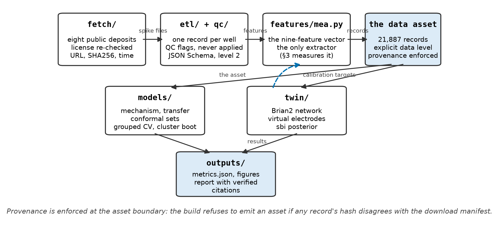{width=100%}

**What it is not.** NeuroMPS is not an automated screening platform, and it does not predict whether
an uncharacterized compound is safe or effective. Several of our most useful results are negative:
they show that a measurement does not contain a signal people routinely assume it does. We treat
those results (§18) as a core deliverable, not as an apology.

## 2. The data

Our asset holds 21,887 records <!-- metrics.json: data_asset.n_records --> from eight public
sources. They are not all the same kind of record, and that difference matters more than the count.

| what the record holds | record count | what you can do with it |
|---|---|---|
| spike times | 1,512 <!-- metrics.json: data_asset.counts.by_data_level.spike_times --> | recompute any feature from scratch with our common code |
| fitted dose-response curves | 20,375 <!-- metrics.json: data_asset.counts.by_data_level.fitted_curve --> | read a potency estimate that another laboratory fitted |

We require every record in our dataset to explicitly declare its data type. While that might sound
like routine bookkeeping, it directly protects our pipeline: virtually all of our predictive
modeling and twin calibration rely solely on spike-time recordings, because only those can pass
through our unified feature extractor. If we had simply lumped the two record types together into a
single table, the dataset would look twenty times larger — but it would be twenty times less useful
to us.

**The species imbalance.** By species, our asset holds 21,530 rat
<!-- metrics.json: data_asset.counts.by_species.rat --> and 357 human
<!-- metrics.json: data_asset.counts.by_species.human --> records. This imbalance is the single
biggest limitation of the project, and no amount of clever coding can fix it: it reflects what is
publicly available under licenses that permit reuse. Rather than hide it, we treat it as an explicit
boundary whenever we test species transfer.

**The case that tested our rules.** One dataset (Tukker 2020) was an ideal scientific fit, and we
still excluded it. It is licensed CC BY-NC, and the competition rules give the organizing committee
joint ownership of entries — a right that a non-commercial license does not allow us to grant. We
record the exclusion and its reason in `data/raw/MANIFEST.json`, next to the sources we accepted,
instead of letting the dataset quietly disappear. We mention it because you should be able to check
that our license discipline is real rather than claimed: every source re-checks its license at fetch
time, and the build stops if any checksum disagrees with the manifest.

---

# ACT II: Standardizing the mess and benchmarking real biology

## 3. Are two laboratories' numbers actually comparable?

The whole dataset rests on this question, so we tested it instead of assuming it. One module,
`features/mea.py`, computes all nine features directly from spike times: mean firing rate, burst
rate, burst duration, spikes per burst, percentage of spikes in bursts, network burst rate,
synchrony index, the coefficient of variation of inter-spike intervals, and the number of active
electrodes.

We detect bursts with a stated rule — spikes closer than 100 ms, at least five in a row — rather than
a vendor default. For synchrony we use the spike-time tiling coefficient (STTC) with a 50 ms
coincidence window. Unlike a plain correlation, STTC does not reward two electrodes just for both
being busy.

**The benchmark.** Kapucu and colleagues deposited their own feature tables alongside their spike
files, computed with `meaRtools`. That gave us an independent implementation to test against: we ran
our code over their spikes and compared the results across 336 recordings
<!-- metrics.json: extractor_agreement.n_recordings --> on 3 plates
<!-- metrics.json: extractor_agreement.n_plates -->, 2,298 paired values
<!-- metrics.json: extractor_agreement.n_paired_values --> in total. We consider this the most
important methodological result in the report, so here it is, plainly.

| feature | rank agreement (ρ) | value ratio (ours / theirs) | practical consequence |
|---|---|---|---|
| `synchrony_index` | 0.9839 <!-- metrics.json: extractor_agreement.by_feature.synchrony_index.spearman_rho --> | 0.736 <!-- metrics.json: extractor_agreement.by_feature.synchrony_index.median_ratio_ours_over_theirs --> | ranks match; our STTC is about a quarter lower |
| `mfr_hz` | 0.9831 <!-- metrics.json: extractor_agreement.by_feature.mfr_hz.spearman_rho --> | 0.7539 <!-- metrics.json: extractor_agreement.by_feature.mfr_hz.median_ratio_ours_over_theirs --> | ranks match; baseline firing rate scaled differently |
| `active_electrodes` | 0.9763 <!-- metrics.json: extractor_agreement.by_feature.active_electrodes.spearman_rho --> | 1.3624 <!-- metrics.json: extractor_agreement.by_feature.active_electrodes.median_ratio_ours_over_theirs --> | ranks match; our activity cutoff is more inclusive |
| `pct_spikes_in_bursts` | 0.9703 <!-- metrics.json: extractor_agreement.by_feature.pct_spikes_in_bursts.spearman_rho --> | 0.9864 <!-- metrics.json: extractor_agreement.by_feature.pct_spikes_in_bursts.median_ratio_ours_over_theirs --> | reproduces on both axes |
| `spikes_per_burst` | 0.9167 <!-- metrics.json: extractor_agreement.by_feature.spikes_per_burst.spearman_rho --> | 0.9418 <!-- metrics.json: extractor_agreement.by_feature.spikes_per_burst.median_ratio_ours_over_theirs --> | close numerical agreement |
| `burst_rate_per_min` | 0.8907 <!-- metrics.json: extractor_agreement.by_feature.burst_rate_per_min.spearman_rho --> | 0.4423 <!-- metrics.json: extractor_agreement.by_feature.burst_rate_per_min.median_ratio_ours_over_theirs --> | disagrees twofold, purely from definition |
| `burst_duration_s` | 0.7926 <!-- metrics.json: extractor_agreement.by_feature.burst_duration_s.spearman_rho --> | 0.8189 <!-- metrics.json: extractor_agreement.by_feature.burst_duration_s.median_ratio_ours_over_theirs --> | the weakest rank agreement of the seven |

{width=100%}

Read the two columns separately. The left one asks "do we rank recordings the same way?", and the
right one asks "do we get the same number?" Only one feature passes both tests. Three rank
recordings almost identically but on a different scale. And the burst measures disagree about
*which* recordings burst more: `burst_rate_per_min` differs by more than a factor of two.

**What this means.** Inside our dataset, comparisons are safe, because one code path produced every
number. Across papers they are not: "bursts per minute" from two laboratories can differ twofold from
the algorithm definitions alone, before any biology enters the picture. That is exactly why we
recompute everything from raw spikes instead of pooling published summary tables.

## 4. The three questions we asked the data

Every model in this report works on changes, not on static states. We pair each treated well with
its own pre-treatment baseline, and the model sees the log2 fold-change of each feature between the
two. This is the most consequential design decision in our analysis, and we made it for the same
reason an experimenter would: cultures differ enormously from one another. If one culture fires at
4 Hz and another at 8 Hz, that tells you about the cultures. If a culture drops from 8 Hz to 4 Hz
after a compound goes in, that is a pharmacological response.

For each feature, measured in the same well before and during exposure, the model sees

::: equation
Δ = log~2~(*x*~exposure~ / *x*~baseline~)
:::

so every halving or doubling moves Δ by one unit, whatever the culture's starting rate. A well that
falls silent is floored at one twentieth of its baseline, so abolished activity stays a finite
number, and a zero baseline leaves the ratio undefined rather than inventing a value for it.

1. **Mechanism.** Given the change in the nine features, can we tell which class of compound caused
   it — GABA-A antagonist, sodium-channel blocker, glutamatergic antagonist, and so on?
2. **Detection.** Can a model trained on one laboratory's data flag a known compound in a different
   laboratory's recordings?
3. **Platform contrast.** Does the same mechanism look the same on two different platforms?

**Two rules we never break**, and they are why our scores look lower than many published ones.
First, *we split strictly by culture*: wells from the same culture never end up on both sides of a
training/testing split. Wells within a culture are near-copies of each other, so splitting them would
let a model score well just by recognizing the culture — like seeing the exam questions in advance.
Second, *we resample uncertainty over cultures, not rows*: every interval is a cluster bootstrap over
whole cultures. With 73 pairs from 50 cultures, treating each row as independent would produce
intervals about half as wide — and wrong.

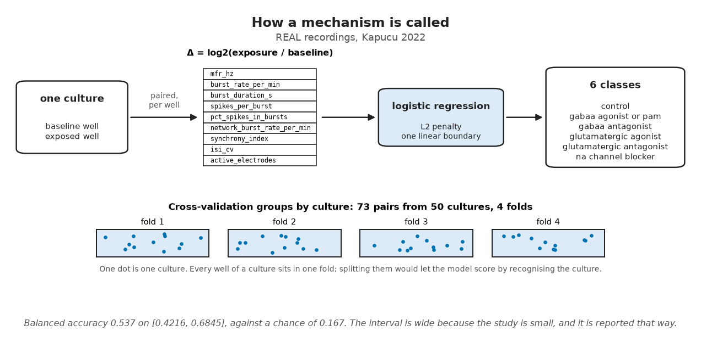{width=100%}

---

## 5. Can you read a mechanism from the features?

Within one platform, we worked with 73 treated/baseline pairs
<!-- metrics.json: mechanism_baselines.task1_within_platform.n_pairs --> from 50 cultures
<!-- metrics.json: mechanism_baselines.task1_within_platform.n_groups --> across six mechanism classes (Kapucu 2022):

| model | balanced accuracy | 95% bootstrap CI | operational note |
|---|---|---|---|
| always guess commonest class | 0.167 <!-- metrics.json: mechanism_baselines.task1_within_platform.models.dummy_most_frequent.balanced_accuracy_mean --> | — | theoretical chance across 6 classes |
| gradient boosting | 0.398 <!-- metrics.json: mechanism_baselines.task1_within_platform.models.gradient_boosting.balanced_accuracy_mean --> | 0.2762 to 0.5178 <!-- metrics.json: mechanism_baselines.task1_within_platform.models.gradient_boosting.balanced_accuracy_ci95.1 --> | expressive model over-fits 73 examples |
| logistic regression (L2) | **0.537** <!-- metrics.json: mechanism_baselines.task1_within_platform.models.logistic_regression.balanced_accuracy_mean --> | 0.4216 to 0.6845 <!-- metrics.json: mechanism_baselines.task1_within_platform.models.logistic_regression.balanced_accuracy_ci95.1 --> | simpler linear boundary generalizes best |

Balanced accuracy averages the recall of each class, so a model cannot win just by getting the most
common class right. Three things stand out. First, there is real signal: the model calls roughly half
the mechanisms correctly where chance is 0.167
<!-- metrics.json: mechanism_baselines.task1_within_platform.chance_balanced_accuracy -->, and the
interval clears chance. Second, the interval is wide, because 73 pairs from 50 cultures is a small
study, and we show that openly. Third, the simpler model wins decisively. When a flexible model loses
to a linear one by fourteen points, the honest reading is that our dataset is small, not that
boosting is bad.

The errors are not random either. They cluster between the two GABA-A classes, antagonists and
positive modulators, which makes chemical sense given how both act on the excitatory/inhibitory
balance.

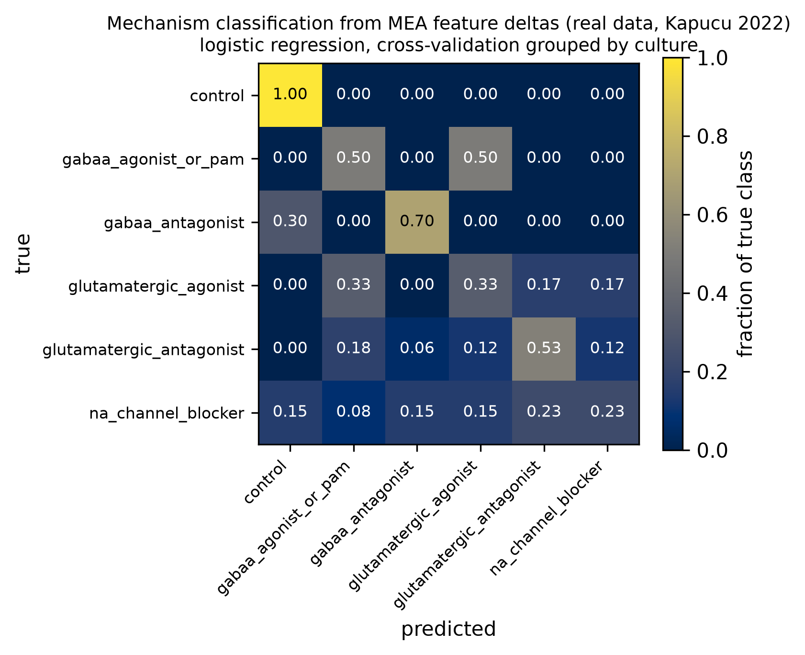{width=72%}

**The same task, refit in a second laboratory.** `vassallo2017` comes from a different laboratory
and a different vendor, with six compounds Kapucu never used, and each baseline sits on the same chip
as its doses: 171 pairs <!-- metrics.json: mechanism_baselines.task1b_independent_platform.n_pairs --> over 26 chips
<!-- metrics.json: mechanism_baselines.task1b_independent_platform.n_groups --> in four classes. We
refit the same pipeline there from scratch, training and testing inside that source with the same
grouped cross-validation. Logistic regression reaches 0.333
<!-- metrics.json: mechanism_baselines.task1b_independent_platform.models.logistic_regression.balanced_accuracy_mean --> against a
chance of 0.25 <!-- metrics.json: mechanism_baselines.task1b_independent_platform.chance_balanced_accuracy -->, on an interval of 0.2317 to
0.4204 <!-- metrics.json: mechanism_baselines.task1b_independent_platform.models.logistic_regression.balanced_accuracy_ci95.1 --> that includes
chance.

These two results are not a before and after. They are different problems — six classes against
four, different compounds, and therefore different chance levels — so the only fair comparison is
each against its own baseline. Kapucu clears its chance of 0.167
<!-- metrics.json: mechanism_baselines.task1_within_platform.chance_balanced_accuracy --> more than
threefold; Vassallo clears its own by about a third, and its interval does not exclude chance. So
mechanism signal is not a quirk of the one dataset we built the method around, but it is much weaker
in the second laboratory. Note that nothing is transferred here: both models are trained and tested
inside their own laboratory. We test transfer itself — a model trained in one laboratory and applied
to another — in §6 and at the end of this section.

**Why we never pooled the platforms.** Pooling is tempting, and it would have produced a
better-looking number. It would also have been meaningless. Across the full pool, the label alone
determines the source for 97.35% of pairs
<!-- metrics.json: mechanism_baselines.label_source_confounding.source_determined_by_label -->, and
6 <!-- metrics.json: mechanism_baselines.label_source_confounding.n_labels_from_one_source_only --> of the 9 mechanism classes
<!-- metrics.json: mechanism_baselines.label_source_confounding.n_labels --> appear in only one
source. A pooled classifier would score well simply by learning which laboratory a recording came
from.

**The structural reason, and a test built around it.** The obstacle is even sharper than that
percentage suggests: the largest number of classes that any two laboratories share is 1
<!-- metrics.json: cross_lab_transfer.max_classes_shared_by_any_two_laboratories -->, and a
classifier needs at least two classes to tell apart. That means we cannot run
leave-one-laboratory-out cross-validation here at all.

What we can build is a deliberately confounded test. Three classes appear in more than one source,
and all three appear in Kapucu. We train there on 20 pairs <!-- metrics.json: cross_lab_transfer.n_train --> and test
on the other laboratories' versions of the same three classes, 535 pairs
<!-- metrics.json: cross_lab_transfer.n_test -->. In that test set, each class comes from exactly one
laboratory — a correspondence of 1.0 <!-- metrics.json: cross_lab_transfer.label_source_correspondence --> — so in
this test, class and laboratory cannot be told apart. A high score would have been ambiguous: it
could mean the model read the pharmacology, or only that each laboratory's recordings look
different. A score at chance has one reading: neither the mechanism signal learned in Kapucu nor
any laboratory difference carried the classes across. That is why we built the test so that only a
**low** score is interpretable.

The model scores 0.3482 <!-- metrics.json: cross_lab_transfer.balanced_accuracy -->, 95% CI [0.278, 0.4082]
<!-- metrics.json: cross_lab_transfer.balanced_accuracy_ci95 -->, against a chance of 0.3333
<!-- metrics.json: cross_lab_transfer.chance -->. That is indistinguishable from guessing: what the
model learned in one laboratory did not carry to the others.

**The control that makes it mean something.** Twenty training pairs is not many, so the failure
could come from sample size rather than from the change of laboratory. To check, we scored the same
classes and the same 20 pairs *inside* Kapucu with grouped cross-validation, which gives 0.5833
<!-- metrics.json: cross_lab_transfer.within_source_control.balanced_accuracy -->. Same data, same
size: the model learns something when it stays in one laboratory and nothing when it crosses into
another.

## 6. External detection, and the negative control that matters more

Can a model trained on Kapucu's plate flag bicuculline in ScreenNeuroPharm's chambers — a different
laboratory, and a different compound from the same mechanism class? Across 497 recordings
<!-- metrics.json: mechanism_baselines.task2_external_detection.screenneuropharm_bicuculline.n -->, it calls
"GABA-A antagonist" 36.6% of the time
<!-- metrics.json: mechanism_baselines.task2_external_detection.screenneuropharm_bicuculline.detection_rate -->.
There are two ways to read that, and only one is right. It is far above the rate at which that class
would appear by chance, so something does transfer. But it is not an autonomous detector, because
two-thirds of the time it says something else.

**The negative control.** What makes that first number trustworthy is the control. On Sharf's
diazepam recordings — a GABA-A positive modulator, the opposite pharmacology — the same model calls
"antagonist" only 7.7% of the time
<!-- metrics.json: mechanism_baselines.task2_external_detection.sharf_diazepam_negative_control.detection_rate -->.
A model that simply shouted "GABA-A antagonist" at anything unusual would have fired on both. Ours
does not.

**Detection does not track dose.** Within the bicuculline series, detection probability shows no
relationship with dose: Spearman ρ = −0.059
<!-- metrics.json: mechanism_baselines.task2_external_detection.screenneuropharm_bicuculline.dose_spearman -->, p = 0.189
<!-- metrics.json: mechanism_baselines.task2_external_detection.screenneuropharm_bicuculline.dose_spearman_p -->.
Mechanism and dose are different questions, and this model only answers the first. The recordings
do carry a dose signal, as §18 shows; a classifier built to tell mechanisms apart does not read it.

## 7. Rat to human

The whole promise of organ-on-a-chip work is that a human preparation tells you something a rodent
one cannot. So we trained on rat and tested on human, using only the five mechanism classes present
in both.

| transfer setting | balanced accuracy | chance | empirical finding |
|---|---|---|---|
| rat, tested within rat | 0.543 <!-- metrics.json: species_transfer.transfer.none.rat_within.balanced_accuracy --> | 0.2 | rodent primary culture baseline |
| human, tested within human | 0.646 <!-- metrics.json: species_transfer.transfer.none.human_within.balanced_accuracy --> | 0.2 | human iPSC model evaluation |
| **rat → human, no adaptation** | **0.55** <!-- metrics.json: species_transfer.transfer.none.rat_to_human.balanced_accuracy --> | 0.2 <!-- metrics.json: species_transfer.transfer.none.chance_balanced_accuracy --> | transfers without loss; permutation p = 0.0002 <!-- metrics.json: species_transfer.transfer.none.rat_to_human.permutation_p --> |
| rat → human, CORAL | 0.442 <!-- metrics.json: species_transfer.transfer.coral.rat_to_human.balanced_accuracy --> | 0.2 | covariance alignment erodes biological signal |
| rat → human, standardized | 0.408 <!-- metrics.json: species_transfer.transfer.standardize.rat_to_human.balanced_accuracy --> | 0.2 | per-species normalization degrades toward chance |

The transfer is real, not luck, and two things stand out. First, rat → human (0.55
<!-- metrics.json: species_transfer.transfer.none.rat_to_human.balanced_accuracy -->) is *not* worse
than rat tested within rat (0.543
<!-- metrics.json: species_transfer.transfer.none.rat_within.balanced_accuracy -->): mechanism
information crosses the species boundary about as well as it crosses between cultures within rat.
Second, **both domain-adaptation methods made it worse.** These are the standard tools for this
problem, but here they removed real signal rather than distribution shift — which is what happens
when a method designed for thousands of samples meets 37 rat training pairs
<!-- metrics.json: species_transfer.transfer.none.rat_to_human.n_train --> and 32 human testing pairs
<!-- metrics.json: species_transfer.transfer.none.rat_to_human.n_test -->. We report the unadapted
number as our result, with the adapted ones beside it, rather than picking whichever was highest.

## 8. Which features are actually doing the work?

If the nine-feature vector were doing nine distinct jobs, dropping most of it should hurt. It does
not.

| evaluated feature subset | balanced accuracy | included features |
|---|---|---|
| the two rate features only | **0.53** <!-- metrics.json: uncertainty_and_ablations.feature_subsets.rate_only.balanced_accuracy_mean --> | `mfr_hz`, `burst_rate_per_min` |
| species-invariant subset | 0.516 <!-- metrics.json: uncertainty_and_ablations.feature_subsets.species_invariant.balanced_accuracy_mean --> | features stable across untreated species baselines |
| all nine features | 0.514 <!-- metrics.json: uncertainty_and_ablations.feature_subsets.all.balanced_accuracy_mean --> | the full biophysical complement |
| synchrony only | 0.455 <!-- metrics.json: uncertainty_and_ablations.feature_subsets.synchrony_only.balanced_accuracy_mean --> | `synchrony_index` (STTC) |
| firing rate only | 0.442 <!-- metrics.json: uncertainty_and_ablations.feature_subsets.mfr_only.balanced_accuracy_mean --> | `mfr_hz` |
| network features only | 0.417 <!-- metrics.json: uncertainty_and_ablations.feature_subsets.network_only.balanced_accuracy_mean --> | `network_burst_rate_per_min`, `synchrony_index` |
| burst features only | 0.411 <!-- metrics.json: uncertainty_and_ablations.feature_subsets.burst_only.balanced_accuracy_mean --> | `burst_duration_s`, `spikes_per_burst`, `pct_spikes_in_bursts` |

The two rate features alone do at least as well as all nine. The intervals overlap heavily, so we do
not claim that rate-only is better; what we can say is that the other seven features add nothing we
can detect at this sample size. That matters in practice, because the burst and synchrony
measures — the very features that differ most between laboratories (§3) — are also the ones carrying
the least mechanism information here.

**Validation on sensory neurons.** Because rate alone looked sufficient, we could bring in a source
that reports only firing rates: `fofie2025`, human iPSC-derived sensory neurons, 291 pairs
<!-- metrics.json: rate_only_arm.n_pairs --> from 48 wells <!-- metrics.json: rate_only_arm.n_groups -->. Training on
Kapucu's cortical rate changes and testing on these sensory neurons gives 0.5012
<!-- metrics.json: rate_only_arm.across_sources.balanced_accuracy --> against a chance of 0.3333
<!-- metrics.json: rate_only_arm.across_sources.chance -->, using a single feature and a preparation
with a completely different neuronal identity. What the two sources share is the compound's
mechanism, not the preparation or the network <!-- metrics.json: rate_only_arm.caveat -->.

## 9. How confident is the model, really?

**Calibration.** When the model says 70%, is it right 70% of the time? Our expected calibration error
is 0.1114 <!-- metrics.json: mechanism_baselines.task1_within_platform.calibration.ece --> on 73 points
<!-- metrics.json: mechanism_baselines.task1_within_platform.calibration.n -->, with a bootstrap interval reaching 0.2557
<!-- metrics.json: mechanism_baselines.task1_within_platform.calibration.ece_ci95.1 -->. That upper
end is large. We would treat the predicted probabilities as a ranking, not as a risk — and not even
as a reliable ranking above 0.8
<!-- metrics.json: mechanism_baselines.task1_within_platform.calibration.bins.8.lower --> confidence,
where observed accuracy actually falls.

**Conformal sets.** Instead of a single answer, a conformal predictor returns a set of classes that
is guaranteed to contain the truth a stated fraction of the time. When we ask for 95%, empirical
coverage is 0.918
<!-- metrics.json: uncertainty_and_ablations.conformal_sweep.0.empirical_coverage --> and the average set holds 4.562
<!-- metrics.json: uncertainty_and_ablations.conformal_sweep.0.mean_set_size --> of the six classes.
A set of four or five classes out of six is honest and nearly useless — which is the right answer for
73 calibration points. A method that promised 95%
<!-- metrics.json: uncertainty_and_ablations.conformal_sweep.0.target_coverage --> coverage with
narrow sets on this much data would
be doing something wrong.

## 10. Untreated baselines: what differs before a drug is added

Let's set pharmacology aside for a moment. If we take untreated recordings and ask what separates rat
from human, and dissociated cultures from organoids, the features consistently fall into two groups
across three separate analyses. Rate-like features stay fairly stable across species, while synchrony
and burst-structure features move the most. Those same features differ most between baselines, carry
the least mechanism information (§8), and are the least reproducible across software (§3).

That three-way agreement is the most actionable result here for experimental design: the burst and
synchrony family is where you will have the most trouble, from three independent directions at once.

One analysis disagrees, and we kept it. The platform contrast (§11) finds that for the *same*
mechanism on two platforms, mean firing rate reverses sign while synchrony agrees. So three analyses
say synchrony is the unreliable family, and one says it is the reliable one. We do not resolve that
tension; we report it.

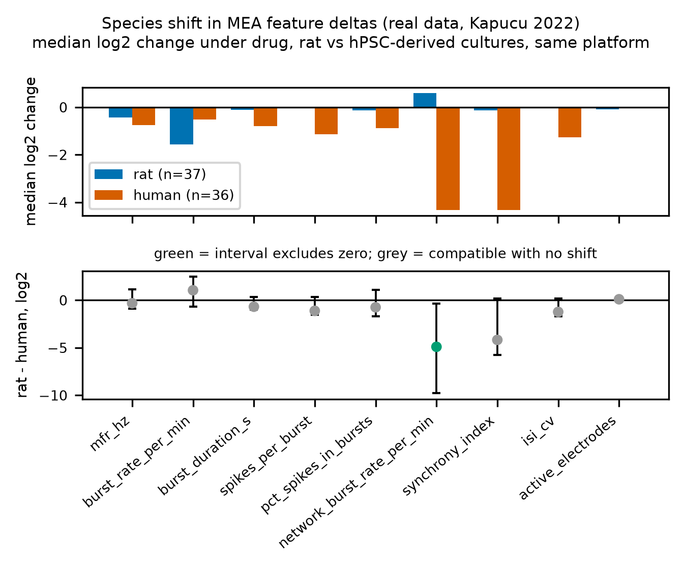{width=61%}

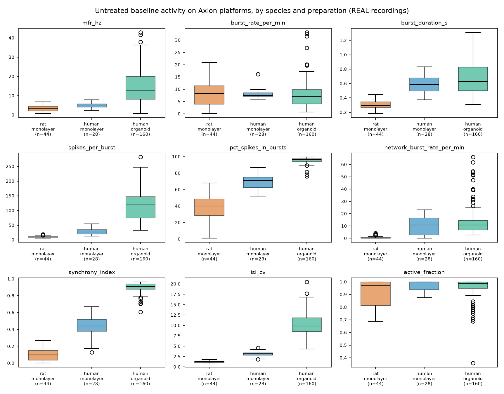{width=75%}

## 11. The cross-platform reversal paradox

We compared GABA-A antagonists at 30 µM
<!-- metrics.json: mechanism_baselines.task3_platform_contrast.min_dose_uM --> and above on two
platforms: Kapucu's gabazine and ScreenNeuroPharm's bicuculline. Mean firing rate goes **up** on one
platform and **down** on the other, while synchrony moves the same way on both.

If you take away one thing from this report about cross-laboratory comparison, make it this: the
mechanism is identical, yet the direction of the most commonly reported endpoint is not. Anyone
pooling MEA pharmacology on the assumption that "GABA-A antagonists raise firing rate" would get it
backwards half the time.

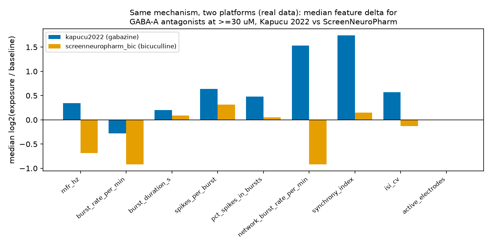{width=58%}

---

# ACT III: Calibrating a biophysical digital twin

## 12. The digital twin: what it is, and what it is for

Our digital twin is a simulated culture, not a statistical surrogate. It has two compartments of
model neurons — 80% excitatory, 20% inhibitory, each a leaky integrate-and-fire neuron with
spike-frequency adaptation — wired densely within each compartment and sparsely between them through
a directional pathway. Virtual electrodes sit over the sheet and "hear" neurons within a set radius,
and their spike trains go through the same `features/mea.py` that the real recordings use. That last
point is a deliberate constraint: the twin cannot look good by being measured differently.

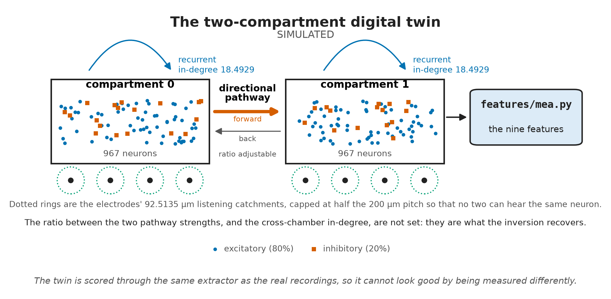{width=100%}

**What the twin is for.** It lets us test scenarios that are expensive or impractical to try at the
bench. How many electrodes, and how much recording time, do you need to detect an effect? What
happens to the readout if axonal projections become twice as directional? And, most fundamentally, is
the metric you are tracking even capable of answering your question?

**What calibration means here.** We are not fitting the twin to reproduce one culture — that would
simply be overfitting to that culture. Instead, we ask it to land inside the interquartile band of 48
real chamber baselines
<!-- metrics.json: twin_hd12_calibration.targets_real.n_records --> from rat two-chamber devices. In
other words, we want it to be an unremarkable member of the population, not a copy of one member.

## 13. Calibration

We ran a random search over 9 parameters <!-- metrics.json: twin_hd12_calibration.tuned_parameters -->,
scoring each candidate on 2 network seeds <!-- metrics.json: twin_hd12_calibration.n_seeds_per_draw --> across 160 draws
<!-- metrics.json: twin_hd12_calibration.n_draws -->. None of the chosen values sits on the edge of
the range it was drawn from, so the optimum is genuinely inside the search space rather than clipped
at a boundary
<!-- metrics.json: twin_hd12_calibration.boundary_hits -->.

| feature | simulated twin value | real band (IQR) | calibration result |
|---|---|---|---|
| `synchrony_index` (STTC) | 0.8387 <!-- metrics.json: twin_hd12_calibration.best.features_simulated.synchrony_index --> | 0.678 to 0.843 <!-- metrics.json: twin_hd12_calibration.targets_real.by_feature.synchrony_index.q75 --> | inside target band |
| `burst_rate_per_min` | 22.9219 <!-- metrics.json: twin_hd12_calibration.best.features_simulated.burst_rate_per_min --> | 12.627 to 29.726 <!-- metrics.json: twin_hd12_calibration.targets_real.by_feature.burst_rate_per_min.q75 --> | inside target band |
| `network_burst_rate_per_min` | 24.0 <!-- metrics.json: twin_hd12_calibration.best.features_simulated.network_burst_rate_per_min --> | 11.692 to 22.697 <!-- metrics.json: twin_hd12_calibration.targets_real.by_feature.network_burst_rate_per_min.q75 --> | minor overshoot |
| `mfr_hz` | 5.9862 <!-- metrics.json: twin_hd12_calibration.best.features_simulated.mfr_hz --> | 6.793 to 21.007 <!-- metrics.json: twin_hd12_calibration.targets_real.by_feature.mfr_hz.q75 --> | minor undershoot |
| `pct_spikes_in_bursts` | 83.8409 <!-- metrics.json: twin_hd12_calibration.best.features_simulated.pct_spikes_in_bursts --> | 84.657 to 93.685 <!-- metrics.json: twin_hd12_calibration.targets_real.by_feature.pct_spikes_in_bursts.q75 --> | near lower bound |

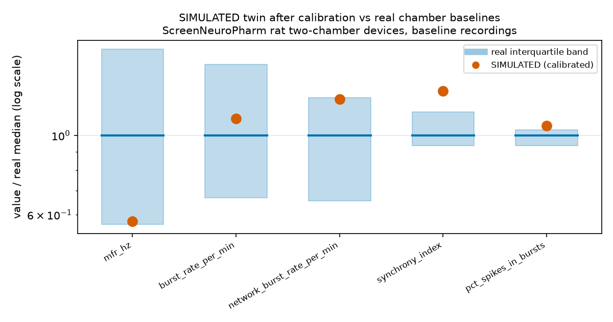{width=58%}

Getting to this table took us longer than anything else, and the story is a warning for anyone who
simulates cultures.

For a long time the twin was far too synchronous — an STTC around 0.96 against a real band topping
out at 0.84 — and it looked as if we were missing a biophysical mechanism. We tried three candidates,
and none of them worked: short-term synaptic depression, varied axonal conduction delays, and
distance-dependent wiring, which actually pushed synchrony the wrong way.

**The real cause was not biophysics; it was cell density and electrode geometry.** Our simulated
chamber held 250 neurons in 1.92 mm², about 130 neurons/mm², whereas a real dissociated culture runs
roughly 1000 to 3000. On top of that, we had let the electrode's listening radius grow larger than
the spacing between electrodes. The oversized electrode compensated for the sparse culture in two
ways at once: it pooled enough neurons to produce a plausible firing rate, and, because neighboring
listening areas overlapped, it counted one neuron's spikes on several electrodes — which inflates
pairwise synchrony by construction, with no biology involved. Once we fixed the density at 967
<!-- metrics.json: twin_hd12_calibration.best.draw.n_per_compartment --> neurons per compartment and
imposed one geometric rule, synchrony landed inside the real band for the first time:

**An electrode's listening radius may not exceed half the electrode pitch, r ≤ p/2.**

On our 200 µm <!-- metrics.json: twin_hd13_perturbation.simulation.layout.pitch_um --> grid, that
rule guarantees that no neuron is heard by two electrodes. The calibrated radius settled at
92.5135 µm <!-- metrics.json: twin_hd12_calibration.best.draw.detection_radius_um -->, inside the
cap. The rule carries over to physical arrays: if an electrode's catchment exceeds half the pitch,
expect synchrony to read high for reasons that have nothing to do with the culture.

**Out-of-sample trust.** The winning parameter set reached a loss of 0.0756
<!-- metrics.json: twin_hd12_calibration.held_out.selection_score --> on its selection seeds. On 5 seeds
<!-- metrics.json: twin_hd12_calibration.held_out.n_seeds --> the search never saw, it scores 0.1994
<!-- metrics.json: twin_hd12_calibration.held_out.score_mean -->, with synchrony holding at 0.7732
<!-- metrics.json: twin_hd12_calibration.held_out.synchrony_index_mean --> ± 0.0685
<!-- metrics.json: twin_hd12_calibration.held_out.synchrony_index_sd --> and inside the band on 60% of seeds
<!-- metrics.json: twin_hd12_calibration.held_out.synchrony_index_in_band_fraction -->. Just like a
real culture, the twin varies enough from run to run that a single simulated recording can fall
outside the band.

## 14. Drug knobs: does the twin respond like a culture?

The twin has three pharmacological knobs: it can scale inhibitory transmission (`gabaa_scale`),
scale excitatory transmission (`ampa_scale`), or raise the spike threshold (`threshold_scale`). We
tested directional validity — does each knob move each feature in the right direction? — and we only
scored features whose real direction is established by a cluster bootstrap.

| pharmacological knob | mechanistic action | directional concordance |
|---|---|---|
| AMPA blockade | downscale excitation | 4 <!-- metrics.json: twin_hd13_perturbation.knobs.2.n_features_agreeing --> / 4 <!-- metrics.json: twin_hd13_perturbation.knobs.2.n_features_scored --> |
| sodium-channel block | elevate spike threshold | 3 <!-- metrics.json: twin_hd13_perturbation.knobs.3.n_features_agreeing --> / 3 <!-- metrics.json: twin_hd13_perturbation.knobs.3.n_features_scored --> |
| GABA-A antagonism | downscale inhibition | 4 <!-- metrics.json: twin_hd13_perturbation.knobs.0.n_features_agreeing --> / 5 <!-- metrics.json: twin_hd13_perturbation.knobs.0.n_features_scored --> |
| GABA-A potentiation | upscale inhibition | 1 <!-- metrics.json: twin_hd13_perturbation.knobs.1.n_features_agreeing --> / 4 <!-- metrics.json: twin_hd13_perturbation.knobs.1.n_features_scored --> |

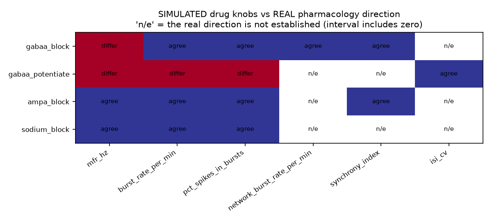{width=59%}

Blocking excitation and blocking sodium channels behave correctly on every scored feature. Blocking
inhibition is mostly right. Potentiating inhibition is mostly wrong — and that is the knob with the
weakest real reference behind it, just 17 pairs from two sources. So the twin is usable for
reasoning about strong, well-evidenced perturbations, but we have not validated it for subtle
allosteric modulation. On a laboratory it had never seen, the EPA's acute MEA screen, the GABA-A block
and sodium-block knobs agree with the positive controls on every scored direction (§33, added
after the first round).

**The twin as a source of labelled training data (added after the first round).** Directions are
one test; recognition is a harder one. We simulated pairs for the five mechanism classes the twin
has a knob for (one chip recorded twice, once with the knob moved; 30 pairs per class), trained the
§5 classifier on those alone, and applied it to the 73 real Kapucu pairs. Registered before the
pairs were simulated (`preregistration/twin_prior_classifier.json`), it reaches a balanced accuracy
of 0.41 <!-- metrics.json: twin_prior_classifier.twin_alone.balanced_accuracy --> (95% interval
0.2808 <!-- metrics.json: twin_prior_classifier.twin_alone.balanced_accuracy_ci95.0 --> to
0.5072 <!-- metrics.json: twin_prior_classifier.twin_alone.balanced_accuracy_ci95.1 -->, culture
bootstrap) where chance is one in six, without seeing a single real label. It never recognises a
sodium-channel blocker, and the reason is size, not direction: the twin's threshold range moves
firing by
−3.273 <!-- metrics.json: twin_prior_classifier.twin_alone.na_channel_blocker_median_deltas.simulated.mfr_hz -->
log2 and silences most electrodes, where the real blockers move it by
−0.795 <!-- metrics.json: twin_prior_classifier.twin_alone.na_channel_blocker_median_deltas.real.mfr_hz -->
with every electrode still active. As a prior for the classifier trained on real pairs, the
simulated pairs add nothing: balanced accuracy goes from
0.537 <!-- metrics.json: twin_prior_classifier.baseline.balanced_accuracy_mean --> to
0.53 <!-- metrics.json: twin_prior_classifier.twin_prior.balanced_accuracy_mean -->, and the
conformal sets do not shrink. Two of the three registered predictions failed. The twin can stand
in for labels where there are none; where real labels exist, it does not improve on them.

---

# ACT IV: Inverting the twin and resolving directionality

## 15. Two-compartment devices, and a result we did not want

The twin models an asymmetric two-compartment chip — the "axon diode" idea, where microchannel
geometry biases which way axons grow. Before simulating it, we asked what real devices actually show.

**Tissue identity drives asymmetry.** Across 16 devices
<!-- metrics.json: compartment_asymmetry.n_devices -->, we measured how asymmetric the coupling
between compartments is. Devices pairing two different tissues (cortex with hippocampus) are more
asymmetric, with a median of 0.138
<!-- metrics.json: compartment_asymmetry.pooled_heterogeneous_vs_homogeneous.median_heterogeneous -->,
than devices pairing a tissue with itself, median 0.094
<!-- metrics.json: compartment_asymmetry.pooled_heterogeneous_vs_homogeneous.median_homogeneous -->, p = 0.042
<!-- metrics.json: compartment_asymmetry.pooled_heterogeneous_vs_homogeneous.p_value -->. What the
chambers contain matters more than the fact that they are connected.

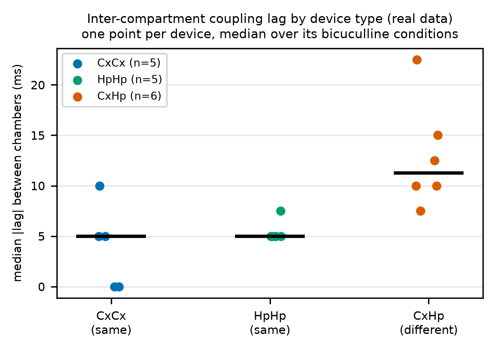{width=56%}

**The directionality null.** One deposit recorded axonal crossings directly inside the tunnels, on
10 cultures <!-- metrics.json: axonal_directionality.n_cultures --> (Brewer 2021). That let us ask
the question a chamber readout exists to answer: if you had only the chamber recordings, could you
tell which way the axons were firing? Using all four chamber-level measures together — coupling
asymmetry, peak correlation, lag and rate imbalance — a classifier reaches a balanced accuracy of
0.3854 <!-- metrics.json: axonal_directionality.chamber_readouts_predict_direction.balanced_accuracy --> against a
chance of 0.5 <!-- metrics.json: axonal_directionality.chamber_readouts_predict_direction.chance -->.
That is worse than guessing. And it is not just a small-sample failure: with this many cultures, the
analysis could have detected a balanced accuracy of 0.6438
<!-- metrics.json: axonal_directionality.chamber_readouts_predict_direction.detectable_balanced_accuracy --> if one
had been there. We could only recover direction by instrumenting the microchannels themselves.

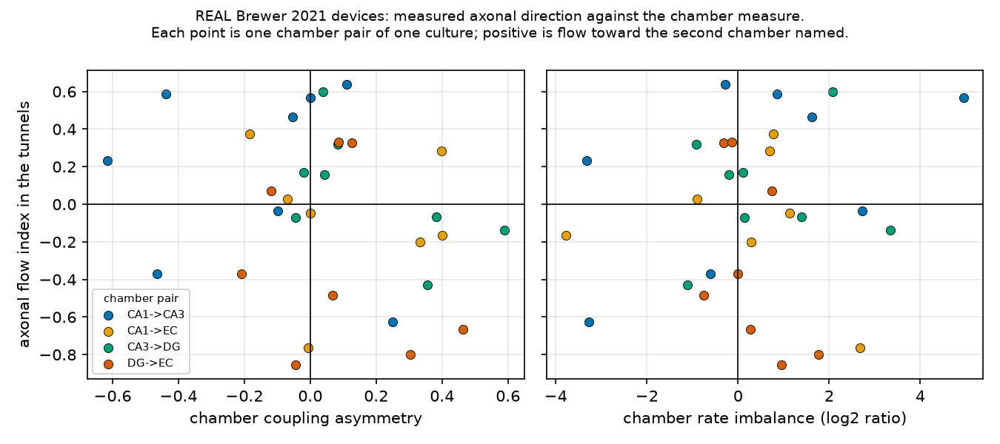{width=100%}

## 16. Running the model backwards, and what that cannot do

The more ambitious use of a twin is to run it backwards: given a recording, infer which knob was
turned. We did this with simulation-based inference, using a neural posterior estimator trained on
3,000 simulations <!-- metrics.json: twin_hd14_inference.n_simulations --> at the calibrated cell
density. Here the twin works as a generator of labelled data: every simulation is a training pair
whose true parameters are known exactly, which no bench experiment can supply.

{width=100%}

The estimator is a masked autoregressive flow, built with the `sbi` library: a stack of 5
<!-- metrics.json: twin_hd14_inference.density_estimator.n_autoregressive_transforms --> autoregressive
transforms with 50 <!-- metrics.json: twin_hd14_inference.density_estimator.hidden_units_per_layer -->
hidden units each, 34,550 <!-- metrics.json: twin_hd14_inference.density_estimator.n_parameters -->
trained weights in all. It learns the joint density of the five parameters given the 19 summary
features, so it returns a full posterior rather than a point estimate, and it never has to run the
simulator again once trained. That is what makes the inference amortized: on 20 held-out
simulations, a posterior of 1,000
<!-- metrics.json: twin_hd14_inference.amortized_inference.posterior_draws --> draws takes a median
of 0.3061 s <!-- metrics.json: twin_hd14_inference.amortized_inference.median_seconds_per_posterior -->
on our workstation, against 6.69 s
<!-- metrics.json: twin_hd14_inference.amortized_inference.forward_simulation_seconds --> for one
10-second run of the simulator, which a method that simulates afresh for every recording would need
many times over. That speed holds for recordings the twin can produce; for those it cannot,
sampling stalls, which is the refusal described below.

The same generator could in principle pre-train models for assays where real data are scarce, such
as human iPSC cultures, but only once the twin is calibrated for them. Today it is calibrated on rat
devices and sits inside the real band on two of five features, so we have not done this.

Before we trust any posterior, we run two honesty checks.

| model parameter | biophysical role | posterior contraction | KS calibration (p) | uniformity status |
|---|---|---|---|---|
| `threshold_scale` | action-potential threshold | 0.661 <!-- metrics.json: twin_hd14_inference.contraction.threshold_scale.contraction --> | 0.6105 <!-- metrics.json: twin_hd14_inference.rank_uniformity_ks_p.threshold_scale.ks_p --> | well calibrated |
| `ampa_scale` | excitatory synaptic weight | 0.599 <!-- metrics.json: twin_hd14_inference.contraction.ampa_scale.contraction --> | 0.3128 <!-- metrics.json: twin_hd14_inference.rank_uniformity_ks_p.ampa_scale.ks_p --> | well calibrated |
| `log10_forward_ratio` | axonal pathway asymmetry | 0.438 <!-- metrics.json: twin_hd14_inference.contraction.log10_forward_ratio.contraction --> | 0.1517 <!-- metrics.json: twin_hd14_inference.rank_uniformity_ks_p.log10_forward_ratio.ks_p --> | well calibrated |
| `gabaa_scale` | inhibitory synaptic weight | 0.3 <!-- metrics.json: twin_hd14_inference.contraction.gabaa_scale.contraction --> | 0.0174 <!-- metrics.json: twin_hd14_inference.rank_uniformity_ks_p.gabaa_scale.ks_p --> | **over-confident** |
| `inter_in_degree` | cross-chamber connectivity | 0.269 <!-- metrics.json: twin_hd14_inference.contraction.inter_in_degree.contraction --> | 0.0121 <!-- metrics.json: twin_hd14_inference.rank_uniformity_ks_p.inter_in_degree.ks_p --> | **over-confident** |

Contraction measures how much narrower the posterior is than the prior; 0 means the model learned
nothing. Rank uniformity asks whether the stated intervals are honest. Three knobs pass. Inhibitory
transmission does not — and it is the knob our pharmacology sections depend on, so **we do not quote
its intervals as calibrated.** Before the density correction (§13), no parameter passed and a fifth of
our simulations were silent; now 0
<!-- metrics.json: twin_hd14_inference.fraction_silent_simulations --> are. Simulating at the
calibrated density brought three knobs into calibration. Appendix G shows the full rank histograms.

**The false-disinhibition artifact.** When we applied the model to real untreated chips, it returned
an inferred inhibition scale of 0.5219
<!-- metrics.json: twin_hd15_real_inference.gabaa_scale_at_baseline.median --> on an interval of 0.2732 to 0.8503
<!-- metrics.json: twin_hd15_real_inference.gabaa_scale_at_baseline.median_ci95.1 --> — apparent
disinhibition in wells that had received no drug. That is not biology. It is the model's way of
saying "real recordings do not look like my simulations," in the only vocabulary it has. When we
reformulated inference around paired deltas, untreated chips moved to 0.9108
<!-- metrics.json: twin_hd17_delta_inference.real_data.gabaa_scale_at_baseline.median --> on 0.8583 to 0.966
<!-- metrics.json: twin_hd17_delta_inference.real_data.gabaa_scale_at_baseline.median_ci95.1 -->, and
contraction rose to 0.5375 <!-- metrics.json: twin_hd17_delta_inference.held_out_checks.contraction -->.
Most of the offset disappears, but not all of it: the interval still stops short of neutral.

**Out-of-distribution rejection.** We asked for 200 draws
<!-- metrics.json: demo_precompute.posterior_draws.requested --> per recording across 113
<!-- metrics.json: demo_precompute.posterior_draws.n_recordings --> bicuculline trials, and the
posterior could not deliver them for 9
<!-- metrics.json: demo_precompute.posterior_draws.n_short_of_requested --> of those recordings; the
worst yielded only 1 <!-- metrics.json: demo_precompute.posterior_draws.fewest_draws --> draw, and 0
<!-- metrics.json: demo_precompute.posterior_draws.n_unsampled --> failed outright. This only appeared
once the twin moved to its calibrated density: a posterior fitted to a sharper forward model is less
forgiving of observations that model cannot produce. In effect the posterior carries a built-in
out-of-distribution flag: a recording it cannot sample from is one the twin cannot produce, and in
high-content screening that recording should go to a person rather than get a forced answer. We
have not measured how well this flag separates genuine anomalies from ordinary recordings, so we
report it as a behavior, not as a validated detector.

## 17. What it takes to see directionality at all

One thing a twin is genuinely good at is telling you how much experiment you need. Across 120
simulated networks <!-- metrics.json: twin_hd16_directionality.n_networks --> with known wiring, the
cheapest configuration that reaches our target distinguishes asymmetric from symmetric wiring with an
AUC of 0.8928
<!-- metrics.json: twin_hd16_directionality.cheapest_configuration.free_rate_all_features.auc -->,
using 24 electrodes per compartment
<!-- metrics.json: twin_hd16_directionality.cheapest_configuration.free_rate_all_features.electrodes_per_compartment -->
and a 10-second recording
<!-- metrics.json: twin_hd16_directionality.cheapest_configuration.free_rate_all_features.duration_s -->.

**The hidden catch.** Most of that signal is firing rate, not direction. A directional pathway
delivers more excitation to its target chamber, so the target simply fires more. If we lower the
receiving chamber's background drive, measured coupling asymmetry moves from 0.109
<!-- metrics.json: twin_hd11_validation.directionality_sweep.0.asymmetry_mean --> to 0.681
<!-- metrics.json: twin_hd11_validation.directionality_sweep.2.asymmetry_mean --> with the wiring
unchanged. Across the sweep, drive moves the measure further than wiring does: a span of 0.671
<!-- metrics.json: twin_hd11_validation.confound_summary.raw.drive_span --> against 0.109
<!-- metrics.json: twin_hd11_validation.confound_summary.raw.wiring_span -->. Regress firing rate
out of the features, inside each training fold, and the cheapest configuration doubles to 48
<!-- metrics.json: twin_hd16_directionality.cheapest_configuration.free_rate_residualized.electrodes_per_compartment -->
electrodes per compartment. Twenty-four electrodes and ten seconds will tell these cultures apart,
but claiming that this reflects directional communication requires explicit rate-matching controls.

---

# ACT V: The negative results and scientific boundaries

## 18. Collection of negative results

Negative results are easy to miss when they are scattered through a long report. Collected in one
place, they are the part of our work we would most like to see challenged — and the part most likely
to save someone else an experiment. Each one tells you what not to rely on, so the last column says
what we would do instead.

| # | finding | evidence | what to do instead |
|---|---|---|---|
| 1 | the twin misses a dose trend the features carry | 2 <!-- metrics.json: feature_dose_response.verdict.n_features_moving_absolute --> of 7 <!-- metrics.json: feature_dose_response.absolute.n_features_tested --> features fall with dose; inferred inhibition does not (ρ = −0.121 <!-- metrics.json: twin_hd15_real_inference.gabaa_scale_dose_trend.spearman_rho -->) | read dose from burst rates against each device's own baseline; do not use the twin's dose inference until it recovers that trend |
| 2 | chamber readouts miss direction | chamber classifier 0.3854 <!-- metrics.json: axonal_directionality.chamber_readouts_predict_direction.balanced_accuracy --> against 0.5 chance | put electrodes inside the microchannels |
| 3 | no cross-laboratory transfer | 0.3482 <!-- metrics.json: cross_lab_transfer.balanced_accuracy --> against 0.3333 <!-- metrics.json: cross_lab_transfer.chance --> chance | validate inside one laboratory; a cross-laboratory test needs two laboratories sharing at least two classes |
| 4 | domain adaptation backfires | CORAL drops transfer to 0.442 <!-- metrics.json: species_transfer.transfer.coral.rat_to_human.balanced_accuracy -->, standardization to 0.408 <!-- metrics.json: species_transfer.transfer.standardize.rat_to_human.balanced_accuracy --> | report the unadapted transfer first; adapt only once it beats that on held-out cultures |
| 5 | synchrony was an artifact | depression and delay dispersion fail to fix synchrony | match cell density to culture and cap each electrode's radius at half the pitch (§13) |
| 6 | posterior over-confidence | `gabaa_scale` fails rank uniformity at p = 0.0174 <!-- metrics.json: twin_hd14_inference.rank_uniformity_ks_p.gabaa_scale.ks_p --> | check rank uniformity before quoting an interval; quote only parameters that pass |
| 7 | baseline read as drug effect | absolute features infer 0.5219 <!-- metrics.json: twin_hd15_real_inference.gabaa_scale_at_baseline.median --> inhibition scale on untreated chips | infer from paired deltas against each well's own baseline (§16) |
| 8 | support rejection | the calibrated twin cannot sample 9 <!-- metrics.json: demo_precompute.posterior_draws.n_short_of_requested --> of 113 <!-- metrics.json: demo_precompute.posterior_draws.n_recordings --> real recordings | treat a refusal as an out-of-distribution flag and send the recording to a person |
| 9 | vesicle depletion does not explain the GABA-A reversal (added after the first round) | under strong GABA-A block the twin's firing rate rises by 2.389 <!-- metrics.json: twin_depression_under_block.summary.control_mfr_delta_at_block --> log2; with depletion, by at least 0.8687 <!-- metrics.json: twin_depression_under_block.summary.smallest_mfr_delta_at_block_with_depression -->; on real chips it changes by −0.335 <!-- metrics.json: twin_depression_under_block.summary.real_gabaa_antagonist_mfr_delta --> | do not read the twin's firing-rate direction under disinhibition as the culture's; look for the missing mechanism elsewhere (recalibrating with depression, depolarization block). Since round 1: in the EPA's rat cortical wells, GABA-A antagonists raise firing rate as the twin does (§33), so the real direction differs between laboratories |

**On the first, which matters most.** §6 showed that the mechanism classifier had no dose
relationship, and §16 showed that the inverse model could not recover dose either. So we asked
whether the signal is in the features at all: across 113 bicuculline recordings
<!-- metrics.json: feature_dose_response.n_recordings --> on 16 devices
<!-- metrics.json: feature_dose_response.n_devices -->, does *any* feature move monotonically with
dose? Seven of the nine had enough points to test; the two burst-shape features, burst duration and
spikes per burst, did not. Using raw values, 2
<!-- metrics.json: feature_dose_response.verdict.n_features_moving_absolute --> of the 7
<!-- metrics.json: feature_dose_response.absolute.n_features_tested --> do: burst rate (ρ = −0.58
<!-- metrics.json: feature_dose_response.absolute.by_feature.burst_rate_per_min.spearman_rho -->)
and network burst rate (ρ = −0.60
<!-- metrics.json: feature_dose_response.absolute.by_feature.network_burst_rate_per_min.spearman_rho -->)
fall with dose. After subtracting each device's own baseline, the same 2
<!-- metrics.json: feature_dose_response.verdict.n_features_moving_baseline_subtracted --> do, in
both cases after a Holm correction for testing seven features at once. The signal is there, and the
twin's posterior does not recover it, so the inverse model is the part to fix. An earlier version of
this analysis ranked doses without their units, which put the two lowest doses, recorded in nM,
among the highest, and concluded the opposite. Another entry in this challenge, NeuroChip Twin,
found the trend; tracing that disagreement found our error.

**On the ninth.** A reviewer of the first round suggested that the twin raises firing rate under
GABA-A block, where real chips lower it, because it lacks presynaptic vesicle depletion: in a dense
culture, disinhibited bursts should exhaust the excitatory synapses and silence the network
between them. It is a good hypothesis and the twin can test it, so we registered the test before
running it (`preregistration/twin_depression_under_block.json`). We ran the four drug knobs and a
five-step GABA-A dose series under each of the
7 <!-- metrics.json: twin_depression_under_block.summary.settings_tested --> depression settings of
§13's earlier check. Depletion shrinks the rise, the more so the stronger it is, but in
none of them does firing rate fall
(0 <!-- metrics.json: twin_depression_under_block.summary.settings_lowering_firing_rate --> settings),
and in none do both burst rates fall with dose, as they do on real chips. The weights were not
recalibrated with depression in place, so this does not rule the mechanism out; it does rule out
depletion added to the present twin as the explanation.

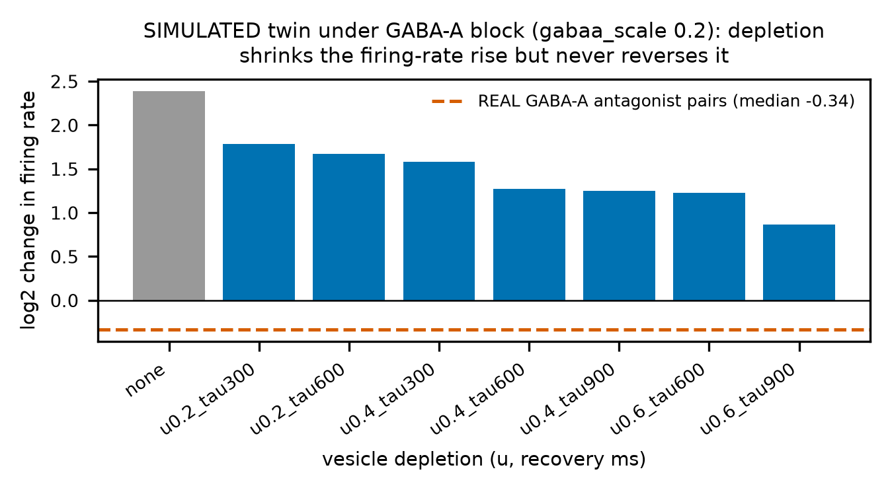{width=72%}

## 19. What you cannot conclude from this work

- **No clinical or safety claims.** NeuroMPS is an exploratory analytical framework. We make no
  efficacy, diagnostic or clinical claims, and the design could not support them.
- **It is not a screening tool.** A within-platform mechanism accuracy of 0.537
  <!-- metrics.json: mechanism_baselines.task1_within_platform.models.logistic_regression.balanced_accuracy_mean -->,
  with an interval from 0.4216 to 0.6845
  <!-- metrics.json: mechanism_baselines.task1_within_platform.models.logistic_regression.balanced_accuracy_ci95.1 -->,
  and near-chance performance across laboratories do not make a decision instrument.
- **Interspecies support is narrow.** Rat-to-human transfer rests on 37 rat training pairs and 32
  human testing pairs, which supports the direction of the effect rather than its size.
- **The simulator is not fully reconciled.** The twin sits inside the real band on two of five
  features, varies from seed to seed, and gets GABA-A potentiation mostly wrong.
- **The twin does not track dose.** Burst rates fall with bicuculline dose, but the twin's inferred
  inhibition does not, so its dose inference is not usable yet.
- **The species balance is severe.** Our asset holds 21,530 rat
  <!-- metrics.json: data_asset.counts.by_species.rat --> against 357 human
  <!-- metrics.json: data_asset.counts.by_species.human --> records — a consequence of open-access
  licensing, not a design choice.
- **The samples are small.** Our primary classification rests on 73 paired recordings from 50
  independent cultures.

---

# ACT VI: Application value, translation and open verification

## 20. Application value and translation for neural organ-on-a-chip

The main bottleneck in making neural organ-on-a-chip systems useful is not microfluidic fabrication;
it is making functional electrophysiology interpretable and reproducible. Academic centers and
commercial vendors alike produce multi-channel MEA recordings that remain hard to compare across
sites. Our results translate into practical guidance in six areas.

**Where this sits.** The US FDA Modernization Act 2.0 (2022) replaced the statutory reference to
animal tests with "nonclinical tests", a category that names cell-based assays, organ chips and
microphysiological systems, and computer modeling. That makes comparable, checkable readouts from
neural chips more useful, and it is the setting our tools are built for. The provenance chain —
license, source URL and a cryptographic checksum recorded for every file, and a build that halts on any mismatch —
can serve as an open template for documenting where such data came from. It is a record of
traceability, not a qualification process: NeuroMPS has not been qualified or reviewed by any
regulator, and nothing in this report is evidence for a submission.

**1. Design guidance for chip hardware.** Developers often assume they can validate directional
connectivity by measuring cross-correlation latencies or coupling asymmetries between open somatic
chambers. §15 shows on real devices that this does not work: chamber readouts reached 0.3854
<!-- metrics.json: axonal_directionality.chamber_readouts_predict_direction.balanced_accuracy -->
balanced accuracy where chance is 0.5, on a sample that could have detected 0.6438
<!-- metrics.json: axonal_directionality.chamber_readouts_predict_direction.detectable_balanced_accuracy -->.
To show that axons really conduct one way, you need microelectrodes inside the microchannels
themselves — and knowing that saves time otherwise spent on measures that cannot answer the question.

**2. A standardization framework for contract research.** Screening protocols should move away from
proprietary vendor summary tables toward standardized processing from raw spikes. Our feature
ablation (§8) shows that two rate metrics match the predictive power of the full nine-feature
vector, while avoiding the cross-platform variance that plagues burst-structure and synchrony
metrics (§3, §11). A smaller, more reliable feature vector is the more reproducible instrument.

**3. Cheaper assay design in silico.** Plating human iPSCs is expensive and takes weeks. The twin
gives you a testbed for pre-registering an assay: the power sweep in §17 sets a minimum electrode
count (24 electrodes per compartment, 10-second recordings) for distinguishing wiring regimes, and the
listening-radius finding in §13 gives you a way to diagnose electrode catchment overlap in physical
recordings.

**4. Paired-delta normalization for analysis pipelines.** Resting firing rates in primary cultures
span an order of magnitude. Expressing screening features as paired log-ratios against each well's
own baseline stabilizes the analysis, raises posterior contraction from 0.3
<!-- metrics.json: twin_hd14_inference.contraction.gabaa_scale.contraction --> to 0.5375
<!-- metrics.json: twin_hd17_delta_inference.held_out_checks.contraction -->, and removes most of
the false-disinhibition artifact described in §16.

**5. Sensitivity targets for an assay, set by a mapped brain (Act VII, added after the first
round).** An MEA assay is useful only if it flags a compound before the compound disturbs what a
nervous system does. On a simulated fly brain, behaviour failed while the chip's firing rate had
moved by as little as 0.149
<!-- metrics.json: fly_confirm_network_bursts.precision.abs_log2_mfr_change_at_behavioural_onset.flywire_sweep.gaba_block -->
log2 under GABA block. Two consequences follow for assay design, both from simulation and both
to be checked on real tissue. First, measure each readout's untreated variation and state it: an
assay meant to catch disinhibition in time needs firing-rate noise below that level, which the
best real controls in our asset only just reach. Second, read a screen's hit threshold for what it
can miss: the EPA's acute MEA screen calls a firing-rate hit only beyond a change of about
−1.784 <!-- metrics.json: fly_screen_cutoffs.acute_firing_rate.cutoff_log2.down --> log2,
5.87 <!-- metrics.json: fly_screen_cutoffs.acute_cutoff_over_largest_fly_change --> times the
largest firing-rate change at which the fly's behaviour had already failed. That threshold is a
reasonable guard against false hits; it is not evidence that a compound below it leaves circuits
untouched. Third, where to record matters as much as how precisely: in the same simulation,
electrodes on the brain's output tract caught GABA block in time where a planar array did not
(§24), the same advice §15 gives from real devices: instrument the channels.

**6. Sample size and plate layout, from real untreated wells (Act IX, added after the first
round).** Before a lab runs a chip screen it needs to know how many wells a given change takes
and how to lay them out. The EPA's own vehicle wells answer that for each of 15 readouts (§32).
Untreated firing rate falls by a median of
−32% <!-- metrics.json: toxcast_noise_floors.components.firing_rate_mean.median_fraction --> over the exposure window, and the exposure day
carries 0.42 <!-- metrics.json: toxcast_noise_floors.components.firing_rate_mean.date_share --> of the variance, so every reading must be
made against vehicle wells from the same day: against a historical reference no number of
wells from one day sees a halving of firing rate, while
4 <!-- metrics.json: toxcast_noise_floors.components.firing_rate_mean.wells_needed.same_date_vehicle.down_50pct --> treated and 4 vehicle
wells on that day do. Burst-shape and synchrony readouts are several times quieter than firing
rate and need far fewer wells for the same relative change. §34 turns this into three
quality-control rules.

## 21. How to reproduce and check this work

Every computed number in this report carries an automated pointer back to the
`outputs/metrics.json` key that produced it, and a test fails if any number drifts from that file.
To reproduce everything from a clean machine, run these steps in a terminal:

| step | command | what it does |
|---|---|---|
| 1. get the code | `git clone https://github.com/Vodolay/AI4S`, then `cd AI4S` | downloads the repository |
| 2. create the environment | install uv as the README shows, then `uv venv --python 3.11 .venv` | an isolated environment with the pinned Python |
| 3. install | `uv pip install --python .venv/bin/python -e ".[dev]"` | NeuroMPS and its pinned dependencies |
| 4. quick run | `.venv/bin/python run_all.py --quick` | every stage end to end on the reduced data tier |
| 5. full run | `.venv/bin/python run_all.py` | the full data tier, 3,000 <!-- metrics.json: twin_hd14_inference.n_simulations --> forward simulations, every figure |
| 6. check the numbers | `.venv/bin/python -m neuromps.report.verify` | re-reads every citation in this report and fails on any disagreement |
| 7. check the registrations | `.venv/bin/python -m neuromps.report.timestamps` | hash-chains every registration and checks that each was committed before its results (needs the full git history, not a shallow clone) |
| 8. open the demo | `.venv/bin/streamlit run app/app.py` | interactive mechanism prediction, twin sweeps and record browser |

Use the environment's own `python` and `streamlit`, as shown. We ran these steps on a fresh clone,
and every cited number reproduced exactly except ten that depend on the machine: the timings, and
the counts and intervals from posterior sampling that stops at a time limit (§16). Provenance is
guarded throughout: `data/raw/MANIFEST.json` records every source's URL, license and checksum.

The registrations are checked the same way. Every study that registered its predictions in
`preregistration/` records each prediction's outcome, and `neuromps.report.audit` (run at the end
of every `run_all`) counts them: 42 <!-- metrics.json: registration_audit.n_studies --> studies made
216 <!-- metrics.json: registration_audit.total.total --> registered predictions, of which
97 <!-- metrics.json: registration_audit.total.pass --> passed,
80 <!-- metrics.json: registration_audit.total.fail --> failed and
38 <!-- metrics.json: registration_audit.total.uninterpretable --> were uninterpretable.
The audit names any study whose predictions carry no outcome, so that none is left out
unnoticed (none is now; `registration_audit.unrecognised`), and it leaves out the rhythm audit,
which re-reads predictions already counted under their own stages.
`neuromps.report.timestamps` writes `preregistration/TIMESTAMPS.json`: each registration's
checksum and the commit that first added it, a hash chain over them in commit order, and, for
every result file that names its registration, whether the registration's commit came first. Of
41 <!-- metrics.json: registration_timestamps.n_registrations --> registrations,
38 <!-- metrics.json: registration_timestamps.n_outputs_checked --> result files were checked and
0 <!-- metrics.json: registration_timestamps.n_violations --> came before their registration. The
check cannot see the
3 <!-- metrics.json: registration_timestamps.not_covered --> registrations whose results do not
name them (the twin's depression test, its prior classifier and the ToxCast noise floors), and it
rests on this repository's own history, not on a third-party timestamp. The two manuscripts in
preparation register their studies the same way in a separate, private repository.

## 22. AI assistance disclosure

We built this project in a paired workflow with Anthropic's Claude Code. Claude wrote most of the
code and tests under step-by-step human direction: we set the plan and the phase gates, chose the
scope, approved each step, and directed the science. We also used it to draft and revise parts of
this report, which we then edited ourselves. Three practices kept that collaboration honest. Numbers
are emitted into `metrics.json` by scripts and re-checked by `neuromps.report.verify`, never typed
by hand. We report results as we observed them, including the ones that failed. And
`report/LAB_NOTEBOOK.md` records what we tried and abandoned. No AI model is part of the delivered
pipeline itself: every statistical model in it is trained from scratch on the data described here.

---

# ACT VII: From chip to animal (after round 1)

*Added after the first-round deadline; `report/POST_SUBMISSION_CHANGES.md` records every change
since the submission. Every result in this act is from **simulation**, for research decision
support; nothing in it is a claim about any compound's effect in any animal or person.*

## 23. The question a chip cannot answer on its own

A neural chip reports what a drug does to a dish of neurons. The question an assay is used to
answer is different: will the drug disturb what a nervous system *does*? No culture can answer
that, and so no chip assay can be checked against it. A mapped brain lets us ask. The adult fly
brain has been reconstructed synapse by synapse, and Shiu et al. (2024) turned that wiring
diagram into a leaky integrate-and-fire model whose responses match the fly's own sensorimotor
pathways.

We applied the twin's drug knobs to that model on the FlyWire connectome,
138,639 <!-- metrics.json: fly_models.flywire783.neurons --> neurons joined by
15,091,983 <!-- metrics.json: fly_models.flywire783.connections --> connections, and read the
same simulated brain two ways at once:

- **as a chip**: a virtual electrode array laid over the brain's regions, each electrode hearing
  one neuron, its recordings scored by `features/mea.py`, the extractor every real recording in
  the asset goes through;
- **as an animal**: the neurons the published model validated against behaviour. MN9, the
  proboscis motor neuron, under sugar drive (feeding) and again with bitter drive added
  (aversive gating); aBN1 under antennal mechanosensory drive (grooming); and how many
  descending neurons the sugar drive recruits (how selectively one stimulus reaches one output).

Five drug families were each run at four or five strengths: GABA block, block of the
glutamate-gated chloride channel (GluCl), GABA potentiation, acetylcholine block and a raised
spike threshold. In the fly, GABA and glutamate are the fast inhibitory transmitters and
acetylcholine the fast excitatory one, so these are the fly's counterparts of the twin's GABA-A,
AMPA and sodium-channel knobs (§14). Behaviour is summarised by a disruption index: the mean
absolute log2 change of the four readouts.

**How it was kept honest.** The design, ten predictions and their pass/fail tests were committed
before the simulations were run (`preregistration/fly_chip_to_animal.json`; its commit and
checksum are in `fly_chip_to_animal.registration`), together with every exploratory result seen
before registering. Two later addenda followed the same rule. The published neuron lists come
from an older FlyWire release than the one we model, and a neuron's identifier changes when it
is edited, so the code keeps only neurons whose identifier is unchanged and refuses any table
that covers too few of the model's neurons; the two tables we use cover
0.9999 <!-- metrics.json: fly_models.flywire783.release_coverage.annotations --> and
0.9964 <!-- metrics.json: fly_models.flywire783.release_coverage.neuropil_counts --> of them.
With the same code, sugar drives MN9 at
76.75 <!-- metrics.json: fly_chip_to_animal.predictions.R1_replication.value.mn9_783_hz --> Hz on
our release and
77.375 <!-- metrics.json: fly_chip_to_animal.predictions.R1_replication.value.mn9_630_hz --> Hz on
the paper's.

## 24. The chip ranks drugs correctly and raises the alarm late

{width=100%}

**Behaviour responds as the circuits predict.** Blocking GABA releases feeding from bitter
suppression (rank correlation with dose
1.0 <!-- metrics.json: fly_chip_to_animal.predictions.B1_disinhibition_releases_feeding_from_bitter.value -->)
and recruits ever more descending neurons
(1.0 <!-- metrics.json: fly_chip_to_animal.predictions.B3_disinhibition_recruits_off_target_descending_neurons.value -->):
the brain loses its selectivity. Blocking acetylcholine silences the motor and grooming outputs.

**The chip ranks drugs by their effect on behaviour.** Across the 21 drug conditions, the change
in the array's firing rate tracks the disruption index (Spearman
0.863 <!-- metrics.json: fly_chip_to_animal.predictions.C1_chip_tracks_disruption.value -->). The
fly array also agrees with real chips about which way each mechanism moves each feature as often
as the chip twin does:
12 <!-- metrics.json: fly_chip_to_animal.predictions.A1_direction_agreement_with_real_chips.value.fly -->
agreeing features against the twin's 12
<!-- metrics.json: fly_chip_to_animal.predictions.A1_direction_agreement_with_real_chips.value.twin -->.

**But it is late: the registered prediction failed in every family.** We predicted that, at the
registered detection threshold, the chip would flag each drug at a dose no higher than the one
that impairs behaviour. In all five families behaviour failed first. At the weakest GABA block,
the bitter gate on feeding has already broken while the array's firing rate has barely moved.
Dropping any one readout from the disruption index leaves the chip late in at least four of the
five families, and the result replicates on fresh random seeds.

{width=100%}

**What a chip would need to catch it in time.** The change in firing rate at the first dose that
impairs behaviour is the precision a chip must reach to flag that drug before behaviour fails.
This analysis is exploratory: it was done after the registered test failed.

| Drug family | Firing-rate change at behavioural onset (log2) |
|---|---|
| GABA block | 0.149 <!-- metrics.json: fly_confirm_network_bursts.precision.abs_log2_mfr_change_at_behavioural_onset.flywire_sweep.gaba_block --> |
| Raised threshold | 0.124 <!-- metrics.json: fly_confirm_network_bursts.precision.abs_log2_mfr_change_at_behavioural_onset.flywire_sweep.excitability_block --> |
| GABA potentiation | 0.199 <!-- metrics.json: fly_confirm_network_bursts.precision.abs_log2_mfr_change_at_behavioural_onset.flywire_sweep.gaba_potentiate --> |
| GluCl block | 0.263 <!-- metrics.json: fly_confirm_network_bursts.precision.abs_log2_mfr_change_at_behavioural_onset.flywire_sweep.glucl_block --> |
| Acetylcholine block | 0.304 <!-- metrics.json: fly_confirm_network_bursts.precision.abs_log2_mfr_change_at_behavioural_onset.flywire_sweep.ach_block --> |

Real chips in the asset vary between untreated recordings by up to
0.156 <!-- metrics.json: fly_confirm_network_bursts.precision.real_chip_noise.kapucu2022_control.q95_abs_log2 -->
(Kapucu's vehicle controls, 95th percentile) and
1.752 <!-- metrics.json: fly_confirm_network_bursts.precision.real_chip_noise.vassallo2017_inactive.q95_abs_log2 -->
(Vassallo's inactive compounds). At the better of the two, a chip would flag acetylcholine block,
GluCl block and GABA potentiation in time, but not GABA block or a raised threshold; at the worse,
none of the five. GABA block was the hardest family to catch in the second brain as well. The
practical reading is a specification, not a verdict: an assay meant to catch disinhibition before
it reaches behaviour must resolve firing-rate changes of a few percent.

**A tempting fix that is noise.** In the first sweep, network-burst rate crossed the threshold at
or before behaviour in every family. We registered a confirmation, on fresh seeds and on the
second brain, before seeing either. Out of sample it crossed early in
8 <!-- metrics.json: fly_confirm_network_bursts.pooled_out_of_sample.network_bursts_at_or_before_behaviour -->
of
10 <!-- metrics.json: fly_confirm_network_bursts.pooled_out_of_sample.tests -->
family tests against
3 <!-- metrics.json: fly_confirm_network_bursts.pooled_out_of_sample.firing_rate_at_or_before_behaviour -->
for firing rate, and two of the four registered tests passed. Then we checked what the
registration had not: two groups of *untreated* recordings already differ by the threshold in a
fraction
0.382 <!-- metrics.json: fly_checks.false_alarm_rate_untreated.by_feature.network_burst_rate_per_min -->
of random splits, while for firing rate the untreated 95th percentile is
0.028 <!-- metrics.json: fly_checks.false_alarm_rate_untreated.by_feature.q95_abs_log2.mfr_hz -->
log2. Trains shifted in time, which keeps every rate and breaks every coincidence, still yield
network bursts. Network-burst rate looked early because it is noisy, not because it sees more.

**Where to put the electrode.** The fly's descending neurons carry the brain's output down the
neck to the nerve cord: a bundle of axons between two compartments, which is what a chip's
microchannels are. We registered a test before recording them
(`preregistration/fly_output_tract_electrode.json`): read the same spontaneous recordings through
64 single-unit electrodes on descending neurons and through 64 electrodes drawn from the planar
array, at one threshold set by real-chip noise. All four registered predictions passed. Under GABA
block, at the dose where behaviour first fails, the tract's firing rate has moved by
0.361 <!-- metrics.json: fly_output_tract.abs_delta_mfr_at_onset.tract_64.gaba_block --> log2
against
0.044 <!-- metrics.json: fly_output_tract.abs_delta_mfr_at_onset.planar_64.gaba_block --> for the
equal-count planar array and
0.149 <!-- metrics.json: fly_output_tract.abs_delta_mfr_at_onset.planar.gaba_block --> for the full
one. The tract flags
3 <!-- metrics.json: fly_output_tract.families_flagged_in_time.tract_64 --> of the five families
no later than behaviour, against
2 <!-- metrics.json: fly_output_tract.families_flagged_in_time.planar_64 -->, and never
false-alarms on untreated recordings
(rate 0.0 <!-- metrics.json: fly_output_tract.false_alarm_rate.tract_64 -->). Two checks we added
after it passed temper it without overturning it. Which 64 neurons the electrodes hear matters:
over ten random draws of each array, the tract is ahead in
7 <!-- metrics.json: fly_output_tract_robustness.registered_index.draws_meeting_t1 --> of the
10 <!-- metrics.json: fly_output_tract_robustness.registered_index.draws --> draws. And the result
does not come from the overlap between the tract and one behaviour readout, which counts descending
neurons: leaving that readout out changes nothing. This agrees with what real devices showed in
§15, from the other side: there, chamber electrodes could not tell which way axons fired and only
electrodes inside the microchannels could; here, an electrode on the output tract sees the
circuit fail sooner than one on the tissue around it.

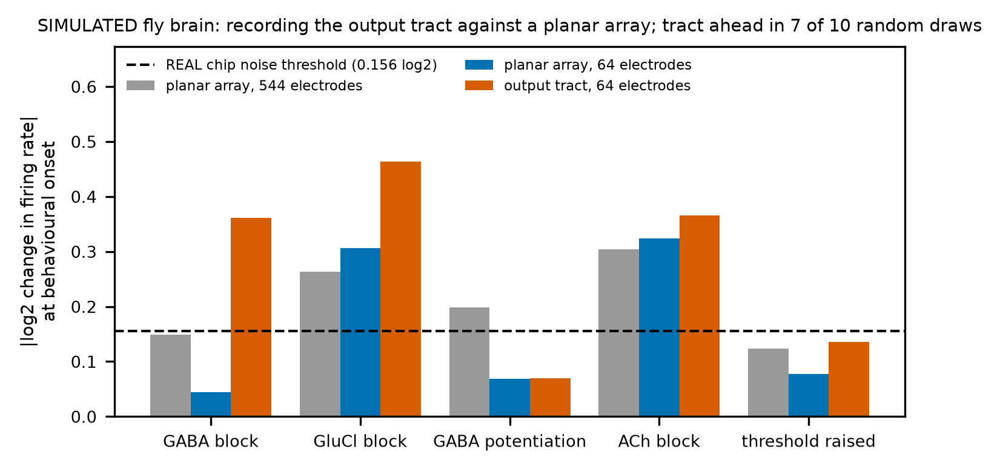{width=85%}

## 25. Direction between regions, and a second brain

{width=90%}

§15 and §17 found that a chamber-level measure does not recover direction on real devices whose
axons are instrumented. The fly brain repeats that test where the answer is known for every pair
of regions. On spontaneous activity, the chip's cross-correlation measure gets the direction of
strongly asymmetric pairs right at chance
(0.4946 <!-- metrics.json: fly_chip_to_animal.predictions.D1_spontaneous_direction_is_near_chance.value -->).
Pulsed stimulation of one region, read shortly after each pulse, does better
(0.6222 <!-- metrics.json: fly_chip_to_animal.predictions.D2_pulsed_stimulation_recovers_direction.value.evoked -->)
but misses the registered target, and read through the array's electrodes alone it falls back to
chance
(0.4889 <!-- metrics.json: fly_chip_to_animal.predictions.D3_an_electrode_array_sees_it_too.value -->).

**A second brain agrees.** The male central nervous system connectome (MaleCNS: brain and nerve
cord, an independent reconstruction of a male fly;
165,122 <!-- metrics.json: fly_models.malecns.neurons --> neurons and
25,563,096 <!-- metrics.json: fly_models.malecns.connections --> connections) was run under the
same design, with the published neuron sets matched by cell type and side. All five registered
replication tests pass: sugar drives MN9 at
31.625 <!-- metrics.json: fly_malecns_replication.predictions.M0_feeding_circuit_exists.value.mn9_sugar_hz -->
Hz and bitter suppresses it; GABA block releases it; acetylcholine block silences the outputs;
and the chip's firing-rate change again tracks behavioural disruption (Spearman
0.878 <!-- metrics.json: fly_malecns_replication.predictions.M_C1.value -->).

**One step closer to behaviour: motor neurons.** The behaviour readouts above are named
interneurons, MN9 excepted. The male connectome includes the nerve cord, so the same protocols
can be read at the motor neurons that move the body: the
67 <!-- metrics.json: fly_motor_readout.pool_sizes.proboscis --> proboscis motor neurons for
feeding and its bitter gate, the
135 <!-- metrics.json: fly_motor_readout.pool_sizes.front_leg --> front-leg motor neurons for
antennal grooming, and how many of all
815 <!-- metrics.json: fly_motor_readout.pool_sizes.all_motor --> motor neurons a drive recruits.
We registered the test before running it (`preregistration/fly_motor_readout.json`), repeating
the replication's trials with the same seeds, so its interneuron readouts had to come back
unchanged; they did (largest difference
0.0 <!-- metrics.json: fly_motor_readout.predictions.MR0_interneuron_readouts_reproduce.value -->).
The pools carry the behaviours: sugar drives the proboscis pool at
31.405 <!-- metrics.json: fly_motor_readout.predictions.MR1_the_motor_pools_carry_the_behaviours.value.proboscis_sugar -->
Hz and bitter cuts it to
5.625 <!-- metrics.json: fly_motor_readout.predictions.MR1_the_motor_pools_carry_the_behaviours.value.proboscis_sugar_bitter -->
Hz; antennal drive moves the front legs at
5.023 <!-- metrics.json: fly_motor_readout.predictions.MR1_the_motor_pools_carry_the_behaviours.value.front_leg_jon_ce -->
Hz against
2.394 <!-- metrics.json: fly_motor_readout.predictions.MR1_the_motor_pools_carry_the_behaviours.value.front_leg_sugar -->
under sugar. Six of the seven registered predictions passed: GABA block releases the gate at
the motor level, acetylcholine block silences motor output, and the chip's firing-rate change
tracks motor disruption (Spearman
0.8922 <!-- metrics.json: fly_motor_readout.predictions.MR4_chip_tracks_motor_disruption.value -->).
The one that failed was the chip-is-late prediction, and narrowly: the chip flagged the drug
after motor output was impaired in
3 <!-- metrics.json: fly_motor_readout.summary.families_chip_later_than_motor --> families and
at the same dose in
2 <!-- metrics.json: fly_motor_readout.summary.families_chip_tied_with_motor -->, where the test
needed four. It was never earlier
(0 <!-- metrics.json: fly_motor_readout.summary.families_chip_earlier_than_motor --> families).
Motor output failed no later than the interneuron readouts in every family, and earlier under
acetylcholine block. Read at the motor level, then, the chip is not ahead of behaviour, it is
at best level with it.

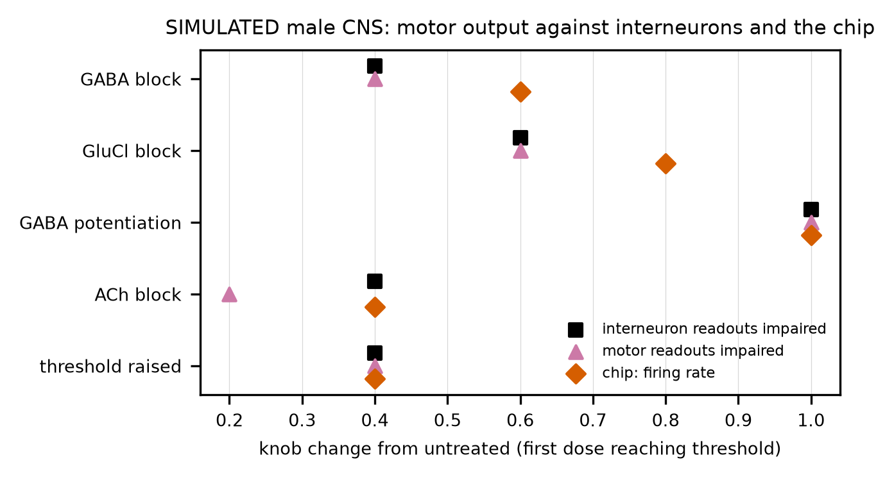{width=75%}

The two ties were a matter of resolution: both onsets fell inside one coarse dose step. So we
registered a follow-up before running it (`preregistration/fly_motor_tie_break.json`), with four
finer levels inside each tied step, the same seeds and the same untreated references; re-running
the tied levels reproduced them exactly (largest difference
0.0 <!-- metrics.json: fly_motor_tie_break.predictions.TB0_tied_levels_reproduce.value -->). The
raised threshold resolves: motor output fails at
0.32 <!-- metrics.json: fly_motor_tie_break.resolutions.excitability_block.motor_onset -->, the
chip detects at 0.4
<!-- metrics.json: fly_motor_tie_break.resolutions.excitability_block.chip_onset -->. GABA
potentiation stays tied even on the finer grid, both crossing at
0.6 <!-- metrics.json: fly_motor_tie_break.resolutions.gaba_potentiate.motor_onset -->; there the
chip is within a hair of its threshold one step earlier. The registered follow-up predicted that
both ties would resolve with the chip later, so it failed too. MR5 stays failed as registered;
read with the follow-up beside it, the chip is later than motor output in
4 <!-- metrics.json: fly_motor_tie_break.combined_with_parent.chip_later --> families, level in
1 <!-- metrics.json: fly_motor_tie_break.combined_with_parent.tied --> and earlier in
0 <!-- metrics.json: fly_motor_tie_break.combined_with_parent.chip_earlier -->.

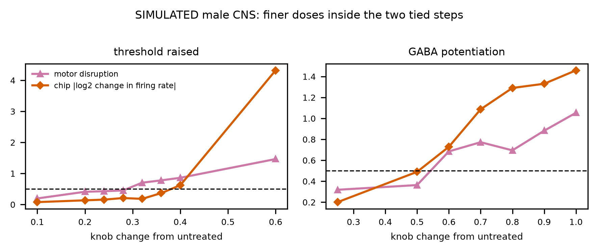{width=80%}

## 26. What the fly study does not show

- **It is a model.** The fly model is a leaky integrate-and-fire network with one free weight, no
  adaptation and no neuromodulation; it fires asynchronously and does not burst the way a culture
  does. Its behaviour readouts are firing rates of named neurons, motor neurons included, not
  movement: there is no body and no sensory feedback. In the male connectome, which has more
  synapses per neuron under the same weight, any drive recruits a large share of the motor
  neurons, so off-target recruitment starts high.
- **The knobs scale whole transmitter classes.** A real compound acts on particular receptor
  subunits, with its own potency and off-target effects. Nothing here says what any compound
  does to a fly, a culture or a person.
- **The precision table is exploratory.** It depends on the disruption index and the registered
  threshold, and it was computed after the registered test failed.
- **The real-chip noise floors** come from two sources with very different spreads, one of them
  from few recordings.

The study runs with `python run_all.py --stage fly` (the licensed files are fetched first);
`python -m neuromps.fly.replication`, `python -m neuromps.fly.confirm` and
`python -m neuromps.fly.checks` run the two addenda and the noise checks. The demo app's fourth
tab shows the sweep with a dose slider.

---

# ACT VIII: The embodied fly (after round 1)

Act VII read behaviour as the firing of named neurons. This act gives the simulated fly a body
and asks whether Act VII's answer survives: does the chip still flag a drug before behaviour
fails when behaviour is movement? Every stage below was registered before it ran; the roadmap
document (`report/ROADMAP_EMBODIED_FLY.md`, §7) carries each stage in full, including the
failures, and `report/DECISION_LOG.md` records every choice of path. Everything here is
simulated.

## 27. A body for the simulated fly

The male nerve cord (male CNS connectome) drives a muscle-driven front leg (FlyMimic, in MuJoCo)
through a motor-neuron-to-muscle map built from published names; the FlyWire brain drives the
proboscis of a whole-fly model (flybody) through the motor neurons of each proboscis muscle. The
two connectomes are joined where each model is validated: the FlyWire brain's descending spikes
are replayed into the male nerve cord, matched by cell type and side. Antennal input to the
brain then brings the claw to
0.5369 <!-- metrics.json: embodied_stage1f.predictions.F1_antennal_input_reaches_deepest.value.jon_ce -->
mm of the antenna, sugar input only to
0.9377 <!-- metrics.json: embodied_stage1f.predictions.F1_antennal_input_reaches_deepest.value.sugar --> mm, and removing the two
antennal-grooming descending neuron types alone leaves it at
1.4793 <!-- metrics.json: embodied_stage1f.predictions.F4_the_reach_runs_through_the_grooming_neurons.value.lesioned --> mm. Sugar input
extends the proboscis fully
(0.3431 <!-- metrics.json: embodied_stage2b.predictions.G1_sugar_extends_the_proboscis.value.sugar -->
mm of a possible 0.3428 <!-- metrics.json: embodied_stage2b.predictions.G1_sugar_extends_the_proboscis.value.e_full -->), and adding bitter
input halves the peak
(0.1618 <!-- metrics.json: embodied_stage2b.predictions.G3_bitter_gates_extension.value.sugar_bitter --> mm).

## 28. Walking: what the wiring does and does not do

The male nerve cord, run as leaky integrate-and-fire neurons, does not turn its walking command
into a rhythm: not as published, not with spike-frequency adaptation swept over a registered
grid, not with either of two rules for where glutamate excites. A firing-rate model published
for this question (Pugliese et al. 2025), reimplemented and built on the male CNS as its authors
build it, does produce a front-leg motor rhythm under the walking command: a corrected rhythm
score of
0.8886 <!-- metrics.json: embodied_stage2h.none.predictions.H1_the_walking_command_makes_a_leg_rhythm.value -->
at a period of
196.5 <!-- metrics.json: embodied_stage2h.none.predictions.H6_a_fly_like_step_period.value --> ms without size scaling, and silencing the
published three-neuron circuit removes it
(0.0 <!-- metrics.json: embodied_stage2h.none.predictions.H5_the_rhythm_needs_the_three_neuron_circuit.value.lesion -->).
With the published size rule, neuron volume, fetched later from the male CNS release, the
circuit's necessity reproduces too (silenced:
0.0115 <!-- metrics.json: embodied_stage2i.predictions.V5_the_rhythm_needs_the_three_neuron_circuit.value.lesion -->); a registered check finds no rhythm when the
volumes are shuffled across neurons, so the rhythm needs the identified neurons' own volumes. A
promotor-remotor offset seen once did not replicate reliably, and neither model alternates
antagonist muscles. One
earlier claim was withdrawn on the way: the rhythm measure registered since the first leg stage
took the largest autocorrelation without requiring a peak, so smooth movements scored as
rhythmic; a registered audit with a corrected measure reproduced every recorded outcome and
reversed one (that walking drive "swings" the leg).

## 29. Closing the loop

Feedback from the front leg's position sensors (the femoral chordotonal claw neurons, identified
by type in the male CNS) was closed through the leg every millisecond. It shifts the tibia motor
pools toward resisting the movement, but it neither moves a held leg nor returns a pushed one
faster: the push returns in
32.0 <!-- metrics.json: embodied_stage3b.predictions.M1_feedback_speeds_the_return.value.resistance --> ms with
feedback and
30.0 <!-- metrics.json: embodied_stage3b.predictions.M1_feedback_speeds_the_return.value.open --> ms without.
The male CNS traces few proprioceptors for the front leg
(4 <!-- metrics.json: embodied_stage3b_check.chordotonal_by_leg.front_L.claw -->
claw neurons on the left, against
22 <!-- metrics.json: embodied_stage3b_check.chordotonal_by_leg.hind_L.claw --> on the left hind leg), which is
the most likely limit. Closed through the well-traced right hind leg instead (25 claw neurons;
flybody's servoed tibia), the feedback changes the leg's posture but makes the hold swing, and a
registered paired test on fresh seeds found no part of it that speeds the return: resistance
sooner than a sham in
14 <!-- metrics.json: embodied_stage3d.predictions.Q1_feedback_that_follows_the_push_speeds_the_return.value.seeds_favouring_resistance -->
of 32 seeds.

## 30. Drugs in the loop: the chip is late at every level

Act VII's drug design, rerun with movement as the readout (proboscis extension and the grooming
reach), gives the same answer. In every family the chip first flags the drug at a higher dose
than movement fails: GABA-A block impairs movement at
0.2 <!-- metrics.json: embodied_stage4a.predictions.N3_the_chip_flags_before_movement_fails.value.gaba_block.movement --> of the knob's range and the chip flags it at
0.6 <!-- metrics.json: embodied_stage4a.predictions.N3_the_chip_flags_before_movement_fails.value.gaba_block.chip -->; GABA-A potentiation impairs movement at
0.5 <!-- metrics.json: embodied_stage4a.predictions.N3_the_chip_flags_before_movement_fails.value.gaba_potentiate.movement --> and is flagged at 1.0
<!-- metrics.json: embodied_stage4a.predictions.N3_the_chip_flags_before_movement_fails.value.gaba_potentiate.chip -->.
Movement never fails before the neural readouts of Act
VII, and the output-tract electrode no longer leads the planar array at this level. A registered
rerun on fresh seeds, against the chip's own fresh-seed replication, finds the chip late again in
every family. Left out of the index, the bitter-gated proboscis turns out to carry GABA-A
potentiation: without it movement fails only at
1.0 <!-- metrics.json: embodied_stage4b.onsets_leave_one_out.proboscis_sugar_bitter.gaba_potentiate -->, where the chip flags it. A finer
registered dose grid keeps the chip late with the full index but leaves that tie in place (both at
0.6 <!-- metrics.json: embodied_stage4c.predictions.F2_without_the_bitter_gate_chip_later.value.chip_onset -->). Read through a
fictive walking rhythm alone, GABA-A and GluCl block break it well before the chip flags them;
whether acetylcholine block is caught first depends on how the rhythm is scored (a registered
retest counts its low-dose rise in rhythm as a change at
0.2 <!-- metrics.json: embodied_stage4e.predictions.E1_acetylcholine_block_is_caught_first.value.walking_onset -->), so it is not claimed. At the dose
where movement first fails the chip has moved by only
0.149 <!-- metrics.json: embodied_stage4a_precision.abs_log2_mfr_change_at_movement_onset.gaba_block --> to
0.452 <!-- metrics.json: embodied_stage4a_precision.abs_log2_mfr_change_at_movement_onset.gaba_potentiate --> log2 (exploratory), within
the noise of real chips. A
literature comparison registered before its search found no study that gives adult flies these
drugs and scores feeding or grooming movements, so the simulated directions cannot yet be
checked against fly pharmacology: the gap names the experiments that would. Simulating the
identified neurons such a study manipulated (the front leg's GABAergic 13A and 13B hemilineages)
reproduced one published direction for the grooming reach: silencing 13A shortens it to
0.3806 <!-- metrics.json: embodied_stage5b.predictions.I1_silencing_13A_reduces_grooming.value.depth_mm -->
mm. Read at the femur-tibia joint, though, none of the published postures appears (silencing 13A
shifts the tibia by
-0.1488 <!-- metrics.json: embodied_stage5c.predictions.J1_silencing_13A_flexes_the_tibia.value.shift_rad --> rad,
toward extension, against a published flexion): in this model the inhibitory leg neurons act as broad
brakes, not as joint-specific controllers.

## 31. What the embodied fly does not show

- **It is open loop where it works and weak where it is closed.** The leg and proboscis results
  are open loop; the one closed loop runs through four sensory neurons.
- **The bodies are partial.** One muscle-driven leg; the proboscis joints are position servos.
- **The knobs are transmitter-class scalings,** as in Act VII; nothing here says what any
  compound does to a fly or a person.
- **The walking result is a negative for one model class** and a reimplementation of another
  group's model; neither produces coordinated walking.

The stages run with `python run_all.py --stage embodied` (or one at a time through
`python -m neuromps.fly.pipeline`).

---

# ACT IX: What a real screen's untreated wells say (after round 1)

*Added after the first-round deadline (`report/POST_SUBMISSION_CHANGES.md`, entry 42). Unlike
Acts VII and VIII, the measurements in this act are **real**: well-level recordings from the
EPA's acute MEA screen. The twin's side of §33 and §35 is simulated and labelled so. All three
analyses were registered before any response statistic was computed
(`preregistration/toxcast_noise_floors.json`, `preregistration/twin_toxcast_positive_controls.json`,
`preregistration/twin_toxcast_dose_response.json`).
This is research decision support about measurement design; nothing here is a claim about any
compound's effect.*

## 32. How large a change can a chip see? The noise floor, per feature

A lab that wants to use a neural chip has to answer a plain question before any modelling: how
many wells does it take to see a fall of a fifth, and in which readout? The answer depends on how
much an *untreated* well moves on its own, and on whether that movement is shared by wells
recorded on the same day. Neither number is in the published curve fits we used in round 1. Both
are in the EPA's raw database.

**The data.** The EPA's ToxCast database (invitrodb, CC0) holds every well of its acute MEA screen: rat
cortical cultures on 48-well plates, each well recorded 40 minutes before and 40 minutes after
exposure, stored as the percent change from its own baseline. We read its full MySQL dump as
text, never executing it, and extracted the 15 electrophysiology readouts
(`neuromps.etl.toxcast_wells`). Seven of these readouts, firing rate among them, have no well rows in the
public dump; we recovered them from the dump's own row numbering and checked the recovery
against values the database stores independently: concentrations agree on every row and each
exposure date's stored baseline is reproduced on every date (`neuromps.etl.toxcast_recover`;
checks in `data/interim/toxcast_mea/recovery_checks.json`). The vehicle wells (DMSO or water)
are the untreated reference: 714 <!-- metrics.json: toxcast_noise_floors.components.firing_rate_mean.wells -->
wells on 97 <!-- metrics.json: toxcast_noise_floors.components.firing_rate_mean.dates -->
exposure dates and 274 <!-- metrics.json: toxcast_noise_floors.components.firing_rate_mean.plates -->
physical plates.

{width=100%}

**Three findings a chip user needs.**

1. **Untreated wells drift, and by a lot.** Over the 40-minute exposure window an untreated
   well's firing rate falls by a median of
   −32% <!-- metrics.json: toxcast_noise_floors.components.firing_rate_mean.median_fraction -->,
   and one well in twenty falls by more than
   −69% <!-- metrics.json: toxcast_noise_floors.components.firing_rate_mean.q05_fraction -->.
   A treated well read only against its own baseline would show a large "effect" with no drug at
   all. Every change must be read against vehicle wells. Burst counts and cross-correlation drift
   the same way; burst shape, synchrony and network-burst readouts barely drift.
2. **Much of the noise is the day, not the well.** The exposure date carries
   0.42 <!-- metrics.json: toxcast_noise_floors.components.firing_rate_mean.date_share --> of the
   variance in vehicle firing rate (95% interval
   0.31 <!-- metrics.json: toxcast_noise_floors.components.firing_rate_mean.date_share_ci95.0 --> to
   0.54 <!-- metrics.json: toxcast_noise_floors.components.firing_rate_mean.date_share_ci95.1 -->,
   resampling dates); the physical plate adds almost nothing beyond it (plate share
   0.40 <!-- metrics.json: toxcast_noise_floors.components.firing_rate_mean.plate_share -->).
   Wells recorded on one day share that day's offset, so adding more of them does not average
   it away.
3. **So the design matters more than the well count.** For a 20% fall in firing rate:
   32 <!-- metrics.json: toxcast_noise_floors.components.firing_rate_mean.wells_needed.independent.down_20pct -->
   wells spread over independent dates suffice; the same number from one date, judged against
   the screen's historical vehicle mean, never does (more than
   96 <!-- metrics.json: toxcast_noise_floors.n_max --> wells; even a 50% fall stays out of
   reach, since 96 wells from one date detect only a
   52% <!-- metrics.json: toxcast_noise_floors.components.firing_rate_mean.curves.one_date.96.detectable_down_fraction -->
   fall); and wells from one date judged against the same number of vehicle wells from that
   date need
   32 <!-- metrics.json: toxcast_noise_floors.components.firing_rate_mean.wells_needed.same_date_vehicle.down_20pct -->
   of each. For a 50% fall the counts are
   3 <!-- metrics.json: toxcast_noise_floors.components.firing_rate_mean.wells_needed.independent.down_50pct -->
   independent wells, or
   4 <!-- metrics.json: toxcast_noise_floors.components.firing_rate_mean.wells_needed.same_date_vehicle.down_50pct -->
   treated and 4 vehicle wells on one date. A single well detects only a fall of
   68% <!-- metrics.json: toxcast_noise_floors.components.firing_rate_mean.curves.independent.1.detectable_down_fraction -->
   or more, and rises are harder to see than falls of the same percentage (a 20% rise needs
   48 <!-- metrics.json: toxcast_noise_floors.components.firing_rate_mean.wells_needed.independent.up_20pct -->
   independent wells).

**Wells needed to detect a fall, per readout** (two-sided false alarms at
5% <!-- metrics.json: toxcast_noise_floors.false_alarm_rate --> per test, power
80% <!-- metrics.json: toxcast_noise_floors.power -->; smallest count on the grid 1 to
96 <!-- metrics.json: toxcast_noise_floors.n_max -->; A: wells spread over independent dates;
B: all wells from one date against the historical vehicle mean; C: that many treated *and* that
many vehicle wells on one date; sorted by noise floor; every vehicle well of the screen, DMSO
and water):

| readout | untreated change, median (5th to 95th pct.) | abs. q95 (log2) | date share | wells for a 20% fall (A / B / C) | wells for a 50% fall (A / B / C) |
|---|---|---|---|---|---|
| network burst percentage | −1% <!-- metrics.json: toxcast_noise_floors.components.network_burst_percentage.median_fraction --> (−12% <!-- metrics.json: toxcast_noise_floors.components.network_burst_percentage.q05_fraction --> to +2% <!-- metrics.json: toxcast_noise_floors.components.network_burst_percentage.q95_fraction -->) | 0.20 <!-- metrics.json: toxcast_noise_floors.components.network_burst_percentage.abs_q95_log2 --> | 0.18 <!-- metrics.json: toxcast_noise_floors.components.network_burst_percentage.date_share --> | 3 <!-- metrics.json: toxcast_noise_floors.components.network_burst_percentage.wells_needed.independent.down_20pct --> / 8 <!-- metrics.json: toxcast_noise_floors.components.network_burst_percentage.wells_needed.one_date.down_20pct --> / 8 <!-- metrics.json: toxcast_noise_floors.components.network_burst_percentage.wells_needed.same_date_vehicle.down_20pct --> | 1 <!-- metrics.json: toxcast_noise_floors.components.network_burst_percentage.wells_needed.independent.down_50pct --> / 1 <!-- metrics.json: toxcast_noise_floors.components.network_burst_percentage.wells_needed.one_date.down_50pct --> / 1 <!-- metrics.json: toxcast_noise_floors.components.network_burst_percentage.wells_needed.same_date_vehicle.down_50pct --> |
| synchrony index | −4% <!-- metrics.json: toxcast_noise_floors.components.synchrony_index.median_fraction --> (−16% <!-- metrics.json: toxcast_noise_floors.components.synchrony_index.q05_fraction --> to +3% <!-- metrics.json: toxcast_noise_floors.components.synchrony_index.q95_fraction -->) | 0.26 <!-- metrics.json: toxcast_noise_floors.components.synchrony_index.abs_q95_log2 --> | 0.32 <!-- metrics.json: toxcast_noise_floors.components.synchrony_index.date_share --> | 6 <!-- metrics.json: toxcast_noise_floors.components.synchrony_index.wells_needed.independent.down_20pct --> / 12 <!-- metrics.json: toxcast_noise_floors.components.synchrony_index.wells_needed.one_date.down_20pct --> / 10 <!-- metrics.json: toxcast_noise_floors.components.synchrony_index.wells_needed.same_date_vehicle.down_20pct --> | 1 <!-- metrics.json: toxcast_noise_floors.components.synchrony_index.wells_needed.independent.down_50pct --> / 1 <!-- metrics.json: toxcast_noise_floors.components.synchrony_index.wells_needed.one_date.down_50pct --> / 1 <!-- metrics.json: toxcast_noise_floors.components.synchrony_index.wells_needed.same_date_vehicle.down_50pct --> |
| per network burst electrodes number mean | −6% <!-- metrics.json: toxcast_noise_floors.components.per_network_burst_electrodes_number_mean.median_fraction --> (−21% <!-- metrics.json: toxcast_noise_floors.components.per_network_burst_electrodes_number_mean.q05_fraction --> to +10% <!-- metrics.json: toxcast_noise_floors.components.per_network_burst_electrodes_number_mean.q95_fraction -->) | 0.40 <!-- metrics.json: toxcast_noise_floors.components.per_network_burst_electrodes_number_mean.abs_q95_log2 --> | 0.25 <!-- metrics.json: toxcast_noise_floors.components.per_network_burst_electrodes_number_mean.date_share --> | 3 <!-- metrics.json: toxcast_noise_floors.components.per_network_burst_electrodes_number_mean.wells_needed.independent.down_20pct --> / 4 <!-- metrics.json: toxcast_noise_floors.components.per_network_burst_electrodes_number_mean.wells_needed.one_date.down_20pct --> / 4 <!-- metrics.json: toxcast_noise_floors.components.per_network_burst_electrodes_number_mean.wells_needed.same_date_vehicle.down_20pct --> | 1 <!-- metrics.json: toxcast_noise_floors.components.per_network_burst_electrodes_number_mean.wells_needed.independent.down_50pct --> / 1 <!-- metrics.json: toxcast_noise_floors.components.per_network_burst_electrodes_number_mean.wells_needed.one_date.down_50pct --> / 1 <!-- metrics.json: toxcast_noise_floors.components.per_network_burst_electrodes_number_mean.wells_needed.same_date_vehicle.down_50pct --> |
| burst percentage mean | −6% <!-- metrics.json: toxcast_noise_floors.components.burst_percentage_mean.median_fraction --> (−24% <!-- metrics.json: toxcast_noise_floors.components.burst_percentage_mean.q05_fraction --> to +3% <!-- metrics.json: toxcast_noise_floors.components.burst_percentage_mean.q95_fraction -->) | 0.40 <!-- metrics.json: toxcast_noise_floors.components.burst_percentage_mean.abs_q95_log2 --> | 0.39 <!-- metrics.json: toxcast_noise_floors.components.burst_percentage_mean.date_share --> | 3 <!-- metrics.json: toxcast_noise_floors.components.burst_percentage_mean.wells_needed.independent.down_20pct --> / 16 <!-- metrics.json: toxcast_noise_floors.components.burst_percentage_mean.wells_needed.one_date.down_20pct --> / 8 <!-- metrics.json: toxcast_noise_floors.components.burst_percentage_mean.wells_needed.same_date_vehicle.down_20pct --> | 1 <!-- metrics.json: toxcast_noise_floors.components.burst_percentage_mean.wells_needed.independent.down_50pct --> / 1 <!-- metrics.json: toxcast_noise_floors.components.burst_percentage_mean.wells_needed.one_date.down_50pct --> / 1 <!-- metrics.json: toxcast_noise_floors.components.burst_percentage_mean.wells_needed.same_date_vehicle.down_50pct --> |
| per burst spike number mean | −5% <!-- metrics.json: toxcast_noise_floors.components.per_burst_spike_number_mean.median_fraction --> (−23% <!-- metrics.json: toxcast_noise_floors.components.per_burst_spike_number_mean.q05_fraction --> to +22% <!-- metrics.json: toxcast_noise_floors.components.per_burst_spike_number_mean.q95_fraction -->) | 0.43 <!-- metrics.json: toxcast_noise_floors.components.per_burst_spike_number_mean.abs_q95_log2 --> | 0.33 <!-- metrics.json: toxcast_noise_floors.components.per_burst_spike_number_mean.date_share --> | 4 <!-- metrics.json: toxcast_noise_floors.components.per_burst_spike_number_mean.wells_needed.independent.down_20pct --> / >96 <!-- metrics.json: toxcast_noise_floors.n_max --> / 6 <!-- metrics.json: toxcast_noise_floors.components.per_burst_spike_number_mean.wells_needed.same_date_vehicle.down_20pct --> | 1 <!-- metrics.json: toxcast_noise_floors.components.per_burst_spike_number_mean.wells_needed.independent.down_50pct --> / 1 <!-- metrics.json: toxcast_noise_floors.components.per_burst_spike_number_mean.wells_needed.one_date.down_50pct --> / 1 <!-- metrics.json: toxcast_noise_floors.components.per_burst_spike_number_mean.wells_needed.same_date_vehicle.down_50pct --> |
| cross correlation HWHM | +1% <!-- metrics.json: toxcast_noise_floors.components.cross_correlation_HWHM.median_fraction --> (−26% <!-- metrics.json: toxcast_noise_floors.components.cross_correlation_HWHM.q05_fraction --> to +23% <!-- metrics.json: toxcast_noise_floors.components.cross_correlation_HWHM.q95_fraction -->) | 0.49 <!-- metrics.json: toxcast_noise_floors.components.cross_correlation_HWHM.abs_q95_log2 --> | 0.33 <!-- metrics.json: toxcast_noise_floors.components.cross_correlation_HWHM.date_share --> | 6 <!-- metrics.json: toxcast_noise_floors.components.cross_correlation_HWHM.wells_needed.independent.down_20pct --> / >96 <!-- metrics.json: toxcast_noise_floors.n_max --> / 10 <!-- metrics.json: toxcast_noise_floors.components.cross_correlation_HWHM.wells_needed.same_date_vehicle.down_20pct --> | 1 <!-- metrics.json: toxcast_noise_floors.components.cross_correlation_HWHM.wells_needed.independent.down_50pct --> / 1 <!-- metrics.json: toxcast_noise_floors.components.cross_correlation_HWHM.wells_needed.one_date.down_50pct --> / 1 <!-- metrics.json: toxcast_noise_floors.components.cross_correlation_HWHM.wells_needed.same_date_vehicle.down_50pct --> |
| burst duration mean | +4% <!-- metrics.json: toxcast_noise_floors.components.burst_duration_mean.median_fraction --> (−20% <!-- metrics.json: toxcast_noise_floors.components.burst_duration_mean.q05_fraction --> to +43% <!-- metrics.json: toxcast_noise_floors.components.burst_duration_mean.q95_fraction -->) | 0.54 <!-- metrics.json: toxcast_noise_floors.components.burst_duration_mean.abs_q95_log2 --> | 0.36 <!-- metrics.json: toxcast_noise_floors.components.burst_duration_mean.date_share --> | 5 <!-- metrics.json: toxcast_noise_floors.components.burst_duration_mean.wells_needed.independent.down_20pct --> / >96 <!-- metrics.json: toxcast_noise_floors.n_max --> / 8 <!-- metrics.json: toxcast_noise_floors.components.burst_duration_mean.wells_needed.same_date_vehicle.down_20pct --> | 1 <!-- metrics.json: toxcast_noise_floors.components.burst_duration_mean.wells_needed.independent.down_50pct --> / 1 <!-- metrics.json: toxcast_noise_floors.components.burst_duration_mean.wells_needed.one_date.down_50pct --> / 1 <!-- metrics.json: toxcast_noise_floors.components.burst_duration_mean.wells_needed.same_date_vehicle.down_50pct --> |
| per network burst spike number std | +2% <!-- metrics.json: toxcast_noise_floors.components.per_network_burst_spike_number_std.median_fraction --> (−31% <!-- metrics.json: toxcast_noise_floors.components.per_network_burst_spike_number_std.q05_fraction --> to +56% <!-- metrics.json: toxcast_noise_floors.components.per_network_burst_spike_number_std.q95_fraction -->) | 0.80 <!-- metrics.json: toxcast_noise_floors.components.per_network_burst_spike_number_std.abs_q95_log2 --> | 0.38 <!-- metrics.json: toxcast_noise_floors.components.per_network_burst_spike_number_std.date_share --> | 16 <!-- metrics.json: toxcast_noise_floors.components.per_network_burst_spike_number_std.wells_needed.independent.down_20pct --> / >96 <!-- metrics.json: toxcast_noise_floors.n_max --> / 20 <!-- metrics.json: toxcast_noise_floors.components.per_network_burst_spike_number_std.wells_needed.same_date_vehicle.down_20pct --> | 2 <!-- metrics.json: toxcast_noise_floors.components.per_network_burst_spike_number_std.wells_needed.independent.down_50pct --> / 2 <!-- metrics.json: toxcast_noise_floors.components.per_network_burst_spike_number_std.wells_needed.one_date.down_50pct --> / 2 <!-- metrics.json: toxcast_noise_floors.components.per_network_burst_spike_number_std.wells_needed.same_date_vehicle.down_50pct --> |
| per network burst spike number mean | −25% <!-- metrics.json: toxcast_noise_floors.components.per_network_burst_spike_number_mean.median_fraction --> (−52% <!-- metrics.json: toxcast_noise_floors.components.per_network_burst_spike_number_mean.q05_fraction --> to +40% <!-- metrics.json: toxcast_noise_floors.components.per_network_burst_spike_number_mean.q95_fraction -->) | 1.11 <!-- metrics.json: toxcast_noise_floors.components.per_network_burst_spike_number_mean.abs_q95_log2 --> | 0.31 <!-- metrics.json: toxcast_noise_floors.components.per_network_burst_spike_number_mean.date_share --> | 20 <!-- metrics.json: toxcast_noise_floors.components.per_network_burst_spike_number_mean.wells_needed.independent.down_20pct --> / >96 <!-- metrics.json: toxcast_noise_floors.n_max --> / 32 <!-- metrics.json: toxcast_noise_floors.components.per_network_burst_spike_number_mean.wells_needed.same_date_vehicle.down_20pct --> | 2 <!-- metrics.json: toxcast_noise_floors.components.per_network_burst_spike_number_mean.wells_needed.independent.down_50pct --> / 3 <!-- metrics.json: toxcast_noise_floors.components.per_network_burst_spike_number_mean.wells_needed.one_date.down_50pct --> / 3 <!-- metrics.json: toxcast_noise_floors.components.per_network_burst_spike_number_mean.wells_needed.same_date_vehicle.down_50pct --> |
| burst percentage std | +2% <!-- metrics.json: toxcast_noise_floors.components.burst_percentage_std.median_fraction --> (−29% <!-- metrics.json: toxcast_noise_floors.components.burst_percentage_std.q05_fraction --> to +121% <!-- metrics.json: toxcast_noise_floors.components.burst_percentage_std.q95_fraction -->) | 1.20 <!-- metrics.json: toxcast_noise_floors.components.burst_percentage_std.abs_q95_log2 --> | 0.19 <!-- metrics.json: toxcast_noise_floors.components.burst_percentage_std.date_share --> | 24 <!-- metrics.json: toxcast_noise_floors.components.burst_percentage_std.wells_needed.independent.down_20pct --> / >96 <!-- metrics.json: toxcast_noise_floors.n_max --> / 48 <!-- metrics.json: toxcast_noise_floors.components.burst_percentage_std.wells_needed.same_date_vehicle.down_20pct --> | 3 <!-- metrics.json: toxcast_noise_floors.components.burst_percentage_std.wells_needed.independent.down_50pct --> / 4 <!-- metrics.json: toxcast_noise_floors.components.burst_percentage_std.wells_needed.one_date.down_50pct --> / 4 <!-- metrics.json: toxcast_noise_floors.components.burst_percentage_std.wells_needed.same_date_vehicle.down_50pct --> |
| spike number | −32% <!-- metrics.json: toxcast_noise_floors.components.spike_number.median_fraction --> (−69% <!-- metrics.json: toxcast_noise_floors.components.spike_number.q05_fraction --> to +5% <!-- metrics.json: toxcast_noise_floors.components.spike_number.q95_fraction -->) | 1.71 <!-- metrics.json: toxcast_noise_floors.components.spike_number.abs_q95_log2 --> | 0.42 <!-- metrics.json: toxcast_noise_floors.components.spike_number.date_share --> | 32 <!-- metrics.json: toxcast_noise_floors.components.spike_number.wells_needed.independent.down_20pct --> / >96 <!-- metrics.json: toxcast_noise_floors.n_max --> / 48 <!-- metrics.json: toxcast_noise_floors.components.spike_number.wells_needed.same_date_vehicle.down_20pct --> | 3 <!-- metrics.json: toxcast_noise_floors.components.spike_number.wells_needed.independent.down_50pct --> / >96 <!-- metrics.json: toxcast_noise_floors.n_max --> / 4 <!-- metrics.json: toxcast_noise_floors.components.spike_number.wells_needed.same_date_vehicle.down_50pct --> |
| firing rate mean | −32% <!-- metrics.json: toxcast_noise_floors.components.firing_rate_mean.median_fraction --> (−69% <!-- metrics.json: toxcast_noise_floors.components.firing_rate_mean.q05_fraction --> to +5% <!-- metrics.json: toxcast_noise_floors.components.firing_rate_mean.q95_fraction -->) | 1.71 <!-- metrics.json: toxcast_noise_floors.components.firing_rate_mean.abs_q95_log2 --> | 0.42 <!-- metrics.json: toxcast_noise_floors.components.firing_rate_mean.date_share --> | 32 <!-- metrics.json: toxcast_noise_floors.components.firing_rate_mean.wells_needed.independent.down_20pct --> / >96 <!-- metrics.json: toxcast_noise_floors.n_max --> / 32 <!-- metrics.json: toxcast_noise_floors.components.firing_rate_mean.wells_needed.same_date_vehicle.down_20pct --> | 3 <!-- metrics.json: toxcast_noise_floors.components.firing_rate_mean.wells_needed.independent.down_50pct --> / >96 <!-- metrics.json: toxcast_noise_floors.n_max --> / 4 <!-- metrics.json: toxcast_noise_floors.components.firing_rate_mean.wells_needed.same_date_vehicle.down_50pct --> |
| burst number | −35% <!-- metrics.json: toxcast_noise_floors.components.burst_number.median_fraction --> (−73% <!-- metrics.json: toxcast_noise_floors.components.burst_number.q05_fraction --> to +4% <!-- metrics.json: toxcast_noise_floors.components.burst_number.q95_fraction -->) | 1.87 <!-- metrics.json: toxcast_noise_floors.components.burst_number.abs_q95_log2 --> | 0.38 <!-- metrics.json: toxcast_noise_floors.components.burst_number.date_share --> | 48 <!-- metrics.json: toxcast_noise_floors.components.burst_number.wells_needed.independent.down_20pct --> / >96 <!-- metrics.json: toxcast_noise_floors.n_max --> / 48 <!-- metrics.json: toxcast_noise_floors.components.burst_number.wells_needed.same_date_vehicle.down_20pct --> | 4 <!-- metrics.json: toxcast_noise_floors.components.burst_number.wells_needed.independent.down_50pct --> / >96 <!-- metrics.json: toxcast_noise_floors.n_max --> / 5 <!-- metrics.json: toxcast_noise_floors.components.burst_number.wells_needed.same_date_vehicle.down_50pct --> |
| interburst interval mean | +61% <!-- metrics.json: toxcast_noise_floors.components.interburst_interval_mean.median_fraction --> (−15% <!-- metrics.json: toxcast_noise_floors.components.interburst_interval_mean.q05_fraction --> to +327% <!-- metrics.json: toxcast_noise_floors.components.interburst_interval_mean.q95_fraction -->) | 2.13 <!-- metrics.json: toxcast_noise_floors.components.interburst_interval_mean.abs_q95_log2 --> | 0.15 <!-- metrics.json: toxcast_noise_floors.components.interburst_interval_mean.date_share --> | 48 <!-- metrics.json: toxcast_noise_floors.components.interburst_interval_mean.wells_needed.independent.down_20pct --> / >96 <!-- metrics.json: toxcast_noise_floors.n_max --> / 96 <!-- metrics.json: toxcast_noise_floors.components.interburst_interval_mean.wells_needed.same_date_vehicle.down_20pct --> | 5 <!-- metrics.json: toxcast_noise_floors.components.interburst_interval_mean.wells_needed.independent.down_50pct --> / 12 <!-- metrics.json: toxcast_noise_floors.components.interburst_interval_mean.wells_needed.one_date.down_50pct --> / 8 <!-- metrics.json: toxcast_noise_floors.components.interburst_interval_mean.wells_needed.same_date_vehicle.down_50pct --> |
| cross correlation area | −43% <!-- metrics.json: toxcast_noise_floors.components.cross_correlation_area.median_fraction --> (−77% <!-- metrics.json: toxcast_noise_floors.components.cross_correlation_area.q05_fraction --> to +3% <!-- metrics.json: toxcast_noise_floors.components.cross_correlation_area.q95_fraction -->) | 2.15 <!-- metrics.json: toxcast_noise_floors.components.cross_correlation_area.abs_q95_log2 --> | 0.44 <!-- metrics.json: toxcast_noise_floors.components.cross_correlation_area.date_share --> | 48 <!-- metrics.json: toxcast_noise_floors.components.cross_correlation_area.wells_needed.independent.down_20pct --> / >96 <!-- metrics.json: toxcast_noise_floors.n_max --> / 64 <!-- metrics.json: toxcast_noise_floors.components.cross_correlation_area.wells_needed.same_date_vehicle.down_20pct --> | 5 <!-- metrics.json: toxcast_noise_floors.components.cross_correlation_area.wells_needed.independent.down_50pct --> / >96 <!-- metrics.json: toxcast_noise_floors.n_max --> / 6 <!-- metrics.json: toxcast_noise_floors.components.cross_correlation_area.wells_needed.same_date_vehicle.down_50pct --> |

The same pattern holds across readouts. Burst shape (burst duration, spikes per burst, the share
of spikes in bursts), synchrony and network-burst readouts are quiet: a handful of wells sees a
fall of a fifth. Firing rate, spike and burst counts and cross-correlation area are several times
noisier, and for them a one-date experiment against a historical reference cannot see even a
halving.

**How we checked the arithmetic.** The counts come from resampling the vehicle wells through a
two-level model (a shrunken effect per date plus a within-date residual), which is what lets us
ask about 96 wells from one date when no date has more than a handful. Two assumptions could make it
wrong, and both are checked in `toxcast_noise_floors.components.*.model_checks`. First, the
model might misrepresent the real wells: for firing rate, plain resampling of real wells (and,
up to six wells, of real wells from one real date) gives thresholds within
−0.135 <!-- metrics.json: toxcast_noise_floors.components.firing_rate_mean.model_checks.independent.largest_relative_difference -->
(relative) of the model's. For three quiet readouts with a single well at the floor (synchrony,
burst percentage, network-burst percentage) the model is conservative by up to
−0.598 <!-- metrics.json: toxcast_noise_floors.components.synchrony_index.model_checks.independent.largest_relative_difference -->
(relative), so their counts are upper bounds. Second, the vehicle might matter: on DMSO wells
alone (706 <!-- metrics.json: toxcast_noise_floors.components.firing_rate_mean.dmso_only.wells -->),
the date share of firing rate is
0.41 <!-- metrics.json: toxcast_noise_floors.components.firing_rate_mean.dmso_only.date_share -->
and the independent-well count for a 20% fall is unchanged at
32 <!-- metrics.json: toxcast_noise_floors.components.firing_rate_mean.dmso_only.wells_needed.independent.down_20pct -->.
The counts assume treated wells scatter around their shifted mean as vehicle wells scatter
around theirs; a drug that also makes wells more variable needs more.

## 33. The twin meets a laboratory it has never seen

The twin was calibrated on one laboratory's baselines (ScreenNeuroPharm's chambers), and its drug
knobs were checked (§14) against recordings from that laboratory and two others. The EPA screen
is one it has never seen: on almost every exposure
date it runs three positive controls, bicuculline and picrotoxin (both remove GABA-A
inhibition) and tetrodotoxin (blocks sodium channels), each at one concentration. The twin has a
knob for each mechanism: the GABA-A block knob for the first two, the excitability knob for TTX.
Before computing any real statistic we registered the six readouts the two share, the rule for
reading a direction from the twin (eight simulated chips, each recorded untreated and treated,
must agree), and the agreement test; then the twin computed and we committed its predictions
(`outputs/twin/toxcast_positive_controls_predictions_simulated.json`). Each real change is a
well's change from its own baseline minus the median of the same date's vehicle wells, the
correction §32 says every reading needs.

{width=100%}

**Every scored direction agrees:**
12 <!-- metrics.json: twin_toxcast_positive_controls.total.agreeing --> of
12 <!-- metrics.json: twin_toxcast_positive_controls.total.scored -->, four per drug, so all
four registered predictions pass. The one that matters most is firing rate under GABA-A block.
The twin raises it
(2.367 <!-- metrics.json: twin_toxcast_positive_controls.twin.gabaa_block.mfr_hz.median --> log2),
and §18 (row 9) recorded that as the twin's one wrong direction, because the real GABA-A
antagonist pairs in our asset, from two other laboratories, lower it
(−0.335 <!-- metrics.json: twin_depression_under_block.summary.real_gabaa_antagonist_mfr_delta --> log2).
In the EPA's rat cortical wells, bicuculline raises it by
1.124 <!-- metrics.json: twin_toxcast_positive_controls.real.Bicuculline.mfr_hz.median --> log2
over 348 <!-- metrics.json: twin_toxcast_positive_controls.real.Bicuculline.mfr_hz.wells --> wells
and picrotoxin by
1.624 <!-- metrics.json: twin_toxcast_positive_controls.real.Picrotoxin.mfr_hz.median --> log2,
and TTX lowers it by
−4.034 <!-- metrics.json: twin_toxcast_positive_controls.real.Tetrodotoxin.mfr_hz.median --> log2
(silence) where the twin predicts
−3.065 <!-- metrics.json: twin_toxcast_positive_controls.twin.sodium_block.mfr_hz.median -->.
So the direction of firing rate under disinhibition differs between laboratories and platforms;
it is not simply a defect of the twin.

**Why this is a low bar, which we checked after seeing the result.** At these strong doses
nearly every readout moves with firing rate. A rule that knows only whether each drug raised or
lowered firing rate, and predicts every other readout the same way, scores
11 <!-- metrics.json: twin_toxcast_positive_controls.posthoc_follow_firing_rate.total.agreeing -->
of 11 <!-- metrics.json: twin_toxcast_positive_controls.posthoc_follow_firing_rate.total.scored -->
on the same cells, where the twin, firing rate excluded, scores
9 <!-- metrics.json: twin_toxcast_positive_controls.twin_without_firing_rate.total.agreeing -->
of 9 <!-- metrics.json: twin_toxcast_positive_controls.twin_without_firing_rate.total.scored -->.
The twin earns no credit beyond that rule, and where they differ the rule is right: burst rate
rises under bicuculline
(0.382 <!-- metrics.json: twin_toxcast_positive_controls.real.Bicuculline.burst_rate_per_min.median --> log2)
and picrotoxin
(0.899 <!-- metrics.json: twin_toxcast_positive_controls.real.Picrotoxin.burst_rate_per_min.median -->),
while the twin leans the other way
(−0.261 <!-- metrics.json: twin_toxcast_positive_controls.twin.gabaa_block.burst_rate_per_min.median -->,
too inconsistent across chips to count as a call). Magnitudes do not transfer: the twin
overstates the rise in spikes per burst under GABA-A block
(2.907 <!-- metrics.json: twin_toxcast_positive_controls.twin.gabaa_block.spikes_per_burst.median -->
log2 against
1.042 <!-- metrics.json: twin_toxcast_positive_controls.real.Bicuculline.spikes_per_burst.median -->
for bicuculline), as §14 found for the sodium knob. The fair summary: the twin is not wrong on
an unseen laboratory's strongest controls, and that is all this test can show.

## 34. A quality-control rule for chip screens, from §32

Three rules follow from the vehicle wells. The computation in
`neuromps.models.toxcast_noise_floors` applies unchanged to any lab's own vehicle wells, given
a date for each.

- **Judge every treated well against vehicle wells from the same day, never against its own
  baseline alone.** The vehicle drift (a median
  −32% <!-- metrics.json: toxcast_noise_floors.components.firing_rate_mean.median_fraction --> in
  firing rate) is larger than most effects a screen looks for.
- **Put vehicle wells on every exposure date, or spread replicates across dates.** With about
  two-fifths of the variance shared by the day, a one-day experiment against a historical
  reference is blind to a 50% fall in firing rate however many wells it uses; the same wells
  against same-day vehicles see it with
  4 <!-- metrics.json: toxcast_noise_floors.components.firing_rate_mean.wells_needed.same_date_vehicle.down_50pct -->
  of each. The EPA's own normalization already works per date; a smaller lab should copy it.
- **Choose readouts by their noise floor, not only by their meaning.** For a fall of a fifth,
  burst-shape and synchrony readouts need a handful of wells where firing rate needs
  32 <!-- metrics.json: toxcast_noise_floors.components.firing_rate_mean.wells_needed.independent.down_20pct -->.
  This also sharpens §20's fly result: the
  0.149 <!-- metrics.json: fly_confirm_network_bursts.precision.abs_log2_mfr_change_at_behavioural_onset.flywire_sweep.gaba_block -->
  log2 firing-rate change at which the simulated fly's behaviour had already failed is below
  what even 96 <!-- metrics.json: toxcast_noise_floors.n_max --> independent real wells detect
  (a
  0.167 <!-- metrics.json: toxcast_noise_floors.components.firing_rate_mean.curves.independent.96.detectable_up_log2 -->
  log2 rise).

**What this act does not show.** The noise floors are one laboratory's, on one rat cortical
preparation and one platform; another lab's will differ and should be measured the same way.
Seven of the fifteen readouts rest on recovered well assignments (§32); the checks that support
them are exact, but they test dates and concentrations, not a well's position on its plate. The
positive controls are single, saturating concentrations, so §33 tests directions at the extremes;
§35 puts the dose response itself to the test.

## 35. The dose response: the twin's knob grid against real concentration-response curves

§33 left the obvious question open. The screen's positive controls are run at one saturating
concentration, so they say nothing about whether the twin's knobs move the readouts *in the
order* a rising concentration does. The screen also runs about five hundred compounds over
seven concentrations each, and for some of them the primary target is one of the twin's four
knobs.

Registered first (decision D30,
`preregistration/twin_toxcast_dose_response.json`
<!-- metrics.json: twin_toxcast_dose_response.registration.file -->, committed before the twin
ran): the
compound list with one class label each, the knob grids, the rank rule matching a concentration
to a knob level, the rule for which bins count as moving, an exclusion rule for the screen's own
viability readout, and the predictions with their thresholds. Firing rate was declared already
seen — an earlier private analysis had looked at it — and is reported here, never tested. The
twin's curves (12 simulated chips, four knobs, seven levels each, every recording paired with
its own chip untreated and run through the same `features/mea.py` path) were committed before a
single treated well was read. Concentrations
are matched to knob levels by rank, because the two axes share no unit and every registered score
is unchanged by a monotone map between them.

{width=100%}

**Two of the four registered predictions pass**
(2 <!-- metrics.json: twin_toxcast_dose_response.headline.predictions_passing --> of
4 <!-- metrics.json: twin_toxcast_dose_response.headline.predictions_total -->), over
13 <!-- metrics.json: twin_toxcast_dose_response.headline.compounds_scored --> compounds and
26 <!-- metrics.json: twin_toxcast_dose_response.headline.pairs_scored --> scored
compound-readout pairs.

- **P1 (shape) fails.** Only
  10 <!-- metrics.json: twin_toxcast_dose_response.twin.hits --> of
  26 <!-- metrics.json: twin_toxcast_dose_response.twin.pairs --> pairs reach the registered
  correlation of 0.6, a hit rate of
  0.38 <!-- metrics.json: twin_toxcast_dose_response.twin.hit_rate --> against the 0.5 the
  registration required, at a mean Spearman of
  0.34 <!-- metrics.json: twin_toxcast_dose_response.twin.mean_spearman -->.
- **P2 (beat the follow-firing-rate rule) fails**, as in §33. Predicting every readout's curve
  from the compound's own real firing-rate curve scores
  0.52 <!-- metrics.json: twin_toxcast_dose_response.nulls.follow_firing_rate.mean_spearman -->,
  so the twin is behind by
  −0.18 <!-- metrics.json: twin_toxcast_dose_response.predictions.P2_beats_follow_firing_rate.margin -->.
- **P3 (the mechanism label matters) passes, and not narrowly.** Scored under a knob the
  compound is not labelled with, the same curves give
  −0.13 <!-- metrics.json: twin_toxcast_dose_response.nulls.shuffled_mechanism.mean_spearman -->
  over 64 <!-- metrics.json: twin_toxcast_dose_response.nulls.shuffled_mechanism.pairs -->
  combinations, so the labelled knob leads by
  0.47 <!-- metrics.json: twin_toxcast_dose_response.predictions.P3_beats_shuffled_mechanism.margin -->.
  Whatever the twin's curves carry, it is specific to the mechanism, not a shape any knob would
  produce.
- **P4 (which readout moves first) passes.** The twin names the first-moving readout for
  8 <!-- metrics.json: twin_toxcast_dose_response.predictions.P4_first_mover.agreeing --> of
  11 <!-- metrics.json: twin_toxcast_dose_response.predictions.P4_first_mover.compounds -->
  compounds where both sides make a call, a rate of
  0.73 <!-- metrics.json: twin_toxcast_dose_response.predictions.P4_first_mover.rate -->; in
  almost every case that readout is spikes per burst, which the vehicle wells of §32 also showed
  to be among the quietest.
- **Firing rate (seen, so reported only).** At each compound's highest retained concentration the
  twin's sign agrees with the real one for
  9 <!-- metrics.json: twin_toxcast_dose_response.firing_rate_sign.agreeing --> of
  13 <!-- metrics.json: twin_toxcast_dose_response.firing_rate_sign.compounds --> compounds.
  Three of the four that differ are GABA-A antagonists whose real firing rate collapses at the
  top concentration where the twin's disinhibition knob raises it; the fourth is the one
  barbiturate, where the real change is small and the twin's knob is weak.

**The assumption this rests on, and the check.** The rank match assumes the screen's
concentration range covers a comparable span of each mechanism to the knob grid. Rescoring with
the grid's two strongest levels removed changes little
(0.31 <!-- metrics.json: twin_toxcast_dose_response.sensitivity_truncated_grid.twin.mean_spearman --> against
0.34 <!-- metrics.json: twin_toxcast_dose_response.twin.mean_spearman -->), so the result does
not hinge on where the grid ends.

**Where the registered test broke, found after the fact.** The registered exclusion rule — drop
every concentration from the first one at which the plates' own viability readout falls below
its vehicle noise floor — excluded nothing anywhere. In a forty-minute acute exposure that
readout barely moves, and for two compounds some bins pooled more wells than any single
exposure date's vehicle set can supply, so the rule had no power to judge them at all
(`viability_untestable_bins`
<!-- metrics.json: twin_toxcast_dose_response.viability_untestable_bins -->). The top
concentration therefore stayed in every curve. **Post hoc**, dropping each compound's highest
concentration lifts the twin to
0.65 <!-- metrics.json: twin_toxcast_dose_response.posthoc_without_top_bin.dropping_top_bin.twin.mean_spearman -->
mean Spearman and
17 <!-- metrics.json: twin_toxcast_dose_response.posthoc_without_top_bin.dropping_top_bin.twin.hits -->
of 22 <!-- metrics.json: twin_toxcast_dose_response.posthoc_without_top_bin.dropping_top_bin.twin.pairs -->
pairs above the hit line, ahead of the firing-rate rule
(0.45 <!-- metrics.json: twin_toxcast_dose_response.posthoc_without_top_bin.dropping_top_bin.nulls.follow_firing_rate.mean_spearman -->).
Dropping any one bin would do that only if the curves were noise, so we checked: dropping the
lowest concentration instead gives
0.22 <!-- metrics.json: twin_toxcast_dose_response.posthoc_without_top_bin.dropping_bottom_bin.twin.mean_spearman -->
and a middle one
0.32 <!-- metrics.json: twin_toxcast_dose_response.posthoc_without_top_bin.dropping_middle_bin.twin.mean_spearman -->,
both at or below the registered score. The failure is specific to the highest concentration,
which is exactly where this screen cannot tell a mechanism apart from a general loss of
activity. None of this changes the registered verdict: **P1 and P2 fail as registered.**

**What this section does not show.** The twin's sodium and AMPA knobs are not dose-responsive at
the grid used here: both abolish activity at their weakest level, so for them the match is a step,
not a curve, and the one sodium-channel compound contributes no scored pair. A compound's wells
are pooled across exposure dates while the null draws within one date, which makes the moving-bin
rule slightly permissive for the few compounds run on more than one date. And the class labels
are the compounds' established primary targets, not measurements made here; a compound that acts
on something else as well will not match its knob however good the twin is.

---

# Appendices: consolidated technical reference

## Appendix A & B — Record architecture, data levels and ingestion ETL

Every record declares a data level: `spike_times`, `per_well_features` or `fitted_curve`. The level
decides what may be computed from the record, and the build enforces that instead of trusting it — a
feature that needs spikes cannot be derived from a record holding only a fitted curve. Records
validate against `schema/neuromps_schema.json` at three conformance levels, so a partially specified
source can still enter the asset as long as it declares what it is missing.

We record quality-control flags but never apply them silently: 537
<!-- metrics.json: data_asset.counts.by_usable.False --> of 21,887
<!-- metrics.json: data_asset.n_records --> records are marked unusable, with the diagnostic reason
attached, and the flag travels with the record. Each analysis decides whether to honor it and says
which it did; if we dropped flagged records inside the pipeline, the reader could never see the drop.

Each record also carries the method string that produced its features — the exact burst rule, the
synchrony method and the active-electrode threshold — so two records computed under different
settings cannot be compared by accident.

Ingestion lives in `src/neuromps/fetch/`. It uses HTTP range requests against remote ZIP archives to
pull only the files we need, instead of downloading multi-gigabyte archives. Two server behaviors
needed special handling and now have regression tests: one EPA host returns HTTP 500 for suffix
ranges, and the same host, when offered gzip encoding, replies with a plausible `Content-Range` while
actually streaming the whole 7.5 GB file from byte zero.

## Appendix C — Data sources and licenses

| dataset | platform format | species | experimental role | records | status |
|---|---|---|---|---|---|
| `toxcast_mea` | screening MEA | rat | high-throughput reference, fitted curves | 20,375 <!-- metrics.json: data_asset.counts.by_source.toxcast_mea --> | ingested |
| `screenneuropharm_bic` | two-compartment chip | rat | directionality and twin calibration | 580 <!-- metrics.json: data_asset.counts.by_source.screenneuropharm_bic --> | ingested |
| `kapucu2022` | planar 48-well MEA | rat / human | primary ML benchmark and transfer | 288 <!-- metrics.json: data_asset.counts.by_source.kapucu2022 --> | ingested |
| `vassallo2017` | planar MEA | rat | second within-platform benchmark | 283 <!-- metrics.json: data_asset.counts.by_source.vassallo2017 --> | ingested |
| `trujillo2019` | planar MEA | human organoid | baseline electrophysiology | 184 <!-- metrics.json: data_asset.counts.by_source.trujillo2019 --> | ingested |
| `mateus2024` | microchannel MEA | rat | microchannel propagation asymmetry | 108 <!-- metrics.json: data_asset.counts.by_source.mateus2024 --> | ingested |
| `brewer2021` | microchannel MEA | rat | axonal propagation ground truth | 40 <!-- metrics.json: data_asset.counts.by_source.brewer2021 --> | ingested |
| `sharf2022` | high-density MEA | human organoid | negative-control screening (diazepam) | 29 <!-- metrics.json: data_asset.counts.by_source.sharf2022 --> | ingested |
| `fofie2025` | multi-well MEA | human sensory | rate-only validation arm (§8) | 291 pairs <!-- metrics.json: rate_only_arm.n_pairs --> | rate-only, outside the record asset |
| `tukker2020` | planar MEA | rat / human | neurotoxicity screening | — | **excluded, CC BY-NC** |

`fofie2025` reports total spike counts rather than spike times, so it supports firing-rate features
only and is not part of the 21,887-record <!-- metrics.json: data_asset.n_records --> asset; we use
it solely for the cross-source rate-only arm. We record `tukker2020` as a skipped source, with its
reason, rather than silently leaving it out.

## Appendix D & E — The nine-feature vector, and enforced repository invariants

| feature | formal definition as computed in `features/mea.py` |
|---|---|
| `mfr_hz` | spikes per second per active electrode |
| `burst_rate_per_min` | bursts per minute per active electrode (≥ 5 spikes, ISI < 100 ms) |
| `burst_duration_s` | mean duration from first to final spike across identified bursts |
| `spikes_per_burst` | mean count of spikes participating in a burst |
| `pct_spikes_in_bursts` | share of all spikes occurring inside bursts |
| `network_burst_rate_per_min` | synchronous population events per minute, clearing chance participation |
| `synchrony_index` | mean pairwise spike-time tiling coefficient, coincidence window Δt = 50 ms |
| `isi_cv` | coefficient of variation of inter-spike intervals |
| `active_electrodes` | electrodes clearing 5 spikes per minute |

Each of the following is a test that fails, not a convention we merely follow.

- **Provenance.** The asset build fails if any record's provenance hash disagrees with the manifest.
- **One feature extractor.** The twin computes features through the same `features/mea.py` as the
  real recordings and — after a defect that survived several phases — through the same coupling
  measure on the same per-electrode input.
- **Interval discipline.** A contract test fails if any headline metric loses its confidence
  interval, and the resample count sits next to every estimate.
- **Cache meaning.** The simulation cache stores its summary names, electrode count, a hash of the
  code that defines every summary, and the calibration it was generated under; it refuses to load
  across a change in any of them.
- **Report numbers.** `neuromps.report.verify` re-reads every citation in this report and fails on
  any disagreement.
- **No clinical claims.** A test scans the reports for efficacy, diagnostic and treatment language
  and fails unless the line is a disclaimer ruling it out.

## Appendix F & G — Coupling asymmetry proof, and posterior calibration diagnostics

**Appendix F.** The measure the twin exists to use reports relative firing rate as much as pathway
direction. The cleanest demonstration holds the wiring **fixed** and changes only the drive: lowering
the receiving chamber's background drive moves asymmetry from 0.109
<!-- metrics.json: twin_hd11_validation.directionality_sweep.0.asymmetry_mean --> to 0.681
<!-- metrics.json: twin_hd11_validation.directionality_sweep.2.asymmetry_mean --> with the pathway
unchanged. Across the whole sweep, drive moves the measure further than wiring does: a span of 0.671
<!-- metrics.json: twin_hd11_validation.confound_summary.raw.drive_span --> against 0.109
<!-- metrics.json: twin_hd11_validation.confound_summary.raw.wiring_span -->. Until something rules
it out, an open-chamber asymmetry is a statement about which chamber is busier.

**Appendix G.** We trained on 3,000 simulations <!-- metrics.json: twin_hd14_inference.n_simulations --> at the
calibrated density, of which 0 <!-- metrics.json: twin_hd14_inference.fraction_silent_simulations --> produced no
spikes. The two parameters that fail rank uniformity are the connectivity parameter and the
inhibitory knob — the latter being the one §16 depends on, which is why we do not quote its intervals
as calibrated.

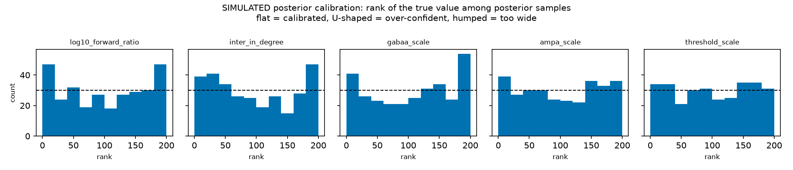{width=100%}

## Appendix H — Quality-control flag registry

| QC flag | affected records | identification criteria | analytical handling |
|---|---|---|---|
| `incomplete_dose_series` | 272 <!-- metrics.json: data_card.flag_counts.incomplete_dose_series --> | concentration series missing intermediate dilution steps | flagged; excluded from monotonic dose sweeps |
| `too_few_active_electrodes` | 265 <!-- metrics.json: data_card.flag_counts.too_few_active_electrodes --> | fewer than 10 electrodes clearing 5 spikes/min | flagged; preserved in the data asset |
| `replicate_divergence` | 221 <!-- metrics.json: data_card.flag_counts.replicate_divergence --> | well deviates more than 3σ from its culture replicate cohort | flagged; logged in metadata |
| `outlier_feature_value` | 221 <!-- metrics.json: data_card.flag_counts.outlier_feature_value --> | feature value outside the acceptable biological distribution | flagged; excluded from density fitting |
| `excluded_well_upstream` | 90 <!-- metrics.json: data_card.flag_counts.excluded_well_upstream --> | source laboratory marked the well defective | flagged; excluded from benchmarks |
| `missing_baseline_pair` | 24 <!-- metrics.json: data_card.flag_counts.missing_baseline_pair --> | no baseline recording on the same well | flagged; cannot enter a paired-delta model |
| `noisy_electrodes_present` | 11 <!-- metrics.json: data_card.flag_counts.noisy_electrodes_present --> | significant mechanical or electrical artifact | flagged; isolated during ingestion |
| `unreadable_channels` | 2 <!-- metrics.json: data_card.flag_counts.unreadable_channels --> | channel could not be decoded from the deposit | flagged; channel dropped |

## Appendix I — Digital twin forward-model parameters

Calibrated values are the chosen draw from the §13 search; held values were fixed and not searched.

| parameter | role | calibrated value | how it was set |
|---|---|---|---|
| `n_per_compartment` | plating cell density per chamber | 967 <!-- metrics.json: twin_hd12_calibration.best.draw.n_per_compartment --> neurons | calibrated, searched over 250–1500 |
| `detection_radius_um` | virtual electrode listening catchment | 92.5135 <!-- metrics.json: twin_hd12_calibration.best.draw.detection_radius_um --> µm | calibrated, searched over 40–100 µm, capped at half the electrode pitch |
| `intra_in_degree` | recurrent local synaptic inputs | 18.4929 <!-- metrics.json: twin_hd12_calibration.best.draw.intra_in_degree --> per neuron | calibrated, searched over 10–35 |
| `background_rate_hz` | Poisson drive frequency | 3.3596 <!-- metrics.json: twin_hd12_calibration.best.draw.background_rate_hz --> Hz | calibrated, searched over 1–40 Hz |
| `background_weight` | Poisson drive conductance step | 0.0692 <!-- metrics.json: twin_hd12_calibration.best.draw.background_weight --> | calibrated, searched over 0.005–0.12 |
| `excitatory_weight` | excitatory conductance step | 0.386 <!-- metrics.json: twin_hd12_calibration.best.draw.excitatory_weight --> | calibrated, searched over 0.15–0.45 |
| `inhibitory_weight` | inhibitory conductance step | 5.4261 <!-- metrics.json: twin_hd12_calibration.best.draw.inhibitory_weight --> | calibrated, searched over 1–7 |
| `adaptation_increment` | spike-frequency adaptation step | 1.0093 <!-- metrics.json: twin_hd12_calibration.best.draw.adaptation_increment --> | calibrated, searched over 0.5–2.5 |
| `threshold_spread` | per-neuron excitability heterogeneity | 0.2258 <!-- metrics.json: twin_hd12_calibration.best.draw.threshold_spread --> | calibrated, searched over 0–0.3 |
| `adaptation_tau_ms` | adaptation decay time constant | 380 ms | **held**, literature standard |
| `intra_delay_sd_ms` | conduction delay dispersion | 0.0 ms | **held**, one delay for every synapse |
| `connection_sigma_um` | range of the within-compartment wiring rule | unset | **held**, uniform random wiring |
| `inter_in_degree`, `forward_ratio`, drug knobs | cross-chamber connectivity, pathway asymmetry, pharmacology | — | **inferred** by simulation-based inference (§16) |

All conductance steps are dimensionless in this model; they are not membrane voltages.

## Appendix J & K — Microchannel detector robustness, and timings

**Appendix J.** Counting recordings, median absolute asymmetry runs from 0.3392
<!-- metrics.json: microchannel_directionality.per_recording_naive.by_condition.control.median_abs_asymmetry --> for
control geometries to 0.8543
<!-- metrics.json: microchannel_directionality.per_recording_naive.by_condition.rams.median_abs_asymmetry --> for the
"rams" geometry. Counting biological chips instead, it is 0.6168
<!-- metrics.json: microchannel_directionality.comparison.by_condition.control.median_abs_asymmetry --> against 0.8745
<!-- metrics.json: microchannel_directionality.comparison.by_condition.rams.median_abs_asymmetry -->, a difference the
test does not resolve: Kruskal p across the geometries is 0.63969
<!-- metrics.json: microchannel_directionality.comparison.kruskal_p -->, and every Holm-adjusted
comparison against the control geometry is 1.0
<!-- metrics.json: microchannel_directionality.comparison.vs_reference_holm.rams -->. The null is not
an artifact of our geometry assumptions either: it survives every detector variant we tried, with a
worst-case Kruskal p of 0.13074
<!-- metrics.json: microchannel_directionality.geometry_robustness.variants.column_one_missing.kruskal_p -->.
Tolerating single-electrode dropouts triples what the detector has to work with, from 336,794
<!-- metrics.json: microchannel_directionality.geometry_robustness.variants.column_strict.total_events --> analyzed
events to 1,101,233
<!-- metrics.json: microchannel_directionality.geometry_robustness.variants.column_one_missing.total_events -->,
and does not change the outcome. We also measured and report a counting confound: chips with fewer
propagation events look more one-sided (Spearman ρ = −0.494
<!-- metrics.json: microchannel_directionality.event_count_confound.spearman_rho -->, p = 0.01032
<!-- metrics.json: microchannel_directionality.event_count_confound.p_value -->), which is what a
counting artifact looks like. Condition is also confounded with culture batch by the deposit's own
design
<!-- metrics.json: microchannel_directionality.batch_confound -->.

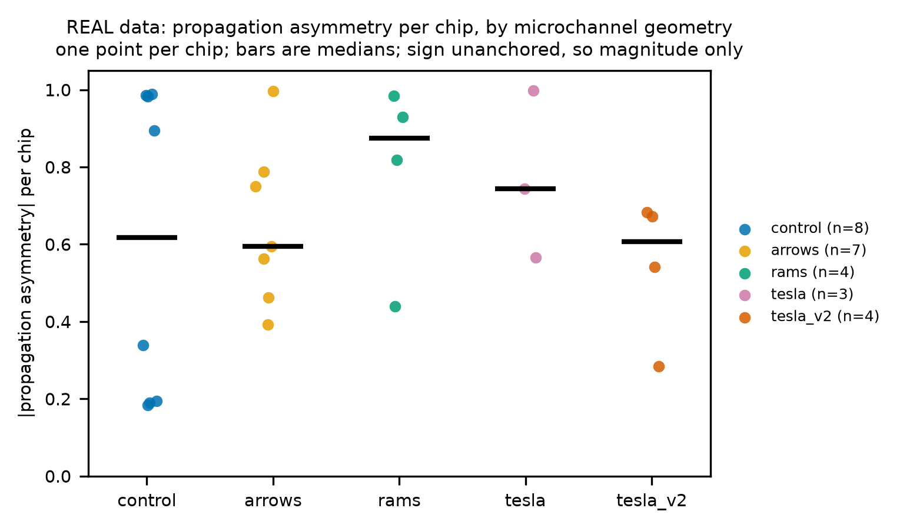{width=85%}

**Appendix K.** `--quick` completes end to end in 544.7 s
<!-- metrics.json: harness_quick.total_s --> on a workstation CPU with 20 cores
<!-- metrics.json: harness_quick.cpu_count -->, and in under twenty minutes on a dual-vCPU CI runner;
the two differ because `worker_processes` correctly asks for the cores it is given. The run itself
writes that figure, and only a run that executed every stage can write it, so a partial re-run
cannot quietly shrink it. It is one measurement rather than a bound: repeat runs on the same machine
vary with whatever else the machine is doing, and the slowest we have seen crossed ten minutes. The
longest stage is the twin, at 344.3 s
<!-- metrics.json: harness_quick.by_stage_s.twin -->. Full reproduction runs through
`python run_all.py` after a full data-tier fetch. The environment is pinned in `pyproject.toml` and
recorded from what actually imported: Python `3.11.16` <!-- metrics.json: harness_quick.python -->,
NumPy `2.3.5` <!-- metrics.json: harness_quick.numpy -->, Brian2 `2.9.0`
<!-- metrics.json: harness_quick.brian2 -->, PyTorch `2.14.0` <!-- metrics.json: harness_quick.torch -->
and sbi `0.27.0` <!-- metrics.json: harness_quick.sbi -->. We hold NumPy back because its next minor
release removes `ndarray.ptp`, which Brian2 imports.

## Appendix L, M & N — Sensory validation, dose tracking and species transfer

**Appendix L, the rate-only arm.** Human sensory neurons across 291 pairs
<!-- metrics.json: rate_only_arm.n_pairs --> in `fofie2025` shift by −0.1743
<!-- metrics.json: rate_only_arm.by_mechanism.control.median_log2_change --> log2 units for vehicle
controls, against −1.9529
<!-- metrics.json: rate_only_arm.by_mechanism.na_channel_blocker.median_log2_change --> for
sodium-channel blockers, which yields 0.5012
<!-- metrics.json: rate_only_arm.across_sources.balanced_accuracy --> balanced accuracy against a chance of
0.3333 <!-- metrics.json: rate_only_arm.across_sources.chance -->.

**Appendix M, Task 2 dose tracking.** The detection rate rises from 0.179
<!-- metrics.json: mechanism_baselines.task2_external_detection.screenneuropharm_bicuculline.by_dose.0.detection_rate --> at 0.1 µM
<!-- metrics.json: mechanism_baselines.task2_external_detection.screenneuropharm_bicuculline.by_dose.0.dose_uM --> to 0.426
<!-- metrics.json: mechanism_baselines.task2_external_detection.screenneuropharm_bicuculline.by_dose.5.detection_rate --> at 30 µM
<!-- metrics.json: mechanism_baselines.task2_external_detection.screenneuropharm_bicuculline.by_dose.5.dose_uM -->.
Quoted on its own, that would look like a dose response, so here is the rest of the series: the rate
peaks at 0.48 <!-- metrics.json: mechanism_baselines.task2_external_detection.screenneuropharm_bicuculline.by_dose.6.detection_rate -->
at 100 µM <!-- metrics.json: mechanism_baselines.task2_external_detection.screenneuropharm_bicuculline.by_dose.6.dose_uM -->
and falls to 0.091
<!-- metrics.json: mechanism_baselines.task2_external_detection.screenneuropharm_bicuculline.by_dose.8.detection_rate --> at the
top of it, 500 µM
<!-- metrics.json: mechanism_baselines.task2_external_detection.screenneuropharm_bicuculline.by_dose.8.dose_uM -->.
The overall rank correlation is not significant (ρ = −0.059
<!-- metrics.json: mechanism_baselines.task2_external_detection.screenneuropharm_bicuculline.dose_spearman -->, p = 0.189
<!-- metrics.json: mechanism_baselines.task2_external_detection.screenneuropharm_bicuculline.dose_spearman_p -->).

**Appendix N, species transfer, all settings.**

| transfer setting | balanced accuracy | 95% bootstrap CI |
|---|---|---|
| human within-species | 0.646 <!-- metrics.json: species_transfer.transfer.none.human_within.balanced_accuracy --> | 0.483 to 0.78 <!-- metrics.json: species_transfer.transfer.none.human_within.balanced_accuracy_ci95.1 --> |
| rat within-species | 0.543 <!-- metrics.json: species_transfer.transfer.none.rat_within.balanced_accuracy --> | 0.458 to 0.7 <!-- metrics.json: species_transfer.transfer.none.rat_within.balanced_accuracy_ci95.1 --> |
| rat → human, zero-shot | 0.55 <!-- metrics.json: species_transfer.transfer.none.rat_to_human.balanced_accuracy --> | 0.4 to 0.6 <!-- metrics.json: species_transfer.transfer.none.rat_to_human.balanced_accuracy_ci95.1 --> |
| rat → human, CORAL | 0.442 <!-- metrics.json: species_transfer.transfer.coral.rat_to_human.balanced_accuracy --> | 0.302 to 0.591 <!-- metrics.json: species_transfer.transfer.coral.rat_to_human.balanced_accuracy_ci95.1 --> |
| rat → human, standardized | 0.408 <!-- metrics.json: species_transfer.transfer.standardize.rat_to_human.balanced_accuracy --> | 0.267 to 0.568 <!-- metrics.json: species_transfer.transfer.standardize.rat_to_human.balanced_accuracy_ci95.1 --> |

Every interval resamples cultures, not rows. For the within-species rows it is taken over the
out-of-fold predictions pooled across the repeated grouped splits, and a culture drawn into a
resample brings all of its predictions with it; for the transfer rows it is taken over the human
test cultures.

## Appendix O — Third-party software, models and AI tools

**Software.** We use the libraries below unmodified, as dependencies; none of their source is
redistributed here. Exact versions are pinned in `pyproject.toml`, and `THIRD_PARTY.md` lists each
package's license as read from its installed metadata.

| license | packages | what they do here |
|---|---|---|
| BSD (3-clause and BSD-style) | numpy, scipy, pandas, scikit-learn, h5py, altair, xlrd | numerics, data handling, classifiers, charts, file readers |
| MIT | jsonschema, openpyxl, python-docx, pytest, ruff | schema validation, spreadsheet input, report build, tests, linting |
| Apache 2.0 | sbi, pyarrow, requests, streamlit | posterior estimation, storage, downloads, the demo app |
| Apache and BSD (combined notice) | torch | neural network backend for posterior estimation |
| Python Software Foundation | matplotlib | figures |
| CeCILL 2.1 | brian2 | spiking-network simulation of the twin |

Brian2's license is the most restrictive in the list; we use it unmodified, as a library.

**Models.** We use no pretrained models. Every statistical model in this report —
logistic regression, gradient boosting and the neural posterior estimator — is trained from scratch
on the data described here. The fly study of Act VII adopts the equations and constants of the
whole-brain model of Shiu et al. (2024; code under the MIT license), reimplemented in our own code.

**Data.** Every dataset we used, with its license and status, is listed in Appendix C.

**AI tools.** We developed the project with Anthropic's Claude Code (§22), a commercial tool used
under Anthropic's terms of service. It is not part of the delivered pipeline, and nothing it wrote is
accepted without passing the same tests and citation checks as the rest of the code.
