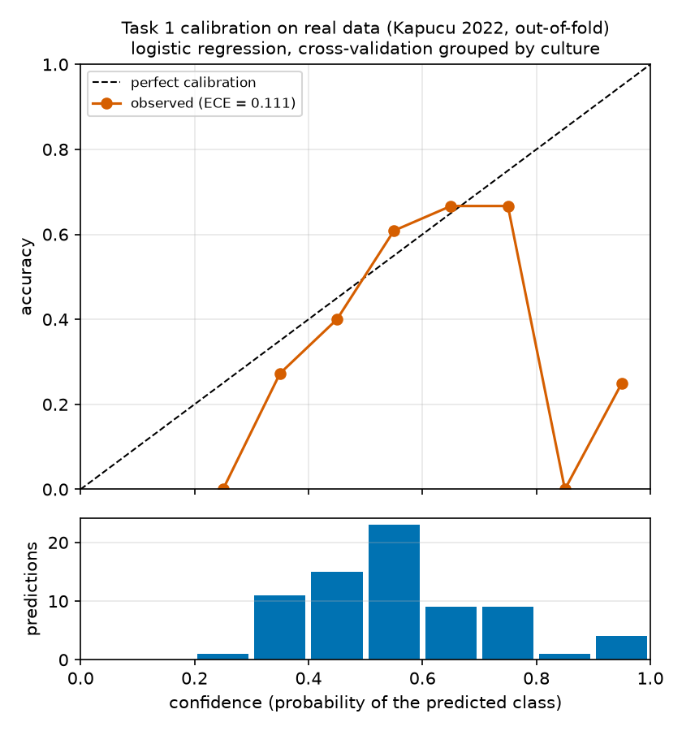
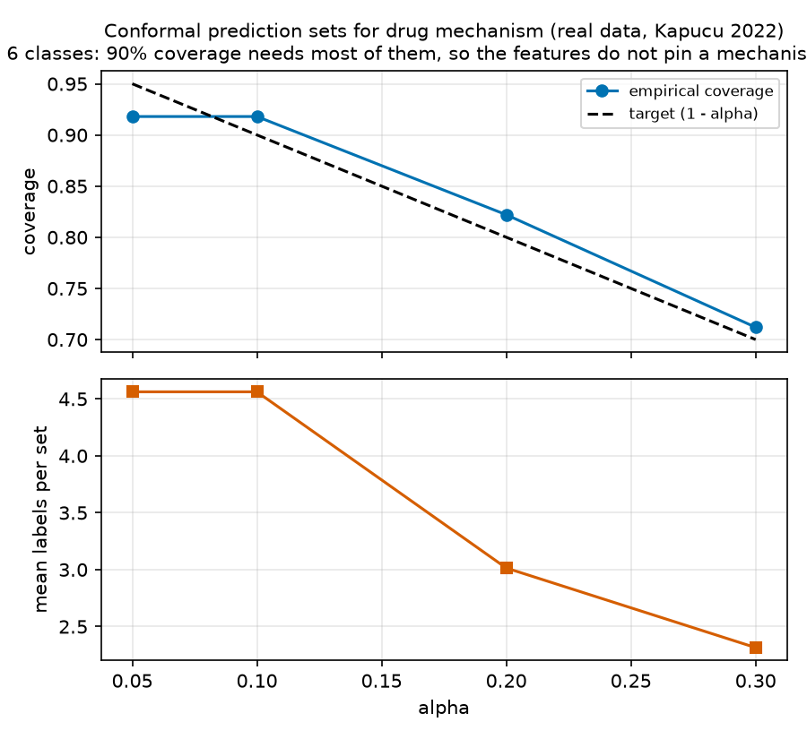
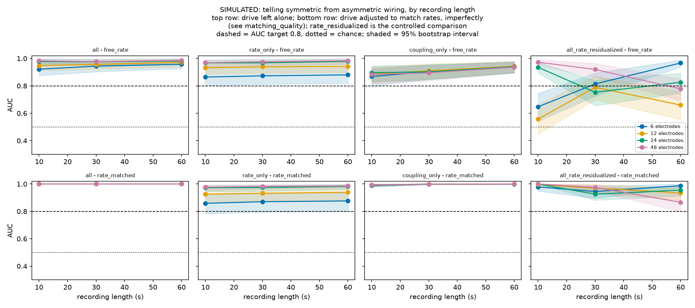

# NeuroMPS — a provenance-tracked MEA data asset and a calibrated two-compartment digital twin

**Technical report.** Entry for the AI4S Open Innovation: AI + Organ-on-a-Chip challenge
(5th Pazhou Algorithm Competition).

> **Research decision-support only.** Nothing in this report is an efficacy, safety, diagnostic or
> clinical claim. The models here describe public *in vitro* recordings and a simulation of them.

Every number below carries an HTML comment naming the `outputs/metrics.json` key it came from.
`python -m neuromps.report.verify` re-reads each citation and fails if the document and the metrics
disagree, so a figure that goes stale when a stage is regenerated cannot quietly survive in the
prose. The decision record behind these results, including what was tried and abandoned, is
`report/LAB_NOTEBOOK.md`.

---

## 1. Summary

Two layers were built:

**(A) A standardized, provenance-tracked data asset** of public neural microelectrode-array (MEA)
recordings: 21,272 records <!-- metrics.json: data_asset.n_records --> from four sources, each
record carrying its source URL, license, SHA256 and download time, validated against a JSON Schema
at a conformance level that requires every provenance hash to match the download manifest.

**(B) A Brian2 spiking-network digital twin** of an asymmetric two-compartment neural chip,
calibrated against the asset, with simulation-based inference (`sbi`) attempting to recover
connectivity and drug effects from MEA summary features.

The results that matter are as much negative as positive, and the report leads with both:

1. **Rate and burst-fraction measures are portable across platforms; synchrony and network-burst
   measures are not.** Four independent analyses converge on this (§6.3, §6.4, §7.3).
2. **Coupling asymmetry tracks relative firing rate, not pathway direction.** At fixed wiring,
   changing one chamber's drive swings the measured asymmetry across most of its range (§7.2).
3. **The twin's posterior does not recover drug-knob direction from real recordings.** The inferred
   GABA-A scale shows no bicuculline dose trend, and untreated chips already infer 0.4149
   <!-- metrics.json: twin_hd15_real_inference.gabaa_scale_at_baseline.median -->, so the parameter
   is absorbing model mismatch rather than tracking the compound (§7.5).
4. **Direction *is* recoverable from simulated features once rate is controlled for** — AUC 0.9784
   <!-- metrics.json: twin_hd16_directionality.cheapest_configuration.rate_matched_residualized.auc -->
   from a 10 s recording on 6 electrodes per compartment — but as a *contrast* between two
   well-spaced wiring classes, not as a measurement of a continuous ratio (§7.6).

The honest summary of the twin is therefore: it reproduces baseline features and most drug
directions, it can tell two wiring regimes apart in simulation, and it cannot yet read pharmacology
off a real chip.

---

## 2. Problem and scope

Microphysiological systems produce electrophysiology that is rich but hard to compare: different
platforms, electrode counts, durations, species and feature definitions. Two consequences follow for
anyone trying to use public MEA data for compound screening.

*Data are not comparable by default.* Feature names collide while definitions differ — "synchrony"
from a spike-time tiling coefficient is not the Axion synchrony index — and provenance is usually
lost by the time data reach an analysis.

*A model of the chip is not a model of the measurement.* A spiking network that reproduces a
culture's firing does not necessarily reproduce what 48 electrodes detect from it.

This entry addresses both: a schema and feature standard with enforced provenance, and a digital
twin that is scored through the *same* feature extractor as the real recordings.

**Out of scope.** No clinical, diagnostic, efficacy or safety claim is made or implied. Compound
labels are mechanism classes drawn from the source publications, not indications.

---

## 3. The data standard

### 3.1 Record model and data levels

Records validate against `schema/neuromps_schema.json` (JSON Schema 2020-12). The central decision is
that records carry an explicit **data level**, and that records only compare within a level:

| level | meaning | records |
|---|---|---|
| `spike_times` | per-electrode spike trains; our feature vector is computable | 897 <!-- metrics.json: data_asset.counts.by_data_level.spike_times --> |
| `fitted_curve` | published concentration-response fits only | 20,375 <!-- metrics.json: data_asset.counts.by_data_level.fitted_curve --> |
| `per_well_features` | vendor feature tables without spike times | — |

This distinction is load-bearing. Most of the asset by count is ToxCast curve fits, from which our
nine-feature vector cannot be recomputed; only 897 records support the feature pipeline. A schema
that hid that behind a single "features" field would invite exactly the wrong comparison.

### 3.2 Provenance and conformance

Conformance **level 2** requires that every record's provenance hash matches `data/raw/MANIFEST.json`,
and the build refuses to emit an asset otherwise. Each fetcher records URL, license, SHA256, byte
count and download time, and re-checks the source's advertised license at fetch time so a
silently-relicensed upstream blocks rather than propagates.


### 3.3 Quality control

QC is recorded, never applied silently. Each record carries flags and a single `qc.usable` verdict,
and the flags are informational: a flagged record is still in the asset, with the reason attached, so
a downstream analysis can make its own decision.

| flag | records | what it means |
|---|---|---|
| `incomplete_dose_series` | 272 <!-- metrics.json: data_card.flag_counts.incomplete_dose_series --> | the compound's dose series is missing points |
| `too_few_active_electrodes` | 169 <!-- metrics.json: data_card.flag_counts.too_few_active_electrodes --> | under 10 electrodes cleared 5 spikes/min |
| `replicate_divergence` | 151 <!-- metrics.json: data_card.flag_counts.replicate_divergence --> | one replicate departs from its group |
| `outlier_feature_value` | 151 <!-- metrics.json: data_card.flag_counts.outlier_feature_value --> | a feature sits far outside its source's distribution |
| `excluded_well_upstream` | 90 <!-- metrics.json: data_card.flag_counts.excluded_well_upstream --> | the source's own log excluded the well |
| `noisy_electrodes_present` | 11 <!-- metrics.json: data_card.flag_counts.noisy_electrodes_present --> | the source marked electrodes as noisy |

Two decisions here were driven by defects found in the data rather than by design. The
replicate-divergence test originally used a robust z-score, which collapses when more than half a
replicate group shares a value — common in sparse recordings, where the median absolute deviation is
exactly zero; it now falls back to a mean absolute deviation and names the diverging feature. And
the 90 wells excluded by an upstream log were at first missing from the asset altogether, because
records were built from the feature tables alone; they are now built from the union of the log and
the spike files, so an exclusion is represented rather than absent.

### 3.4 Feature set

Nine features form the core vector, computed by a single extractor (`features/mea.py`) that the twin
must also call:

| feature | definition as computed |
|---|---|
| `mfr_hz` | spikes per second per active electrode |
| `burst_rate_per_min` | bursts per minute per active electrode |
| `burst_duration_s` | mean burst duration |
| `spikes_per_burst` | mean spikes in a burst |
| `pct_spikes_in_bursts` | share of spikes falling inside bursts |
| `network_burst_rate_per_min` | network bursts per minute, chance-corrected participation |
| `synchrony_index` | spike-time tiling coefficient, mean over electrode pairs |
| `isi_cv` | coefficient of variation of inter-spike intervals |
| `active_electrodes` | electrodes clearing the activity threshold |

Thresholds are fixed and recorded per record: an electrode is active at ≥5 spikes/min, a well is
usable at ≥10 active electrodes, a burst is ≥5 spikes with ISI ≤0.1 s, and the tiling coefficient
uses Δt = 0.05 s.

The network-burst threshold deserves its own note, because the obvious implementation is wrong. A
fixed participation threshold — *n* electrodes firing in the same window — counts coincidences that
independent electrodes produce anyway; at 5 Hz on 16 electrodes that is on the order of fifty
spurious "network bursts" per minute, which would dominate the measure. The threshold is therefore
set per recording so that the expected number of chance detections stays below 0.05, from the
recording's own electrode count and firing rates. This matters beyond bookkeeping: because the
correction scales with electrode count, it is a candidate explanation for part of the cross-platform
disagreement reported in §6.4, and that remains untested.

---

## 4. The data asset

| source | records | level | species | license |
|---|---|---|---|---|
| `toxcast_mea` | 20,375 <!-- metrics.json: data_asset.counts.by_source.toxcast_mea --> | fitted_curve | rat | CC0-1.0 |
| `screenneuropharm_bic` | 580 <!-- metrics.json: data_asset.counts.by_source.screenneuropharm_bic --> | spike_times | rat | MIT |
| `kapucu2022` | 288 <!-- metrics.json: data_asset.counts.by_source.kapucu2022 --> | spike_times | human, rat | CC-BY-4.0 |
| `sharf2022` | 29 <!-- metrics.json: data_asset.counts.by_source.sharf2022 --> | spike_times | human | CC0-1.0 |

Totals: 21,272 records <!-- metrics.json: data_asset.n_records -->, of which 20,831 are marked usable
<!-- metrics.json: data_asset.counts.by_usable.True --> and 441 are not
<!-- metrics.json: data_asset.counts.by_usable.False -->. By species, 21,099 records are rat
<!-- metrics.json: data_asset.counts.by_species.rat --> and 173 are human
<!-- metrics.json: data_asset.counts.by_species.human -->.

**The species imbalance is the asset's main structural weakness** and is stated wherever human
results appear: every human-species conclusion rests on 173 records from two sources.

### 4.1 A rejection, as a worked example of the license discipline

Tukker 2020 (rat and hiPSC MEA pharmacology) is a good fit scientifically and is **excluded**. It is
CC BY-NC 4.0, and the competition rules assign joint ownership of submissions rather than preserving
an entrant's own license, so the non-commercial condition cannot be guaranteed downstream. It is
recorded as `skipped` in the manifest with that reason rather than dropped silently. The cost is
real: without it, the rat→human transfer study rests on one source.

---

## 5. Methods

### 5.1 Cross-validation and resampling

Every model is evaluated with **grouped** cross-validation, grouping by culture/well so replicates
of one culture never span the train/test boundary, and every interval is a **cluster bootstrap over
those groups**, never over rows — with 1,000 resamples
<!-- metrics.json: mechanism_baselines.task1_within_platform.bootstrap_resamples --> in a full run and
200 in `--quick`, the count recorded alongside each estimate. Bootstrapping rows here would report
intervals roughly a factor of two too narrow, because rows within a culture are not independent.

### 5.2 Tasks

- **Task 1 — mechanism classification** (within platform): predict mechanism class from the
  nine-feature delta vector of a treated/baseline pair.
- **Task 2 — external detection**: apply the Task 1 model to a source it never saw, with a negative
  control of the opposite mechanism.
- **Task 3 — platform contrast**: compare the same mechanism measured on two platforms.
- **Transfer**: rat → human, with and without domain adaptation.

---

## 6. Results: data and models

### 6.1 Task 1 — mechanism classification

Six classes, 73 treated/baseline pairs
<!-- metrics.json: mechanism_baselines.task1_within_platform.n_pairs --> across 50 culture groups
<!-- metrics.json: mechanism_baselines.task1_within_platform.n_groups -->, 4-fold grouped CV
<!-- metrics.json: mechanism_baselines.task1_within_platform.n_splits -->.

| model | balanced accuracy | 95% CI |
|---|---|---|
| logistic regression | 0.537 <!-- metrics.json: mechanism_baselines.task1_within_platform.models.logistic_regression.balanced_accuracy_mean --> | [0.4216, 0.6845] <!-- metrics.json: mechanism_baselines.task1_within_platform.models.logistic_regression.balanced_accuracy_ci95 --> |
| gradient boosting | 0.398 <!-- metrics.json: mechanism_baselines.task1_within_platform.models.gradient_boosting.balanced_accuracy_mean --> | [0.2762, 0.5178] <!-- metrics.json: mechanism_baselines.task1_within_platform.models.gradient_boosting.balanced_accuracy_ci95 --> |
| most-frequent baseline | 0.167 <!-- metrics.json: mechanism_baselines.task1_within_platform.models.dummy_most_frequent.balanced_accuracy_mean --> | — |

Chance is 0.167 <!-- metrics.json: mechanism_baselines.task1_within_platform.chance_balanced_accuracy -->.
Logistic regression beats chance with an interval that excludes it, and beats gradient boosting —
with 73 pairs, the simpler model is the better one, and the gap between them is within noise.

{width=82%}


**Calibration.** Expected calibration error on out-of-fold predictions is 0.1114
<!-- metrics.json: mechanism_baselines.task1_within_platform.calibration.ece -->, 95% CI [0.0773, 0.2557]
<!-- metrics.json: mechanism_baselines.task1_within_platform.calibration.ece_ci95 -->
(`outputs/figures/task1_reliability_real.png`). The upper end of that interval is large: predicted
probabilities should be read as ordering, not as calibrated risk.

{width=72%}


**Conformal sets.** At a 95% target the empirical coverage is 0.918
<!-- metrics.json: uncertainty_and_ablations.conformal_sweep.0.empirical_coverage --> with a mean set
size of 4.562 <!-- metrics.json: uncertainty_and_ablations.conformal_sweep.0.mean_set_size --> classes
out of six — honest coverage at the cost of sets too large to act on. That is the correct reading of
73 calibration points, not a defect to tune away.

{width=72%}


### 6.2 Task 2 — external detection and its negative control

Applied to bicuculline recordings from a source the model never saw, the GABA-A antagonist class is
detected in 0.366 <!-- metrics.json: mechanism_baselines.task2_external_detection.screenneuropharm_bicuculline.detection_rate -->
of 497 records <!-- metrics.json: mechanism_baselines.task2_external_detection.screenneuropharm_bicuculline.n -->,
and the detection does **not** track dose (Spearman 0.014
<!-- metrics.json: mechanism_baselines.task2_external_detection.screenneuropharm_bicuculline.dose_spearman -->,
p = 0.751 <!-- metrics.json: mechanism_baselines.task2_external_detection.screenneuropharm_bicuculline.dose_spearman_p -->).

The negative control behaves as it should: diazepam, a positive modulator rather than an antagonist,
is called GABA-A antagonist in only 0.077
<!-- metrics.json: mechanism_baselines.task2_external_detection.sharf_diazepam_negative_control.detection_rate -->
of its records.

{width=88%}


**This is a weak result reported as a weak result.** A detection rate near a third with no dose
relationship is not a screening tool; it is evidence that the mechanism signal partially survives a
platform change.

### 6.3 Species transfer (rat → human)

| setting | balanced accuracy | 95% CI |
|---|---|---|
| human, within-species | 0.646 <!-- metrics.json: species_transfer.transfer.none.human_within.balanced_accuracy --> | — |
| rat, within-species | 0.543 <!-- metrics.json: species_transfer.transfer.none.rat_within.balanced_accuracy --> | — |
| rat → human, no adaptation | 0.55 <!-- metrics.json: species_transfer.transfer.none.rat_to_human.balanced_accuracy --> | [0.4, 0.6] <!-- metrics.json: species_transfer.transfer.none.rat_to_human.balanced_accuracy_ci95 --> |
| rat → human, CORAL | 0.442 <!-- metrics.json: species_transfer.transfer.coral.rat_to_human.balanced_accuracy --> | [0.28, 0.597] <!-- metrics.json: species_transfer.transfer.coral.rat_to_human.balanced_accuracy_ci95 --> |
| rat → human, per-species standardisation | 0.408 <!-- metrics.json: species_transfer.transfer.standardize.rat_to_human.balanced_accuracy --> | [0.246, 0.56] <!-- metrics.json: species_transfer.transfer.standardize.rat_to_human.balanced_accuracy_ci95 --> |

Chance is 0.2 <!-- metrics.json: species_transfer.transfer.none.chance_balanced_accuracy -->.
Transfer works above chance (permutation p = 0.0002
<!-- metrics.json: species_transfer.transfer.none.rat_to_human.permutation_p -->), and **both
adaptation methods made it worse**. With 37 training and 32 test records
<!-- metrics.json: species_transfer.transfer.none.rat_to_human.n_test -->, CORAL is estimating a
covariance it cannot support. Reporting adaptation as a negative result is the useful outcome here.

### 6.4 Which features survive a species change

The most shifted features between species are `synchrony_index`
<!-- metrics.json: species_transfer.species_shift.most_shifted_features -->, `isi_cv` and
`network_burst_rate_per_min`; the most invariant are `mfr_hz`
<!-- metrics.json: species_transfer.species_shift.most_invariant_features -->,
`pct_spikes_in_bursts` and `burst_rate_per_min` (`outputs/figures/species_shift.png`). The synchrony
shift is large — a difference of −4.179
<!-- metrics.json: species_transfer.species_shift.by_feature.synchrony_index.difference --> in log2
units — though its interval [−5.7435, 0.1868]
<!-- metrics.json: species_transfer.species_shift.by_feature.synchrony_index.difference_ci95 -->
reaches zero, so the ordering is better supported than the magnitude.

{width=88%}


### 6.5 Ablations: the feature set is mostly one feature

| feature subset | balanced accuracy | 95% CI |
|---|---|---|
| all nine | 0.514 <!-- metrics.json: uncertainty_and_ablations.feature_subsets.all.balanced_accuracy_mean --> | [0.3983, 0.6619] <!-- metrics.json: uncertainty_and_ablations.feature_subsets.all.balanced_accuracy_ci95 --> |
| rate only | 0.53 <!-- metrics.json: uncertainty_and_ablations.feature_subsets.rate_only.balanced_accuracy_mean --> | [0.3964, 0.6235] <!-- metrics.json: uncertainty_and_ablations.feature_subsets.rate_only.balanced_accuracy_ci95 --> |
| species-invariant three | 0.516 <!-- metrics.json: uncertainty_and_ablations.feature_subsets.species_invariant.balanced_accuracy_mean --> | [0.371, 0.6295] <!-- metrics.json: uncertainty_and_ablations.feature_subsets.species_invariant.balanced_accuracy_ci95 --> |
| synchrony only | 0.455 <!-- metrics.json: uncertainty_and_ablations.feature_subsets.synchrony_only.balanced_accuracy_mean --> | [0.3554, 0.586] <!-- metrics.json: uncertainty_and_ablations.feature_subsets.synchrony_only.balanced_accuracy_ci95 --> |
| network measures only | 0.417 <!-- metrics.json: uncertainty_and_ablations.feature_subsets.network_only.balanced_accuracy_mean --> | [0.2983, 0.5573] <!-- metrics.json: uncertainty_and_ablations.feature_subsets.network_only.balanced_accuracy_ci95 --> |

Two rate features match all nine. Leave-one-out agrees: dropping `mfr_hz` changes balanced accuracy
by −0.05 <!-- metrics.json: uncertainty_and_ablations.leave_one_out.mfr_hz.delta_vs_all -->, while
dropping `burst_rate_per_min` changes it by 0.0
<!-- metrics.json: uncertainty_and_ablations.leave_one_out.burst_rate_per_min.delta_vs_all -->.

### 6.6 Compartment asymmetry in real devices

Across 16 two-chamber devices <!-- metrics.json: compartment_asymmetry.n_devices -->, heterogeneous
devices (cortical–hippocampal) show a higher median absolute coupling asymmetry, 0.138
<!-- metrics.json: compartment_asymmetry.pooled_heterogeneous_vs_homogeneous.median_heterogeneous -->,
than homogeneous ones, 0.094
<!-- metrics.json: compartment_asymmetry.pooled_heterogeneous_vs_homogeneous.median_homogeneous -->
(Mann-Whitney p = 0.042
<!-- metrics.json: compartment_asymmetry.pooled_heterogeneous_vs_homogeneous.p_value -->,
rank-biserial 0.633
<!-- metrics.json: compartment_asymmetry.pooled_heterogeneous_vs_homogeneous.rank_biserial -->,
6 <!-- metrics.json: compartment_asymmetry.pooled_heterogeneous_vs_homogeneous.n_heterogeneous -->
against 10 devices
<!-- metrics.json: compartment_asymmetry.pooled_heterogeneous_vs_homogeneous.n_homogeneous -->).

With six devices on one side, this is a hypothesis, not a finding, and §7.2 gives a specific reason
to distrust the measure itself.

{width=78%}


---

## 7. Results: the digital twin

### 7.1 Model

Two compartments of conductance-based leaky integrate-and-fire neurons with spike-frequency
adaptation, 80/20 excitatory/inhibitory, recurrent intra-compartment connectivity and **directional**
inter-compartment projections whose forward/backward ratio is the parameter of interest. Poisson
background drive. Connectivity is parameterised by **in-degree rather than probability**, so a
calibration done at one network size still holds at another.

The parameters carried by the network, and how each was fixed:

| parameter | role | how it was set |
|---|---|---|
| `intra_in_degree` | recurrent inputs per neuron | calibrated, searched over 10-35 |
| `inter_in_degree` | cross-compartment inputs per neuron | inferred, prior 4-16 |
| `forward_ratio` | forward against backward pathway strength | inferred, prior 1-16 in log space |
| `excitatory_weight`, `inhibitory_weight` | synaptic conductance steps | calibrated |
| `background_rate_hz`, `background_weight` | Poisson drive | calibrated; drive to the target chamber is a separate scale |
| `adaptation_increment`, `adaptation_tau_ms` | spike-frequency adaptation | calibrated |
| `threshold_spread` | per-neuron excitability heterogeneity | calibrated, searched over 0-0.3 |
| `detection_radius_um` | how far an electrode hears | calibrated, searched over 100-300 µm |
| `gabaa_scale`, `ampa_scale`, `threshold_scale` | drug knobs, 1.0 is untreated | inferred |

Identical neurons synchronise almost perfectly, which no real culture does, so `threshold_spread`
exists to stop the twin being trivially more synchronous than any recording. `detection_radius_um`
is a property of the virtual electrode rather than of the culture, and is called out as such in the
calibration record so it is not read as a biological parameter.

Neurons are placed on a virtual electrode grid and only spikes within a detection radius reach an
electrode; the resulting per-electrode spike trains go through the same `features/mea.py` as real
recordings, and — after a defect found in HD16 — through the same coupling measure on the same
per-electrode input.

### 7.2 The measure the twin exists to use is confounded

Coupling asymmetry was expected to report pathway direction. It reports relative firing rate. At
**fixed** wiring, lowering the receiving chamber's background drive swings asymmetry from about 0.11
to 0.68; at **fixed** drive, raising the forward ratio from 1 to 16 barely moves it. This is the most
consequential single finding about the twin, and it propagates into every later section: any analysis
that reads direction off coupling must control for rate first.

Three checks on the real devices confirmed the confound does not obviously bite there (firing-rate
imbalance does not differ by device type), which is why §6.6 survives as a hypothesis.

{width=85%}


### 7.3 Calibration

A random search over seven tuned parameters
<!-- metrics.json: twin_hd12_calibration.tuned_parameters --> brought the simulated baseline into the
real band for `mfr_hz`, `burst_rate_per_min` and `network_burst_rate_per_min`, and **not** for
`pct_spikes_in_bursts` or `synchrony_index`
<!-- metrics.json: twin_hd12_calibration.inside_real_band -->. The residual mismatch is precisely the
burst-structure and synchrony group that §6.4 and §6.5 independently identify as the unreliable part
of the feature set. Four analyses, one conclusion.

{width=85%}


### 7.4 Drug knobs

Each knob is compared against the real direction for its mechanism, scoring only features whose real
direction is established by a cluster bootstrap:

| knob | agrees / scored |
|---|---|
| GABA-A block | 4 <!-- metrics.json: twin_hd13_perturbation.knobs.0.n_features_agreeing --> / 5 <!-- metrics.json: twin_hd13_perturbation.knobs.0.n_features_scored --> |
| GABA-A potentiation | 2 <!-- metrics.json: twin_hd13_perturbation.knobs.1.n_features_agreeing --> / 4 <!-- metrics.json: twin_hd13_perturbation.knobs.1.n_features_scored --> |
| AMPA block | 4 <!-- metrics.json: twin_hd13_perturbation.knobs.2.n_features_agreeing --> / 4 <!-- metrics.json: twin_hd13_perturbation.knobs.2.n_features_scored --> |
| sodium-channel block | 3 <!-- metrics.json: twin_hd13_perturbation.knobs.3.n_features_agreeing --> / 3 <!-- metrics.json: twin_hd13_perturbation.knobs.3.n_features_scored --> |

Directions only: each knob is compared against a real reference from a different platform, so this
supports direction, never magnitude.

{width=88%}


### 7.5 Simulation-based inference, and what it cannot do

A neural posterior estimator was trained on 3,500 simulations
<!-- metrics.json: twin_hd14_inference.n_simulations -->.

| parameter | posterior contraction | KS statistic |
|---|---|---|
| `threshold_scale` | 0.816 <!-- metrics.json: twin_hd14_inference.contraction.threshold_scale.contraction --> | 0.045 <!-- metrics.json: twin_hd14_inference.rank_uniformity_ks_p.threshold_scale.ks_statistic --> |
| `ampa_scale` | 0.445 <!-- metrics.json: twin_hd14_inference.contraction.ampa_scale.contraction --> | 0.061 <!-- metrics.json: twin_hd14_inference.rank_uniformity_ks_p.ampa_scale.ks_statistic --> |
| `gabaa_scale` | 0.327 <!-- metrics.json: twin_hd14_inference.contraction.gabaa_scale.contraction --> | 0.104 <!-- metrics.json: twin_hd14_inference.rank_uniformity_ks_p.gabaa_scale.ks_statistic --> |
| `inter_in_degree` | 0.32 <!-- metrics.json: twin_hd14_inference.contraction.inter_in_degree.contraction --> | 0.114 <!-- metrics.json: twin_hd14_inference.rank_uniformity_ks_p.inter_in_degree.ks_statistic --> |
| `log10_forward_ratio` | 0.295 <!-- metrics.json: twin_hd14_inference.contraction.log10_forward_ratio.contraction --> | 0.086 <!-- metrics.json: twin_hd14_inference.rank_uniformity_ks_p.log10_forward_ratio.ks_statistic --> |

Only excitability is well identified, and only `threshold_scale` passes a rank-uniformity check
(p = 0.4644 <!-- metrics.json: twin_hd14_inference.rank_uniformity_ks_p.threshold_scale.ks_p -->).
**Posterior intervals from this estimator should not be quoted as calibrated.** A learning curve
showed connectivity contraction still rising with training-set size but only slightly: more
simulations alone will not fix it.

{width=95%}


**Applied to 113 real two-chamber recordings**
<!-- metrics.json: twin_hd15_real_inference.n_recordings --> from 16 devices, with 99.2% of real
summary values inside the simulated range
<!-- metrics.json: twin_hd15_real_inference.distribution_check.mean_fraction_inside -->:

- The inferred GABA-A scale shows **no dose trend**: Spearman 0.083
  <!-- metrics.json: twin_hd15_real_inference.gabaa_scale_dose_trend.spearman_rho -->,
  95% CI [−0.2275, 0.4305]
  <!-- metrics.json: twin_hd15_real_inference.gabaa_scale_dose_trend.spearman_rho_ci95 -->,
  clustered over devices.
- **Untreated recordings already infer 0.4149**
  <!-- metrics.json: twin_hd15_real_inference.gabaa_scale_at_baseline.median -->,
  CI [0.3692, 0.4693]
  <!-- metrics.json: twin_hd15_real_inference.gabaa_scale_at_baseline.median_ci95 -->, excluding the
  neutral value of 1.0. The knob is absorbing general model mismatch.
- Four summary dimensions — burst rate and active electrodes in both chambers —
  <!-- metrics.json: twin_hd15_real_inference.distribution_check.unsupported_dimensions --> pass a
  range check but have almost no simulated draws where the real values sit. Range containment is not
  density containment.

An earlier version of this analysis produced an apparent dose trend (ρ = −0.197, p = 0.036). It was
an artefact of pseudo-replication — 113 recordings from 16 devices treated as independent — and of
posterior extrapolation on out-of-distribution dimensions. Both are now checks in code.

{width=80%}


### 7.6 Directionality: what it takes to see asymmetry

120 simulated networks per arm <!-- metrics.json: twin_hd16_directionality.n_networks --> with known
wiring, symmetric against asymmetric. Electrode count is varied by subsampling one fixed array and
recording length by truncating one simulation, so neither varies the culture.

The naive version is confounded exactly as §7.2 predicts: the full feature set separates the classes
at AUC from 0.9219
<!-- metrics.json: twin_hd16_directionality.summary_by_feature_set.free_rate.all.min --> to 0.9863
<!-- metrics.json: twin_hd16_directionality.summary_by_feature_set.free_rate.all.max -->, and three
firing-rate features alone reach from 0.8644
<!-- metrics.json: twin_hd16_directionality.summary_by_feature_set.free_rate.rate_only.min --> to 0.9841
<!-- metrics.json: twin_hd16_directionality.summary_by_feature_set.free_rate.rate_only.max -->.

Residualising every feature against both chambers' firing rates removes that, and carries its own
validity check: rate features after residualising score from 0.3869
<!-- metrics.json: twin_hd16_directionality.summary_by_feature_set.free_rate.rate_only_rate_residualized.min -->
to 0.5969
<!-- metrics.json: twin_hd16_directionality.summary_by_feature_set.free_rate.rate_only_rate_residualized.max -->
and are never better than chance. Direction still separates at 0.9784
<!-- metrics.json: twin_hd16_directionality.cheapest_configuration.rate_matched_residualized.auc -->,
95% CI [0.9481, 0.9983]
<!-- metrics.json: twin_hd16_directionality.cheapest_configuration.rate_matched_residualized.auc_ci95 -->,
from a 10 s recording
<!-- metrics.json: twin_hd16_directionality.cheapest_configuration.rate_matched_residualized.duration_s -->
on 6 electrodes per compartment
<!-- metrics.json: twin_hd16_directionality.cheapest_configuration.rate_matched_residualized.electrodes_per_compartment -->.

**Read this as a contrast, not a measurement.** The same summaries that classify two well-spaced
wiring regimes at 0.98 give a posterior contraction of only 0.295 for the continuous ratio (§7.5).
Classifying is a far weaker demand than estimating.

{width=100%}


---

## 8. Limitations

**Data.** The asset is 21,099 rat records against 173 human
<!-- metrics.json: data_asset.counts.by_species.human -->; every human claim rests on two sources.
Most records are curve fits from which our features cannot be recomputed. Dropping Tukker 2020 on
license grounds leaves the transfer study on a single source. Compound coverage is thin: six
mechanism classes, 73 pairs.

**Models.** Balanced accuracies around 0.5 on six classes are above chance but far from usable;
intervals are wide and overlapping. Conformal sets cover honestly but are too large to act on.
Calibration error may be as high as 0.2557
<!-- metrics.json: mechanism_baselines.task1_within_platform.calibration.ece_ci95.1 -->. The nine-feature
vector is effectively a rate feature plus noise for this task. The implementation uses single-level
grouped CV where the plan specified nested CV, so hyperparameter choice is not fully held out.

**The twin.** Coupling asymmetry tracks rate, not direction (§7.2). Calibration misses burst
structure and synchrony (§7.3). Connectivity parameters are weakly identified and no parameter's
posterior is calibrated except by the weakest test (§7.5). On real data the drug knob absorbs model
mismatch (§7.5). Simulated recordings are 10 s against real recordings of 480 s. The simulated array
is one fixed geometry while real chambers carry 48, 36 or 60 electrodes. HD16's positive result is
identifiability *under a correct model*, since the same simulator generated both classes, and its
rate controls remove only linear rate dependence.

**Process.** A CI workflow is configured and a remote exists, but the remote's `master` is 11
commits behind the work described here, and no CI result has been observed from the environment these
results were produced in; treat CI as unverified. The Streamlit demo specified for Phase 4
is **not yet built**; this report describes only what exists in the repository. Every twin metric
produced before the coupling-definition fix is incomparable with those after it, and was regenerated.

A fuller list, with dates and commits, is in `report/LAB_NOTEBOOK.md` (33 numbered limitations).

---

## 9. Reproducibility

```bash
pip install uv
uv venv --python 3.11 .venv
uv pip install --python .venv/bin/python -e ".[dev]"
python run_all.py --quick     # every figure and metric, reduced settings
python run_all.py             # full run
```

- `--quick` completes in **463 s** on CPU against a 600 s budget; the full twin stage alone takes
  1,956 s. Both timings are logged under `outputs/logs/`.
- Dependencies are pinned in `pyproject.toml`; numpy is held at 2.3.5 because brian2 2.9.0 does not
  import against 2.4.
- Every number in this report is produced by a script under `src/` and written to
  `outputs/metrics.json`; `python -m neuromps.report.verify` checks the report against it.
- Caches refuse to be reused across a change in what they mean: the simulation cache stores its
  summary names, electrode count and a hash of the source of every function that defines a summary.
- Tests run with `pytest` (feature extraction, QC flags, provenance hashing, the MEA simulator, and
  a contract test that fails if any headline metric loses its confidence interval).

### 9.1 Where the time goes

| stage | `--quick` | notes |
|---|---|---|
| fetch | ~50 s | re-checks each source's advertised license over the network |
| data | ~60 s | ETL, features, QC, asset build with provenance verification |
| models | ~70 s | classification, transfer, conformal, ablations, 200 bootstrap resamples |
| twin | ~280 s | validation, calibration, drug knobs, inference, real-data inference, directionality |
| **total** | **463 s** | against a 600 s budget; the full twin stage alone is 1,956 s |

The fetch figure moves by about a minute between runs because it depends on how quickly the license
endpoints respond, which is the main reason the budget headroom is not stable.

### 9.2 What the repository enforces, rather than documents

- **Provenance.** The asset build fails if any record's provenance hash disagrees with the manifest.
- **One feature extractor.** The twin computes features through the same `features/mea.py` as real
  recordings, and — after a defect that survived for several phases — through the same coupling
  measure on the same per-electrode input.
- **Interval discipline.** A contract test fails if any headline metric loses its confidence
  interval, and the resample count is recorded next to every estimate.
- **Cache meaning.** The simulation cache stores its summary names, its electrode count and a hash
  of the source of every function that defines a summary; it refuses to load across a change in any
  of them.
- **Report numbers.** `neuromps.report.verify` re-reads every citation in this document and fails on
  disagreement.
- **No clinical claims.** A test scans the reports for efficacy, diagnostic and treatment language
  and fails unless the line is a disclaimer ruling it out.

---

## 10. AI assistance disclosure

This work was produced in a paired workflow with Anthropic's Claude (Claude Opus 5) via Claude Code.
The model wrote the large majority of the code, tests and prose in this repository, under
step-by-step human direction: the human set the plan and phase gates, chose the scope, approved or
rejected each step, and directed the scientific decisions.

Specific practices used to keep that honest, all visible in the repository history:

- Numbers are never written by hand into documents. Every figure in this report is emitted by a
  script into `outputs/metrics.json` and re-checked against it by `neuromps.report.verify`, which
  caught a stale timestamp and three mis-anchored citations while this report was being written.
- Results were reported as observed, including when they contradicted the plan's expectation — the
  negative findings in §6.2, §6.3, §7.2 and §7.5 are examples.
- `report/LAB_NOTEBOOK.md` records what was tried and abandoned, with dates and commit hashes,
  including several defects the model introduced and then found in its own work.

---

## 11. Sources and licenses

Data sources, with licenses and citations, are listed in `CITATIONS.md` and recorded per file in
`data/raw/MANIFEST.json`. Third-party software licenses are in `THIRD_PARTY.md`. This repository is
released under the MIT license (`LICENSE`).

---

## Appendix A. Where each result lives

Every number in this report comes from a key in `outputs/metrics.json`, written by a script under
`src/`. The main entry points:

| result | metrics key | script |
|---|---|---|
| asset counts and provenance | `data_asset`, `data_card` | `neuromps.etl.build` |
| mechanism classification, calibration | `mechanism_baselines` | `neuromps.models.mechanism` |
| conformal sets, ablations | `uncertainty_and_ablations` | `neuromps.models.conformal`, `.ablation` |
| species transfer and shift | `species_transfer` | `neuromps.models.transfer` |
| compartment asymmetry | `compartment_asymmetry` | `neuromps.models.asymmetry` |
| twin baseline and drive sweep | `twin_hd11_validation` | `neuromps.twin.validate` |
| twin calibration | `twin_hd12_calibration` | `neuromps.twin.calibrate` |
| drug knob directions | `twin_hd13_perturbation` | `neuromps.twin.perturbation` |
| posterior training and coverage | `twin_hd14_inference` | `neuromps.twin.inference` |
| posterior applied to real recordings | `twin_hd15_real_inference` | `neuromps.twin.real_inference` |
| directionality experiment | `twin_hd16_directionality` | `neuromps.twin.directionality` |

Figures are written to `outputs/figures/` (real data) and `outputs/twin/` (simulated, with
`simulated` in the filename, per the project's own rule that simulated output is never presented as
measurement).

## Appendix B. Reading the negative results

Three results in this report are negative, and each is reported because the alternative would have
been to quote a number that does not mean what it appears to mean.

**An apparent dose trend that was not one.** The first pass at §7.5 gave Spearman ρ = −0.197 with
p = 0.036. Two things were wrong: 113 recordings come from 16 devices, so a p-value across
recordings treats replicates as independent; and the posterior was extrapolating on summary
dimensions the simulator cannot produce. After a cluster bootstrap over devices and a sensitivity
check that neutralises those dimensions, nothing remained.

**A discrimination that was reading firing rate.** In §7.6 the full feature set separates wiring
classes at AUC 0.98 — and so do three firing-rate features alone. Two attempts to fix this by
matching the drive both failed, each trading one rate mismatch for another. Residualising features
against both chambers' rates is what worked, and it carries a validity check: rate features, after
residualising, score no better than chance.

**A calibration that misses exactly the features that do not transfer.** The twin's residual
mismatch in §7.3 is burst fraction and synchrony — the same group that disagrees across platforms in
§6.4 and contributes nothing in the ablations of §6.5. Four analyses, arrived at separately, point
at one conclusion about which MEA features are portable.
